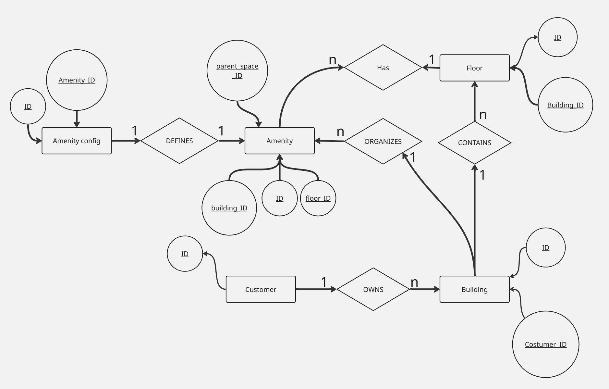
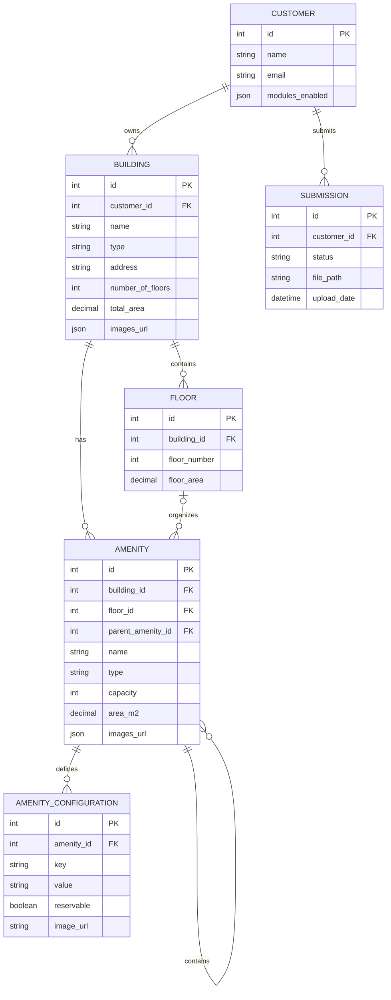

# DATA MODELING  
Conceptual and Logical Data Model

## Table of Contents

- [Overview of Data Modeling](#overview-of-data-modeling)
- [Conceptual Data Model](#conceptual-data-model)
  - [Entity-Relationship Diagram (ERD)](#entity-relationship-diagram-erd)
  - [Entity Identification](#entity-identification)
  - [Attribute Definition](#attribute-definition)
  - [Entity Relationships](#entity-relationships)
  - [Business Rules and Constraints](#business-rules-and-constraints)
  - [Complete Textual Description](#complete-textual-description)
- [Logical Data Model](#logical-data-model)
  - [Transformation from Conceptual to Logical Model](#transformation-from-conceptual-to-logical-model)
  - [Table Structure](#table-structure)
  - [Normalization](#normalization)
  - [Referential Integrity](#referential-integrity)
- [System Use Cases](#system-use-cases)
- [Model Traceability](#model-traceability)

---

## Overview of Data Modeling

Data modeling is an essential activity to structure and organize information in a consistent, scalable, and business-aligned manner.

In this project, the model was developed to represent physical environments managed by the **Equiem** platform, covering clients, buildings, floors, physical spaces (amenities), dynamic configurations, visual resources through image uploads, and **project submission tracking**.

---

## Conceptual Data Model

### Entity-Relationship Diagram (ERD)

The diagram was designed using **Crow’s Foot notation**, highlighting entities, cardinalities, mandatory and optional relationships, internal hierarchies, attributes related to visual customization of environments, and the **submission lifecycle of uploaded projects**. Bellow follows the diagram:

---

### Entity Identification

- CUSTOMER  
- BUILDING  
- FLOOR  
- AMENITY  
- AMENITY_CONFIGURATION  
- SUBMISSION  

---

### Attribute Definition

#### Entity: CUSTOMER

Represents a client of the Equiem platform.

- `id` (PK)  
- `name`  
- `email`  
- `modules_enabled` (JSON)  

The `modules_enabled` attribute stores the functional modules enabled for the client, allowing site customization without the need for additional tables.

---

#### Entity: BUILDING

Represents a physical building belonging to a client.

- `id` (PK)  
- `customer_id` (FK)  
- `name`  
- `type` (commercial, residential, mixed-use)  
- `address`  
- `number_of_floors`  
- `total_area`  
- `images_url` (JSON)  

The `images_url` attribute stores a list of image URLs associated with the building, such as façades, common areas, and outdoor environments, enabling flexible multiple uploads.

---

#### Entity: FLOOR

Organizes spaces within a building.

- `id` (PK)  
- `building_id` (FK)  
- `floor_number`  
- `floor_area`  

---

#### Entity: AMENITY

Represents any usable physical unit within a building.

- `id` (PK)  
- `building_id` (FK)  
- `floor_id` (FK, optional)  
- `parent_space_id` (FK, optional)  
- `name`  
- `type`  
- `capacity`  
- `area_m2`  
- `images_url` (JSON)  

The `images_url` attribute allows storing multiple images related to the physical space, such as rooms, desks, apartments, parking spaces, or common areas.

This model enables the creation of internal hierarchies between spaces, such as rooms containing desks or subdivided environments.

---

#### Entity: AMENITY_CONFIGURATION

Stores dynamic configurations associated with a specific space.

- `id` (PK)  
- `space_id` (FK)  
- `key`  
- `value`  
- `reservable`  
- `image_url` (VARCHAR, optional)  

The `key` and `value` attributes allow flexible representation of variable characteristics, while the `image_url` attribute enables associating an illustrative image with the configuration when required.

This is considered a **weak entity**, as its existence depends directly on an AMENITY.

---

#### Entity: SUBMISSION

Represents the submission of a project or file associated with a client, enabling tracking of approval workflow and file storage.

- `id` (PK)  
- `customer_id` (FK)  
- `status` (approved, returned, pending)  
- `file_path`  
- `upload_date`  

The `status` attribute indicates whether the submission has been approved, returned for adjustments, or is pending review.  
The `file_path` attribute stores the location of the submitted file, while `upload_date` records the submission timestamp.

---

### Domain Constraints

- The `type` attribute of the BUILDING entity must be one of the following:
  - commercial  
  - residential  
  - mixed-use  

- The `type` attribute of the AMENITY entity must assume predefined values, such as:
  - room  
  - desk  
  - apartment  
  - parking  
  - common area  

- The `status` attribute of the SUBMISSION entity must assume one of the following values:
  - approved  
  - returned  
  - pending  

---

### Entity Relationships

| Entity A | Entity B | Cardinality | Participation | Description |
|--------|----------|-------------|---------------|-------------|
| CUSTOMER | BUILDING | 1:N | Mandatory | A client owns buildings |
| BUILDING | FLOOR | 1:N | Mandatory | A building has floors |
| BUILDING | AMENITY | 1:N | Mandatory | A building has spaces |
| FLOOR | AMENITY | 1:N | Optional | A space may not belong to a floor |
| AMENITY | AMENITY | 1:N | Optional | Space hierarchy |
| AMENITY | AMENITY_CONFIGURATION | 1:N | Mandatory | A space has configurations |
| CUSTOMER | SUBMISSION | 1:N | Mandatory | A client submits projects |

---

### Business Rules and Constraints

- Each building belongs to exactly one client.
- A space may exist without being assigned to a floor.
- Spaces may contain other spaces.
- Configurations are specific to each space.
- Only modules enabled in CUSTOMER are displayed on the site.
- A building may have multiple images.
- A physical space may have multiple images.
- Submissions must be associated with exactly one client.
- Each submission has a defined status.
- Images and submitted files are stored externally and referenced by path or URL.

---

### Complete Textual Description

The conceptual model was designed to represent physical environments managed by the Equiem platform in a structured, flexible, and scalable manner.

The CUSTOMER entity centralizes system functional configuration through the `modules_enabled` attribute, enabling customization without increasing structural complexity. The BUILDING, FLOOR, and AMENITY entities represent the physical organization of environments, while AMENITY_CONFIGURATION ensures extensibility through dynamic configurations and visual resources.

The SUBMISSION entity introduces control over the project submission workflow, enabling file tracking, approval status management, and historical auditing of uploaded content.

---

## Logical Data Model

### Logical Diagram

### Transformation from Conceptual to Logical Model

- Entities mapped to relational tables.
- 1:N relationships implemented through foreign keys.
- Hierarchies represented using self-referencing relationships.
- Dynamic configurations isolated in a dedicated table.
- Images and files stored as URLs or file paths.
- Submission workflow represented by a dedicated table.

---

### Table Structure (Example)

#### Table: CUSTOMER

| Column | Type | PK | Description |
|------|------|----|-------------|
| id | SERIAL | ✔ | Identifier |
| name | VARCHAR(255) |  | Name |
| email | VARCHAR(255) |  | Email |
| modules_enabled | JSON |  | Enabled modules |

#### Table: BUILDING

| Column | Type | PK | Description |
|------|------|----|-------------|
| id | SERIAL | ✔ | Identifier |
| customer_id | INT |  | Client |
| name | VARCHAR(255) |  | Name |
| type | VARCHAR(50) |  | Type |
| address | TEXT |  | Address |
| number_of_floors | INT |  | Number of floors |
| total_area | DECIMAL |  | Total area |
| images | JSON |  | Image URLs |

#### Table: SUBMISSION

| Column | Type | PK | Description |
|------|------|----|-------------|
| id | SERIAL | ✔ | Identifier |
| customer_id | INT |  | Client |
| status | VARCHAR(20) |  | Submission status |
| file_path | TEXT |  | File storage path |
| upload_date | TIMESTAMP |  | Upload date |

---

### Normalization

The model is normalized up to the **Third Normal Form (3NF)**, ensuring the absence of redundancy and improper dependencies, even with the inclusion of visual attributes and submission tracking.

---

### Referential Integrity

| Foreign Key | ON DELETE | Justification |
|------------|-----------|---------------|
| BUILDING → CUSTOMER | RESTRICT | Client cannot be deleted if buildings exist |
| FLOOR → BUILDING | CASCADE | Floors depend on building |
| AMENITY → BUILDING | CASCADE | amenities depend on building |
| AMENITY → FLOOR | SET NULL | amenity may exist without floor |
| AMENITY → AMENITY | SET NULL | Preserves hierarchy |
| CONFIG → AMENITY | CASCADE | Configuration depends on amenity |
| SUBMISSION → CUSTOMER | CASCADE | Submission depends on client |

---

## System Use Cases

### Use Case 1 — Site Customization

**Actor:** Client  
**Description:** The client defines which modules are enabled and uploads images for buildings and amenities.  
**Entities involved:** CUSTOMER, BUILDING, AMENITY  
**Outcome:** The site is displayed according to enabled modules and configured visual identity.

### Use Case 2 — Project Submission

**Actor:** Client  
**Description:** The client uploads a project file for review and approval.  
**Entities involved:** CUSTOMER, SUBMISSION  
**Outcome:** The submission is registered with a status and can be approved or returned for adjustments.

---

## Model Traceability

- Conceptual entities ↔ logical tables  
- Relationships ↔ foreign keys  
- Business rules ↔ constraints and deletion policies  
- Visual resources ↔ image attributes  
- Submission workflow ↔ submission table  

### Referential Integrity

Referential integrity constraints were defined based on the system’s business rules, including:

- `ON DELETE CASCADE`
- `ON DELETE RESTRICT`
- `ON DELETE SET NULL`

These constraints ensure data consistency throughout the record lifecycle.

## Traceability Between Models

Traceability between the conceptual and logical models is ensured as follows:

- Each conceptual entity corresponds to a table in the logical model.
- Each conceptual relationship was translated into a foreign key or associative table.
- Business rules from the conceptual model were enforced through logical constraints.

This guarantees alignment and coherence across modeling levels.

## Final Considerations

The presented data models provide a structured, consistent, and scalable foundation for the system.  
The clear separation between conceptual and logical models contributes to maintainability, data integrity, and future system evolution.
