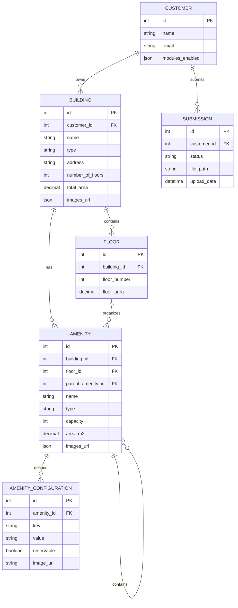

# DATA MODELING  
Conceptual and Logical Data Model

## Table of Contents

- [Overview of Data Modeling](#overview-of-data-modeling)
- [Conceptual Data Model](#conceptual-data-model)
  - [Entity-Relationship Diagram (ERD)](#entity-relationship-diagram-erd)
  - [Entity Identification](#entity-identification)
  - [Attribute Definition](#attribute-definition)
  - [Entity Relationships](#entity-relationships)
  - [Business Rules and Constraints](#business-rules-and-constraints)
  - [Complete Textual Description](#complete-textual-description)
- [Logical Data Model](#logical-data-model)
  - [Logical Diagram](#logical-diagram)
  - [Transformation from Conceptual to Logical Model](#transformation-from-conceptual-to-logical-model)
  - [Table Structure](#table-structure)
  - [Normalization](#normalization)
  - [Referential Integrity](#referential-integrity)
- [System Use Cases](#system-use-cases)
- [Model Traceability](#model-traceability)

---

## Overview of Data Modeling

Data modeling is a fundamental activity for structuring, organizing, and managing information within a system.  
In the context of this project, data modeling enables an accurate representation of the problem domain, ensuring data integrity, consistency, and efficient storage.

## Conceptual Data Model

### Entity-Relationship Diagram (ERD)

FIGURE 01 - ERD 
   
  Source: Material produced by the authors, 2026.

The diagram was created using Crow’s Foot notation and accurately represents the entities and relationships described in the following sections.

### Entity Identification

**Identified entities:**

- Entity 1  
- Entity 2  
- Entity 3  
- Entity N  

### Attribute Definition

#### Entity: **[Entity Name]**

**Description:**  
Textual description of the entity and its role within the system.

**Attributes:**

- `id` (PK) – Unique identifier of the entity  
- `attribute_1` – Attribute description  
- `attribute_2` – Attribute description  
- `attribute_n` – Attribute description  

### Entity Relationships

The relationships describe how entities are connected, including cardinality and participation constraints.

| Entity A | Entity B | Cardinality | Participation | Description |
|---------|----------|-------------|---------------|-------------|
| Entity 1 | Entity 2 | 1:N | Mandatory / Optional | Relationship description |
| Entity 2 | Entity 3 | N:N | Optional | Relationship description |

### Business Rules and Constraints

The following business rules and constraints govern the system behavior:

- A **[actor/entity]** may have at most **X** active records.
- The **[entity]** status must assume only the following values: **[list of values]**.
- The maximum allowed time for **[process/action]** is **X** days.
- Certain relationships are mandatory for record creation.

These rules ensure data validity and consistency.

### Complete Textual Description

This section provides a detailed explanation of all entities, attributes, and relationships, demonstrating how the conceptual model meets the project requirements.

- The entity **[Entity Name]** represents ...
- The relationship between **[Entity A]** and **[Entity B]** allows ...
- The business rules ensure that ...

## Logical Data Model

### Logical Diagram

### Transformation from Conceptual to Logical Model

- Entities mapped to relational tables.
- 1:N relationships implemented through foreign keys.
- Hierarchies represented using self-referencing relationships.
- Dynamic configurations isolated in a dedicated table.
- Images and files stored as URLs or file paths.
- Submission workflow represented by a dedicated table.

---

### Table Structure (Example)

#### Table: CUSTOMER

| Column | Type | PK | Description |
|------|------|----|-------------|
| id | SERIAL | ✔ | Identifier |
| name | VARCHAR(255) |  | Name |
| email | VARCHAR(255) |  | Email |
| modules_enabled | JSON |  | Enabled modules |

#### Table: BUILDING

| Column | Type | PK | Description |
|------|------|----|-------------|
| id | SERIAL | ✔ | Identifier |
| customer_id | INT |  | Client |
| name | VARCHAR(255) |  | Name |
| type | VARCHAR(50) |  | Type |
| address | TEXT |  | Address |
| number_of_floors | INT |  | Number of floors |
| total_area | DECIMAL |  | Total area |
| images | JSON |  | Image URLs |

#### Table: SUBMISSION

| Column | Type | PK | Description |
|------|------|----|-------------|
| id | SERIAL | ✔ | Identifier |
| customer_id | INT |  | Client |
| status | VARCHAR(20) |  | Submission status |
| file_path | TEXT |  | File storage path |
| upload_date | TIMESTAMP |  | Upload date |

---

### Normalization

The model is normalized up to the **Third Normal Form (3NF)**, ensuring the absence of redundancy and improper dependencies, even with the inclusion of visual attributes and submission tracking.

---

### Referential Integrity

| Foreign Key | ON DELETE | Justification |
|------------|-----------|---------------|
| BUILDING → CUSTOMER | RESTRICT | Client cannot be deleted if buildings exist |
| FLOOR → BUILDING | CASCADE | Floors depend on building |
| AMENITY → BUILDING | CASCADE | amenities depend on building |
| AMENITY → FLOOR | SET NULL | amenity may exist without floor |
| AMENITY → AMENITY | SET NULL | Preserves hierarchy |
| CONFIG → AMENITY | CASCADE | Configuration depends on amenity |
| SUBMISSION → CUSTOMER | CASCADE | Submission depends on client |

---

## System Use Cases

### Use Case 1 — Site Customization

**Actor:** Client  
**Description:** The client defines which modules are enabled and uploads images for buildings and amenities.  
**Entities involved:** CUSTOMER, BUILDING, AMENITY  
**Outcome:** The site is displayed according to enabled modules and configured visual identity.

### Use Case 2 — Project Submission

**Actor:** Client  
**Description:** The client uploads a project file for review and approval.  
**Entities involved:** CUSTOMER, SUBMISSION  
**Outcome:** The submission is registered with a status and can be approved or returned for adjustments.

---

## Model Traceability

- Conceptual entities ↔ logical tables  
- Relationships ↔ foreign keys  
- Business rules ↔ constraints and deletion policies  
- Visual resources ↔ image attributes  
- Submission workflow ↔ submission table  

### Referential Integrity

Referential integrity constraints were defined based on the system’s business rules, including:

- `ON DELETE CASCADE`
- `ON DELETE RESTRICT`
- `ON DELETE SET NULL`

These constraints ensure data consistency throughout the record lifecycle.

## Traceability Between Models

Traceability between the conceptual and logical models is ensured as follows:

- Each conceptual entity corresponds to a table in the logical model.
- Each conceptual relationship was translated into a foreign key or associative table.
- Business rules from the conceptual model were enforced through logical constraints.

This guarantees alignment and coherence across modeling levels.

## Final Considerations

The presented data models provide a structured, consistent, and scalable foundation for the system.  
The clear separation between conceptual and logical models contributes to maintainability, data integrity, and future system evolution.
