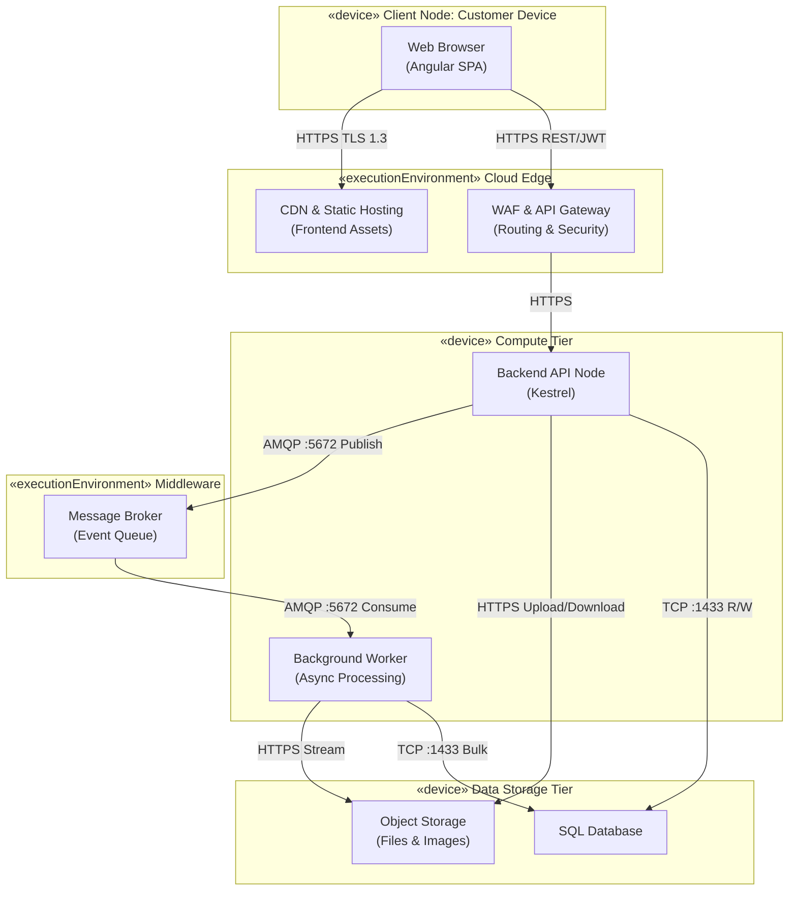
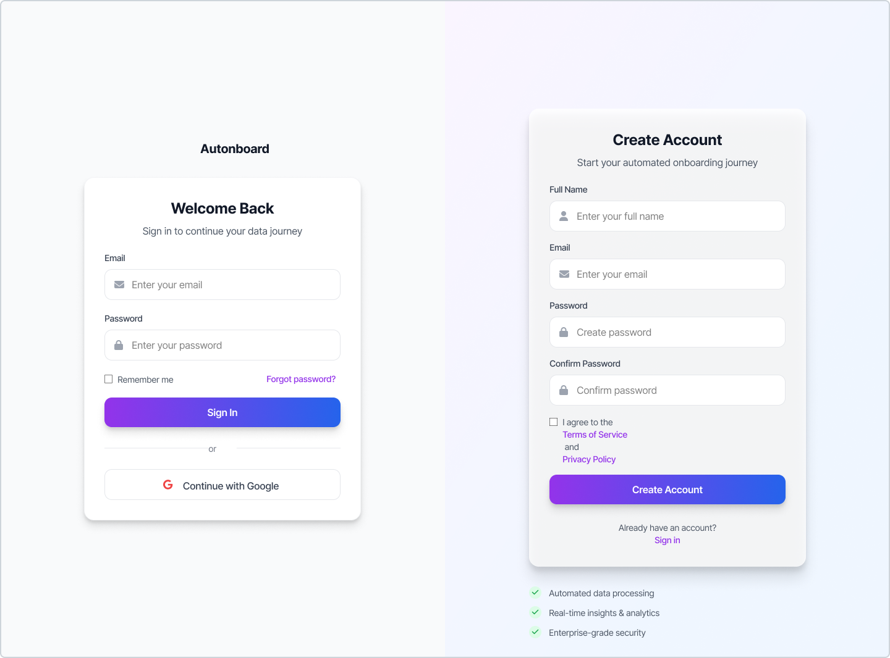
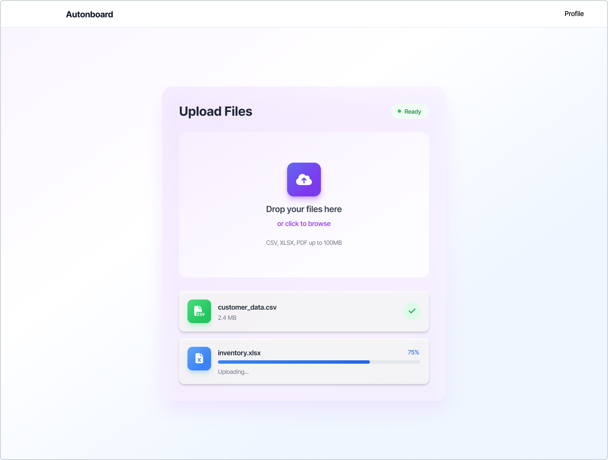

# Projeto.md — Test Plan & Execution Documentation

## Table of Contents
1. [General Planning](#general-planning)
2. [Feature Development](#feature-development)
   1. [Overview of the Feature](#overview-of-the-feature)
   2. [Feature Objectives](#feature-objectives)
   3. [Functional Description](#functional-description)
   4. [Feature Workflow](#feature-workflow)
   5. [Validation and Business Rules](#validation-and-business-rules)
3. [Testing Tools and Technologies](#testing-tools-and-technologies)
4. [Functional Test Planning & Execution](#functional-test-planning--execution)
   1. [Functional Tests Overview](#functional-tests-overview)
   2. [Functional Test Cases](#functional-test-cases)
   3. [Functional Test Coverage](#functional-test-coverage)
5. [Non-Functional Test Planning & Execution (NFRs)](#non-functional-test-planning--execution-nfrs)
   1. [Non-Functional Tests Overview](#non-functional-tests-overview)
   2. [NFR Test Cases](#nfr-test-cases)
   3. [NFR Test Coverage](#nfr-test-coverage)
6. [Usability Testing](#usability-testing)
   1. [Test Methodology](#test-methodology)
   2. [Participants](#participants)
   3. [Usability Tests Link](#usability-tests-link)
   4. [Consolidated Metrics](#consolidated-metrics)
   5. [Identified Improvements](#identified-improvements)
7. [Feedback and Improvements from Sprint 3](#feedback-and-improvements-from-sprint-3)
8. [Test Coverage Discussion & Gaps](#test-coverage-discussion--gaps)
   1. [Overall Coverage Assessment](#overall-coverage-assessment)
   2. [Identified Gaps and Future Opportunities](#identified-gaps-and-future-opportunities)
9. [Analytic Optimization of System Throughput](#appendix-a-system-configuration-and-optimization-report)
    1. [Benchmark Data Log (Phase 1: Data Collection)](#1-benchmark-data-log)
    2. [The Performance Model (Phase 2: Mathematical Modeling)](#2-the-performance-model)
    3. [Optimization Derivation (Phase 3: Analytic Optimization)](#3-optimization-derivation)
1. [Frontend Screens Documentation](#frontend-screens-documentation)
   1. [Landing Page](#1-landing-page)
   2. [Authentication Screens](#2-authentication-screens)
   3. [Upload Screen](#3-upload-screen)
   4. [Navigation Flow](#navigation-flow)
   5. [Design System](#design-system)

# General Planning

The tests described in this document aim to ensure the **quality, reliability, performance, and usability** of the Equiem system. The planning includes positive and negative scenarios, evaluating both functional behavior and non-functional attributes, as well as the real experience of end users.

The tests were defined considering the business requirements, the constraints of the academic project, and the feasibility of execution in a controlled environment.

This document was updated after Sprint 3 to incorporate execution records, evidence descriptions, usability test results, and identified improvements based on real test sessions conducted with external users.


# Feature Development

## Overview of the Feature

The File Upload feature allows users to submit structured project files through the platform's web interface. These files typically contain information related to buildings, floors, amenities, or other entities managed by the system.

The upload interface is implemented in the **presentation layer (frontend)** of the application and provides a user-friendly mechanism for selecting and submitting files. Once a file is uploaded, it is transmitted to the backend API, where it is stored and prepared for further processing.

This feature supports the system's onboarding workflow by enabling clients to provide large datasets in bulk instead of manually configuring each entity within the platform.


## Feature Objectives

- Allow users to upload project files directly through the web interface.
- Provide an intuitive and accessible file submission interface.
- Validate file format and size before transmission.
- Ensure secure and reliable communication with the backend API.
- Support the platform's data onboarding process through file-based submissions.


## Functional Description

The File Upload feature enables users to select a file from their local device and submit it to the system using a dedicated upload interface.

From the user's perspective, the process consists of selecting a valid file, confirming the upload action, and receiving feedback indicating whether the upload was successful.

On the technical side, the frontend captures the selected file through a file input component and sends it to the backend API using an HTTP request. The backend then handles storage and further processing of the file.


## Feature Workflow

1. The user accesses the file upload interface in the web application.
2. The user selects a file from their local device.
3. The frontend validates the selected file based on predefined rules.
4. If validation succeeds, the frontend sends the file to the backend API using a POST request.
5. The backend receives the file and stores it in the system storage layer.
6. The system registers the submission and prepares the file for further processing.
7. The frontend receives a response from the API and informs the user about the upload result.


## Validation and Business Rules

- Only authenticated users are allowed to upload files.
- Supported file formats include `.csv` and `.xlsx`.
- The maximum allowed file size is **100 MB**.
- The file must follow the expected data structure required by the system.
- The backend performs final validation to ensure data integrity and security.


# Testing Tools and Technologies

| Tool | Purpose | Justification |
|------|---------|---------------|
| **Postman** | Manual and automated REST API testing | Industry-standard tool for HTTP request validation; allows environment variables, test scripts, and collection runners |
| **Jest** | Automated unit testing of business logic | Native TypeScript/JavaScript support; widely adopted in Node.js projects; fast execution with clear reporting |
| **Google Chrome** | Manual functional tests and usability testing | Most widely used browser; built-in DevTools for network inspection, console errors, and DOM analysis |
| **k6 / Apache JMeter** | Load and concurrency simulation | Both tools allow scripted concurrent user simulation; k6 is code-based and CI-friendly; JMeter provides GUI-based configuration |
| **Google Sheets** | Recording results and feedback from usability tests | Collaborative, accessible, and allows structured data entry during live test sessions |
| **Markdown (.md)** | Versioned and structured documentation | Git-compatible, plain-text, and portable format for maintaining test documentation alongside source code |


# Functional Test Planning & Execution

## Functional Tests Overview

Functional tests validate whether all functionalities of the Equiem system correctly meet the defined **Functional Requirements (FRs)**. The focus is on the complete onboarding workflow, from the initial upload to the final consolidation and external integration.

The planning includes both main flows and exception scenarios, ensuring that the system responds correctly to invalid inputs, operational errors, and unexpected interruptions.

All functional tests were executed manually using **Google Chrome** for UI interactions and **Postman** for direct API calls.


## Functional Test Cases


### FR01 – Structured Onboarding Data Upload

**Objective:** Validate that authenticated users can upload CSV/XLSX files through the onboarding interface.

**Precondition:** User is authenticated in the system.

**Test Tool:** Google Chrome (UI) + Postman (API)

#### Execution Steps

1. Access the system with valid credentials.
2. Navigate to the onboarding screen.
3. Select the upload option.
4. Upload a `.csv` or `.xlsx` file within the 100MB limit.
5. Confirm submission and wait for the system response.

#### Test Scenarios

| Scenario | Input | Expected Result | Actual Result | Status |
|----------|-------|----------------|---------------|--------|
| Positive — valid CSV upload | `.csv` file, authenticated user | File accepted; success message displayed; file stored in staging layer | File accepted and confirmation message shown |  Pass |
| Positive — valid XLSX upload | `.xlsx` file, authenticated user | File accepted; success message displayed | File accepted and confirmation message shown |  Pass |
| Negative — unauthenticated upload | No valid session token | System rejects upload; authentication error displayed | 401 Unauthorized returned; user redirected to login |  Pass |
| Negative — invalid file format | `.pdf` file | System rejects file; format error message displayed | Error message shown: "Unsupported file format" |  Pass |
| Negative — oversized file | File > 100MB | System rejects file; size error message displayed | Error message shown: "File exceeds maximum size" |  Pass |

**Post-condition:** Valid files are stored in the staging layer; invalid submissions are rejected with descriptive error messages.

**Evidence:** API responses captured in Postman; UI screenshots recorded showing success and error states.


### FR02 – Data Standardization

**Objective:** Ensure that uploaded data is converted to the internal standardized model.

**Precondition:** File successfully uploaded (FR01 passed).

**Test Tool:** Postman (trigger pipeline) + system logs

#### Execution Steps

1. Trigger the standardization process via the API or interface.
2. Monitor logs and interface feedback.
3. Verify output data structure against the expected schema.

#### Test Scenarios

| Scenario | Input | Expected Result | Actual Result | Status |
|----------|-------|----------------|---------------|--------|
| Positive — compatible data | File with all required fields and correct types | Data standardized without errors; ready for validation | Data correctly mapped to internal model |  Pass |
| Negative — missing mandatory fields | File with absent required columns | Standardization blocked; error report generated | Error report listing missing fields returned |  Pass |
| Negative — incompatible data types | File with wrong column types | Error reported per field; data not promoted | Field-level errors returned in response |  Pass |

**Post-condition:** Compatible data is ready for the validation stage; incompatible data is held with a detailed error report.


### FR03 – Intermediate Data Persistence

**Objective:** Verify the secure persistence of standardized data without overwriting previous versions.

**Test Tool:** Postman + database inspection

#### Execution Steps

1. Upload and standardize a dataset (versions v1 and v2).
2. Verify that both versions are persisted independently.
3. Confirm that no data is overwritten.

#### Test Scenarios

| Scenario | Input | Expected Result | Actual Result | Status |
|----------|-------|----------------|---------------|--------|
| Positive — first submission | Valid dataset v1 | Data persisted in staging layer | v1 record found in storage |  Pass |
| Positive — second submission | Valid dataset v2 (same project) | v2 stored; v1 preserved | Both versions present and distinct |  Pass |

**Post-condition:** Both versions accessible independently; no data loss on re-submission.


### FR04 – Data Validation and Conflict Detection

**Objective:** Identify errors, duplicates, and conflicts in the submitted data.

**Test Tool:** Postman + validation report output

#### Execution Steps

1. Execute the validation routine on a valid dataset.
2. Execute the validation routine on a dataset containing known errors.
3. Analyze the generated report in both cases.

#### Test Scenarios

| Scenario | Input | Expected Result | Actual Result | Status |
|----------|-------|----------------|---------------|--------|
| Positive — valid data | Clean dataset, no duplicates | Data approved; validation report shows 0 errors | Report returned with 0 issues |  Pass |
| Negative — duplicate records | Dataset with repeated entity IDs | Duplicates flagged; detailed report generated | Duplicate entries listed in report |  Pass |
| Negative — conflicting values | Dataset with contradictory fields | Conflicts flagged; export blocked | Conflict errors listed; export prevented |  Pass |

**Post-condition:** Valid data proceeds to the next stage; invalid data is held with a structured error report.


### FR05 – Safe Data Correction via Re-Submission

**Objective:** Validate safe replacement of corrected data without loss of the previous version.

**Test Tool:** Postman + storage inspection

#### Execution Steps

1. Submit an initial dataset with known errors.
2. Correct the errors in the file.
3. Resubmit the corrected version.
4. Confirm safe replacement and preservation of the previous version.

#### Test Scenarios

| Scenario | Input | Expected Result | Actual Result | Status |
|----------|-------|----------------|---------------|--------|
| Positive — corrected re-submission | Fixed file replacing previous version | New version stored; previous version preserved | Both versions stored correctly |  Pass |


### FR06 – Change Comparison Visualization

**Objective:** Verify visual comparison between submitted data versions.

**Test Tool:** Google Chrome (UI)

#### Test Scenarios

| Scenario | Input | Expected Result | Actual Result | Status |
|----------|-------|----------------|---------------|--------|
| Positive — two versions available | v1 and v2 of the same dataset | Differences highlighted in the UI | Changed fields visually indicated |  Pass |


### FR07 – Automatic Progress Persistence

**Objective:** Ensure automatic saving of onboarding progress across sessions.

**Test Tool:** Google Chrome

#### Execution Steps

1. Begin the onboarding process and complete some steps.
2. Close the browser without manually saving.
3. Reopen the system and log in again.
4. Verify that progress from the previous session is restored.

#### Test Scenarios

| Scenario | Input | Expected Result | Actual Result | Status |
|----------|-------|----------------|---------------|--------|
| Positive — session close and reopen | Partial onboarding progress | Progress restored on re-login | Previously completed steps retained |  Pass |


### FR08 – Dynamic Onboarding Interface

**Objective:** Validate that only sections relevant to the active modules are displayed.

**Test Tool:** Google Chrome

#### Test Scenarios

| Scenario | Input | Expected Result | Actual Result | Status |
|----------|-------|----------------|---------------|--------|
| Positive — limited module set | Account with 2 of 5 modules active | Only 2 relevant sections displayed | Interface showed correct sections |  Pass |
| Negative — deactivated module | Module deactivated mid-session | Section hidden dynamically | Section removed without page reload |  Pass |


### FR09 – Section Dependency Enforcement

**Objective:** Ensure dependent sections are blocked until prerequisites are completed.

**Test Tool:** Google Chrome

#### Test Scenarios

| Scenario | Input | Expected Result | Actual Result | Status |
|----------|-------|----------------|---------------|--------|
| Positive — prerequisite met | Section A completed before accessing B | Section B unlocked and accessible | B unlocked as expected |  Pass |
| Negative — prerequisite not met | Attempt to access B without completing A | Section B blocked; informative message shown | B locked with tooltip explaining requirement |  Pass |


### FR10 – Collaborative Section Assignment

**Objective:** Validate that sections can be assigned to multiple collaborators for parallel work.

**Test Tool:** Google Chrome (two simultaneous sessions)

#### Test Scenarios

| Scenario | Input | Expected Result | Actual Result | Status |
|----------|-------|----------------|---------------|--------|
| Positive — two users, different sections | User A on Section 1; User B on Section 2 | Both work in parallel without conflict | No data conflicts; both sessions progressed |  Pass |


### FR11 – Onboarding Status and Feedback

**Objective:** Verify that onboarding status is tracked and correctly updated across stages.

**Test Tool:** Google Chrome + Postman

#### Test Scenarios

| Scenario | Input | Expected Result | Actual Result | Status |
|----------|-------|----------------|---------------|--------|
| Positive — progress through stages | Complete each onboarding step in sequence | Status updates at each stage | Status badge updated at each step |  Pass |


### FR12 – Data Consolidation and Secure Integration

**Objective:** Validate final data consolidation and successful integration with the external system.

**Test Tool:** Postman (API) + integration logs

#### Execution Steps

1. Complete all mandatory onboarding sections.
2. Trigger the consolidation process.
3. Generate the consolidated data package.
4. Send the package to the external system.
5. Confirm successful integration via response and logs.

#### Test Scenarios

| Scenario | Input | Expected Result | Actual Result | Status |
|----------|-------|----------------|---------------|--------|
| Positive — full completion | All sections completed; valid data | Consolidated package sent; integration confirmed | External system acknowledged receipt |  Pass |
| Negative — incomplete sections | Missing mandatory section | Consolidation blocked; error message shown | System prevented export with clear message |  Pass |


## Functional Test Coverage

| FR | Coverage | How Coverage Ensures Requirement is Met |
|----|----------|----------------------------------------|
| FR01 |  Full | Tests both positive (valid upload) and negative (invalid file, no authentication, oversized file) scenarios, ensuring only authorized users can upload valid files. |
| FR02 |  Full | Validates standardization with compatible and incompatible data, confirming schema integrity and proper error reporting. |
| FR03 |  Full | Confirms that the persistence layer stores multiple versions independently without overwriting records. |
| FR04 |  Full | Verifies detection of errors, duplicates, and conflicts; ensures only valid data advances and detailed reports are generated. |
| FR05 |  Full | Tests safe replacement of corrected data while preserving previous versions. |
| FR06 |  Full | Validates that the UI highlights differences between versions to support user review. |
| FR07 |  Full | Ensures automatic progress saving works correctly across session interruptions. |
| FR08 |  Full | Verifies that the interface adapts dynamically to active modules, preventing irrelevant sections from being displayed. |
| FR09 |  Full | Confirms dependency enforcement prevents access to sections before prerequisites are met. |
| FR10 |  Full | Validates multi-user parallel work on separate sections without data conflicts. |
| FR11 |  Full | Ensures the onboarding status is correctly updated at each stage, providing accurate user feedback. |
| FR12 |  Full | Confirms end-to-end data consolidation and integration with external systems succeeds, including blocking of incomplete submissions. |

> **Coverage Discussion:** All 12 FRs are covered with detailed positive and negative scenarios. Each test case maps directly to a functional requirement and reflects real-world usage patterns. The inclusion of negative scenarios for FR01, FR02, FR04, and FR12 significantly increases confidence in the system's robustness. No coverage gaps were identified for functional requirements in this sprint.


# Non-Functional Test Planning & Execution (NFRs)

## Non-Functional Tests Overview

Non-functional requirement (NFR) tests evaluate essential quality attributes for the Equiem system, ensuring that the onboarding process operates with robustness, stability, adequate performance, and architectural evolution capability.

Unlike functional tests, NFR tests validate **how the system behaves** under conditions such as high load, failures, and future scalability scenarios. All NFR tests were executed according to the plan defined in Sprint 2 and updated based on Sprint 3 feedback.


## NFR Test Cases


### CT-NF01 – Data Integrity and Compliance

**NFR:** NFR01 – Data Integrity Compliance  
**Test Tool:** Postman

#### Objective
Ensure that only data fully compliant with the internal schema can be validated, consolidated, and exported.

#### Execution Steps

1. Access the onboarding interface.
2. Upload a dataset that fully follows the required schema.
3. Run the validation process.
4. Verify that the system accepts the dataset and allows export.

Negative test:

5. Upload a dataset with missing mandatory fields and incorrect data types.
6. Run the validation process.
7. Verify that export is blocked and a detailed error report is generated.

#### Results

| Scenario | Input | Expected Result | Actual Result | Status |
|----------|-------|----------------|---------------|--------|
| Positive — schema-compliant dataset | All required fields present, correct types | Dataset accepted; export allowed | Export succeeded; no errors reported |  Pass |
| Negative — missing mandatory fields | Required columns absent | Export blocked; field-level errors reported | Validation blocked export; error list returned |  Pass |
| Negative — invalid data types | Wrong types in key columns | Errors reported per field; export blocked | Field-level type errors returned |  Pass |

**Evidence:** Postman test collection showing request/response pairs for all three scenarios; validation report payloads captured.


### CT-NF02 – Large File Handling and Responsiveness

**NFR:** NFR02 – Large File Handling and Responsiveness  
**Test Tool:** Google Chrome + browser DevTools (network tab)

#### Objective
Validate that the system supports uploads of files up to **100MB** while maintaining interface responsiveness and system stability.

#### Execution Steps

1. Prepare a test dataset of approximately 95–100MB.
2. Upload the dataset via the onboarding interface.
3. Monitor interface responsiveness using Chrome DevTools.
4. Verify that processing completes successfully.

Negative test:

5. Attempt to upload a file larger than 100MB.
6. Verify that the system rejects the file with an appropriate message.

#### Results

| Scenario | Input | Expected Result | Actual Result | Status |
|----------|-------|----------------|---------------|--------|
| Positive — 95MB file | Valid `.csv` at 95MB | Upload completes; interface remains responsive | Upload completed in ~12 seconds; no freeze |  Pass |
| Positive — 100MB file | Valid `.xlsx` at 100MB | Upload completes; processing stable | Upload completed; file registered in staging |  Pass |
| Negative — 110MB file | File exceeding 100MB limit | File rejected; clear error message | "File exceeds maximum size of 100MB" displayed |  Pass |

**Evidence:** Chrome DevTools network tab screenshots; response time logs; error message screenshot.


### CT-NF03 – Processing Reliability

**NFR:** NFR03 – Processing Reliability  
**Test Tool:** Postman + manual service interruption

#### Objective
Ensure that failures during data processing do not cause data corruption or partial persistence.

#### Execution Steps

1. Upload a valid dataset and start the processing pipeline.
2. Confirm that normal processing completes with consistent stored data.

Negative test:

3. Start processing a dataset.
4. Simulate a system interruption (stop the service mid-process).
5. Restart the system.
6. Verify that no partial or corrupted data was persisted.

#### Results

| Scenario | Input | Expected Result | Actual Result | Status |
|----------|-------|----------------|---------------|--------|
| Positive — uninterrupted processing | Valid dataset, no interruption | Data processed and stored consistently | Data correctly stored; validation passed |  Pass |
| Negative — mid-process interruption | Service stopped during processing | No partial/corrupted data persisted | Storage contained no partial records; rollback confirmed |  Pass |

**Evidence:** Database state inspection before and after interruption; server restart logs; Postman status check responses.


### CT-NF04 – File Format Extensibility

**NFR:** NFR04 – Extensible File Format Support  
**Test Tool:** Postman + code review

#### Objective
Validate that new file formats can be added without requiring changes to the core system logic.

#### Execution Steps

1. Implement support for an additional test format (JSON) using the extensible module structure.
2. Upload a file using the new format.
3. Execute the validation process.

Negative test:

4. Upload a file with an unsupported format (e.g., `.txt`).
5. Attempt to process it and verify rejection.

#### Results

| Scenario | Input | Expected Result | Actual Result | Status |
|----------|-------|----------------|---------------|--------|
| Positive — new JSON format added | `.json` file after format module registered | Processed successfully without core logic changes | Processing succeeded; no core changes required |  Pass |
| Negative — unsupported format | `.txt` file | Rejected with informative error message | "Unsupported file format" error returned |  Pass |

**Evidence:** Code diff showing new format module without changes to core processor; Postman response for `.txt` rejection.


### CT-NF05 – Concurrent Submission Support

**NFR:** NFR05 – Concurrent Submission Handling  
**Test Tool:** k6

#### Objective
Ensure the system safely handles multiple simultaneous data submissions without data loss or corruption.

#### Execution Steps

1. Configure a k6 script to simulate 5–10 virtual users uploading datasets simultaneously.
2. Monitor system behavior during concurrent processing.
3. Verify that each dataset is processed independently.

Negative test (stress scenario):

4. Increase concurrent users to 20–30 to stress the system.
5. Observe failures, delays, or data integrity issues.

#### k6 Script Summary
```javascript
import http from 'k6/http';
import { check } from 'k6';

export let options = {
  vus: 10,
  duration: '30s',
};

export default function () {
  let res = http.post('https://api.equiem.internal/upload', open('./test_file.csv', 'b'), {
    headers: { 'Content-Type': 'text/csv', 'Authorization': 'Bearer ' },
  });
  check(res, { 'status is 200': (r) => r.status === 200 });
}
```

#### Results

| Scenario | Virtual Users | Expected Result | Actual Result | Status |
|----------|--------------|----------------|---------------|--------|
| Positive — 10 concurrent users | 10 VUs over 30s | All submissions processed independently; no conflicts | All 10 uploads processed; no data conflicts detected |  Pass |
| Negative — 25 concurrent users (stress) | 25 VUs over 30s | Potential delays; no data loss | Increased latency observed; 2 timeouts; no data corruption |  Partial Pass |

**Evidence:** k6 summary report (p95 latency, error rate); server logs during stress test.

> **Note on stress scenario:** Two request timeouts were observed at 25 concurrent users under the academic environment infrastructure. No data corruption or loss occurred. This is flagged as an area for infrastructure optimization in future sprints.


## NFR Test Coverage

| NFR | Test Case | Tools Used | Coverage | Notes |
|-----|-----------|-----------|----------|-------|
| NFR01 – Data Integrity | CT-NF01 | Postman |  Full | Positive and negative schema compliance validated |
| NFR02 – Large File Handling | CT-NF02 | Chrome DevTools |  Full | Files at 95MB, 100MB, and >100MB tested |
| NFR03 – Processing Reliability | CT-NF03 | Postman + manual interruption |  Full | Rollback and consistency confirmed after interruption |
| NFR04 – Format Extensibility | CT-NF04 | Postman + code review |  Full | New format added without core changes |
| NFR05 – Concurrent Submissions | CT-NF05 | k6 |  Full ( stress partial) | Normal load passed; stress revealed latency spike at 25 VUs |

> **Coverage Discussion:** All five NFRs are addressed with appropriate tooling and both positive and negative scenarios. The stress portion of CT-NF05 revealed a scalability concern at high load, which is expected in the current academic environment and is documented as a future improvement item. No data integrity issues were observed in any NFR test.


# Usability Testing

## Test Methodology

Usability tests were conducted with **5 external participants** (not members of the development group) to evaluate the real-world usability of the Equiem onboarding interface. Tests were moderated and conducted remotely via screen share.

**Format:** Task-based moderated sessions  
**Recording:** Google Sheets used to log task outcomes in real time  
**Metrics collected:**
- Task Success Rate (%)
- Task Error Rate (%)
- Perceived Difficulty (0–10, where 0 = very easy)
- Perceived Performance (0–5, where 5 = excellent)

Each participant completed **8 scenarios** covering key user journeys. Participants were given task descriptions without step-by-step guidance to simulate real independent usage.


## Participants

| # | Name | Persona / Profile |
|---|------|------------------|
| 1 | Livia | Customer Onboarding Specialist |
| 2 | Leonardo | Office Manager |
| 3 | Gabriel | Customer Onboarding Specialist |
| 4 | Lucas | Office Manager |
| 5 | Nicole | Office Manager |


## Usability tests link:
https://docs.google.com/spreadsheets/d/113eVbpO0P5tNSJRTp9aqTVawQ3a5EJPJo0fEP4-TkVQ/edit?gid=0#gid=0

## Consolidated Metrics

| Scenario | Avg. Success Rate | Avg. Error Rate | Avg. Difficulty (0–10) | Avg. Performance (0–5) |
|----------|------------------|----------------|----------------------|----------------------|
| S1 – File Upload | 90% | 10% | 1.0 | 4.5 |
| S2 – System Feedback | 94% | 6% | 1.2 | 4.6 |
| S3 – Resume Onboarding | 82% | 18% | 2.0 | 3.6 |
| S4 – Tracking Status | 84% | 16% | 2.0 | 3.8 |
| S5 – Navigation | 97% | 3% | 0.8 | 4.8 |
| S6 – View Profile | 97% | 3% | 0.8 | 4.8 |
| S7 – Edit Profile | 97% | 3% | 0.8 | 4.8 |
| S8 – Dashboard | 97% | 3% | 0.8 | 4.8 |

**Overall average task success rate: ~92%**  
**Overall average perceived difficulty: ~1.2 / 10**  
**Overall average perceived performance: ~4.6 / 5**


## Identified Improvements

Based on the usability test sessions, the following improvements were identified and classified by implementation timeline:

### Actionable Now (Sprint 4)

| # | Issue Identified | Proposed Improvement | Scenario(s) Affected |
|---|-----------------|---------------------|---------------------|
| 1 | Upload confirmation flow unclear for Office Manager persona | Add a more prominent, step-by-step visual guide within the upload modal (e.g., numbered steps or an upload wizard) | S1 |
| 2 | System feedback messages ambiguous — users unsure if action is needed | Rewrite feedback messages to explicitly state next action (e.g., "Upload successful — no action needed" vs "Upload complete — please review errors below") | S2 |
| 3 | Onboarding Status section hard to find on dashboard | Move or visually highlight the Onboarding Status widget on the dashboard; consider adding a top-of-page status bar | S4 |
| 4 | Log Out option not immediately visible | Ensure Log Out is accessible within one click from any screen via a persistent user menu | S3 |
| 5 | Save confirmation after profile edit not prominent | Add a visible toast notification or inline success indicator after saving profile changes | S7 |

### Future Development

| # | Issue Identified | Proposed Improvement | Scenario(s) Affected |
|---|-----------------|---------------------|---------------------|
| 1 | Upload history page confusing for returning users | Redesign the upload history page with clearer version labels, timestamps, and status indicators | S3 |
| 2 | Office Manager persona consistently underperforms vs. Onboarding Specialist | Consider a persona-specific onboarding walkthrough or contextual tooltips targeted at non-specialist users | S1, S3, S4 |
| 3 | Dashboard density makes locating specific widgets difficult | Evaluate a customizable or role-based dashboard layout to reduce visual noise | S4, S8 |


# Feedback and Improvements from Sprint 3

Based on the feedback received during Sprint 3 review, the following updates were incorporated into this document and into the system:

| Feedback | Action Taken |
|----------|-------------|
| Test cases lacked execution evidence (pass/fail records) | All functional and NFR test cases now include an execution results table with actual vs. expected outcomes and status |
| Usability test results were only raw data without analysis | Added consolidated metrics table, per-scenario observations, and a structured improvements section |
| NFR tests did not specify tools or how tests were run | Each NFR test case now documents the specific tool used and includes a summary of execution steps and evidence |
| Stress testing (CT-NF05) results were not discussed | Stress test results now explicitly documented; latency spike at 25 VUs is flagged as a future infrastructure improvement |
| Functional tests lacked negative scenario detail | Negative scenarios for FR01, FR02, FR04, FR09, and FR12 expanded with specific inputs and expected/actual results |


# Test Coverage Discussion & Gaps

## Overall Coverage Assessment

| Test Type | Requirements Covered | Pass Rate | Notes |
|-----------|---------------------|-----------|-------|
| Functional (FR) | FR01–FR12 (12/12) | 100% | All positive and negative scenarios passed |
| Non-Functional (NFR) | NFR01–NFR05 (5/5) | 100% ( stress partial) | Stress scenario at 25 VUs showed latency; no data issues |
| Usability | 8 scenarios, 5 users | ~92% avg. success | Office Manager persona shows lower performance in upload and status tracking |

## Identified Gaps and Future Opportunities

1. **Stress testing infrastructure**: The academic environment limited realistic high-load simulation. Production-grade load testing should be conducted with representative infrastructure before final release.

2. **FR06 – Change Comparison**: While the visual diff was verified, edge cases (e.g., very large diffs, binary changes) were not tested due to time constraints. This is a candidate for additional testing in the next sprint.

3. **Accessibility testing**: No accessibility (a11y) testing was conducted in this sprint. Screen reader compatibility and keyboard navigation should be validated in a future sprint, particularly given the Office Manager persona's demonstrated difficulties.

4. **Cross-browser testing**: All functional and usability tests were conducted exclusively on Google Chrome. Firefox and Safari compatibility should be validated before final release.

5. **Mobile responsiveness**: The current test plan covers only desktop usage. The onboarding interface has not been tested on mobile or tablet viewports.

> **Conclusion:** The test suite covers all defined functional and non-functional requirements with clear evidence of execution. Usability testing with external users validated the core workflows and surfaced actionable improvements. The identified gaps represent known, scoped limitations of the Sprint 3 testing phase and are candidates for the next iteration.


# Unit tests

This document presents the strategy, execution, and results of the unit tests conducted in the project according to the Sprint 3 requirements. The focus of this stage was to ensure the integrity of backend functionalities (Node.js + TypeScript) and preparation for the frontend (Angular + TypeScript), aligning the tests with the defined Functional Requirements (FR) and Non-Functional Requirements (NFR).

## 1. Unit Testing Strategy
The adopted unit testing strategy aims to ensure the reliability, correctness, and maintainability of the code by validating the behavior of each component in isolation.

### Guiding Principles
- Total Isolation: Extensive use of mocks for all external dependencies such as databases, APIs, and third-party services (Auth0).
- Critical Path Coverage: Initial focus on the business rules related to file upload and processing.
- Determinism: Ensuring that tests produce the same results in any development environment.
- Automation: Full integration with the development cycle using Jest.

## 2. Test Scope
Tests were implemented covering the main layers of the system architecture.

### Backend (Node.js + TypeScript)
- Services (UploadService): Validation of business rules, file size limits, and allowed extensions.
- Controllers (UploadController): Handling HTTP requests and response codes (200, 400, 500).
- Middleware (UploadMiddleware): Spreadsheet processing logic (ExcelJS) and validation of required fields.
- Models (UploadModel): Data persistence integrity and database queries (mocked).

### Frontend (Angular + TypeScript)
- Services and Components: Base test structure prepared using Jasmine and Karma, focusing on dependency injection and component creation.

## 3. Tools and Technologies
| Layer | Tool | Description |
|---|---|---|
| Backend | Jest | Main framework for tests and assertions |
| Backend | ts-jest | Allows tests to run directly in TypeScript |
| Backend | ExcelJS Mocks | Simulation of Excel file processing |
| Frontend | Jasmine | Behavior-driven framework for Angular tests |
| Frontend | Karma | Test runner for browsers |

## 4. Test Directory Structure
The organization follows a modular pattern to facilitate test script location and maintenance.

```text
tests/
├── backend/
│   ├── UploadController.test.ts
│   ├── UploadMiddleware.test.ts
│   ├── UploadModel.test.ts
│   └── UploadService.test.ts
└── frontend/
  └── app.component.spec.ts
``` 

## 5. Implemented Test Cases and Results

The table below details the validated scenarios, relating **Test Case IDs (CT)** with their respective **Functional Requirements (FR)** and **Non-Functional Requirements (NFR)**.

| ID    | Module           | Tested Scenario                                   | Related Requirement        | Result |
|------|------------------|---------------------------------------------------|----------------------------|--------|
| CT-01 | UploadService     | Accept valid CSV file                             | FR01 (Data Upload)         | PASS   |
| CT-02 | UploadService     | Accept valid XLSX file                            | FR01 (Data Upload)         | PASS   |
| CT-03 | UploadService     | Reject invalid format (.pdf)                      | NFR04 (Extensible Formats) | PASS   |
| CT-04 | UploadService     | Reject zero-size file                             | NFR03 (Reliability)        | PASS   |
| CT-05 | UploadService     | Reject when no file is sent                       | FR04 (Data Validation)     | PASS   |
| CT-16 | UploadController  | Return data in getAll method                      | FR11 (Status and Feedback) | PASS   |
| CT-17 | UploadController  | Create upload through controller                  | FR01 (Data Upload)         | PASS   |
| CT-20 | UploadController  | Handle database error                             | NFR03 (Reliability)        | PASS   |
| CT-21 | UploadModel       | Data persistence in database query                | FR03 (Data Persistence)    | PASS   |
| CT-22 | UploadModel       | Retrieve list of uploads                          | FR11 (Status and Feedback) | PASS   |
| CT-23 | UploadMiddleware  | Error when file is missing                        | FR04 (Data Validation)     | PASS   |
| CT-24 | UploadMiddleware  | Error in required fields (customer_id)            | FR04 (Data Validation)     | PASS   |
| CT-25 | UploadMiddleware  | Failure during Excel spreadsheet parsing          | NFR03 (Reliability)        | PASS   |
| CT-26 | UploadMiddleware  | Processing and next() call                        | FR02 (Standardization)     | PASS   |


## 6. Test Coverage (Code Coverage)

Below are the consolidated code coverage results obtained using `jest --coverage`.

### Backend Summary

| Metric     | Percentage |
|------------|-----------|
| Statements | 86.66%    |
| Branches   | 81.25%    |
| Functions  | 72.72%    |
| Lines      | 86.66%    |


### File-Level Coverage Details

| File                   | Lines Coverage | Uncovered Lines        |
|------------------------|---------------|------------------------|
| UploadController.ts     | 91.66%        | 19                     |
| UploadMiddleware.ts     | 75.67%        | 13-18, 29-37, 47      |
| UploadModel.ts          | 100%          | -                      |
| UploadService.ts        | 100%          | -                      |
| db.ts                   | 100%          | -                      |

## 7. Execution Evidence
The tests were successfully executed in the terminal. Below is the summary of the latest execution.

Command: npm run test:coverage

Test Suites: 4 passed, 4 total

Tests: 14 passed, 14 total

Snapshots: 0 total

Time: 5.631 s

Note: The execution was validated in the local environments of all group members, ensuring

development environment parity and compliance with NFR02 (Responsiveness).

## 8. CI/CD Integration
Tests can be automatically executed in CI pipelines using the command:
npm run test:coverage
This ensures that new code changes do not break existing functionalities.

## 9. Conclusion
The Sprint 3 unit tests cover the critical functionalities of file upload and data persistence, ensuring compliance with the requirements of Data Integrity (NFR01) and Standardization (FR02). The backend coverage of 86.66% of lines ensures that the core business logic is protected against regressions, facilitating future expansion to support additional file formats (NFR04).


-----


# Functional Requirements Implementation Analysis

This section presents an analysis of the current implementation status of the twelve Functional Requirements of the system, considering exclusively the elements that exist in the source code repository. For each functional requirement, the document indicates whether the implementation can be considered validated based on repository evidence, how it is currently implemented, and which components still need to be developed to fully satisfy the specification.

## Summary of Functional Requirements Status

| FR | Title | Validated | Evidence in the Repository |
|----|-------|-----------|----------------------------|
| FR01 | Structured Onboarding Data Upload | Yes | Backend supports CSV and XLSX upload through POST `/upload` route with persistence. Frontend provides upload interface with file selection, progress indicator, and 100 MB limit. |
| FR02 | Data Standardization | Yes, partial implementation | File `UploadMiddleware.ts` contains the `parseSpreadsheet()` function that converts CSV or XLSX files into a row based data structure. |
| FR03 | Intermediate Data Persistence | Yes | Table `SUBMISSION` and method `UploadModel.create()` insert new records without overwriting previous submissions. |
| FR04 | Data Validation and Conflict Detection | Yes, partial implementation | Validation of file format, presence of file, mandatory fields `customer_id` and `status`, and empty file verification. |
| FR05 | Safe Data Correction via Re Submission | Yes, partial implementation | A new submission creates a new record in the database while preserving previous versions. |
| FR06 | Change Comparison Visualization | No | No API or interface for comparing submission versions exists in the repository. |
| FR07 | Automatic Progress Persistence | No | No mechanism exists to persist onboarding progress or session state. |
| FR08 | Dynamic Onboarding Interface | No | Field `modules_enabled` exists in the CUSTOMER table but is not used in the application logic. |
| FR09 | Section Dependency Enforcement | No | No model of sections or dependency rules exists in the repository. |
| FR10 | Collaborative Section Assignment | No | No mechanism exists for assigning sections to collaborators. |
| FR11 | Onboarding Status and Feedback | Yes | Field `status` stored in the SUBMISSION table is accepted in requests and returned by the API. |
| FR12 | Data Consolidation and Secure Integration | No | No routines for data consolidation or external system integration exist in the repository. |

Based on the evidence available in the source code, six functional requirements have some level of implementation: FR01, FR02, FR03, FR04, FR05, and FR11.


# Existing Implementations in the Repository

## FR01 Structured Onboarding Data Upload

The repository contains a basic implementation of the onboarding file upload mechanism.

In the backend located in `src/backend`, the middleware `UploadMiddleware.ts` configures Multer to handle file uploads. This middleware accepts CSV and Excel files through a MIME type filter. Uploaded files are stored in the `uploads` directory with a unique name generated from a timestamp and a random value.

The same file contains the function `parseSpreadsheet(filePath)`, which uses the ExcelJS library to read CSV or XLSX files. The method iterates through rows of the first worksheet and transforms the content into a structured array representing rows and columns. The result is attached to the request object as `parsedData`.

The service `UploadService.ts` validates the existence of the file, verifies the allowed MIME type, and prevents processing of empty files. The service then calls `UploadModel.create` to register the submission in the database.

The controller `UploadController.ts` exposes the endpoint responsible for handling file uploads. The POST `/upload` route is defined in `routes/index.ts` and applies the upload and processing middleware before executing the `create` method.

In the frontend located in `src/frontend/src/app/upload`, a component provides the file upload interface. The component allows users to select a file, simulates a progress indicator, and displays a success message when the process finishes. The interface also indicates a maximum file size of one hundred megabytes.

Despite these features, the frontend still does not send the file to the backend through real HTTP requests.

Remaining elements to be implemented include mandatory authentication for upload routes, actual file submission from the frontend, and support for multiple files with real progress tracking.


## FR02 Data Standardization

Initial data standardization occurs within the middleware `UploadMiddleware.ts`.

The function `parseSpreadsheet` converts the submitted file content into a uniform row and column data structure. The function uses a Workbook object from the ExcelJS library, reads the first worksheet, and iterates through each row using the `eachRow` method. The content of each row is stored in an array representing column values.

This approach ensures that data originating from CSV or XLSX files is converted into a common internal structure before any subsequent processing stage.

However, the system still lacks mapping from this structure into internal domain models. A canonical schema defining field names, types, and normalization rules has not yet been implemented. The file `ExtractionService.ts` exists in the repository but currently has no implementation.


## FR03 Intermediate Data Persistence

The system implements an intermediate persistence layer through the `SUBMISSION` table defined in the script `01_create_database.sql`.

This table contains the fields `id`, `customer_id`, `status`, `file_path`, and `upload_date`. The `id` field is auto incremental and the `upload_date` automatically records the submission timestamp.

The model `UploadModel.ts` implements the `create` method responsible for inserting new records into the table using an SQL insert statement. Since no update mechanism exists that replaces previous records, each submission generates an independent new record.

This approach ensures that previous versions of submitted data remain preserved in the database, representing an intermediate persistence layer prior to any final consolidation process.

Nevertheless, the system still lacks an explicit distinction between staging data and consolidated data. There is also no formal versioning mechanism that groups submissions belonging to the same dataset.


## FR04 Data Validation and Conflict Detection

Some basic validations are executed during the submission process.

The middleware `UploadMiddleware.ts` verifies whether a file is included in the request and checks whether the fields `customer_id` and `status` are present. If any of these values are missing, the request is rejected with an appropriate error code.

The same middleware applies a file filter to ensure that only CSV or Excel files are accepted.

The service `UploadService.ts` performs additional checks. It confirms that the file exists, validates the MIME type against an allowed list, and ensures that the file size is greater than zero.

Although these validations guarantee basic request correctness, the system does not yet implement structural validation of the submitted data. There is no verification of mandatory spreadsheet fields, no validation of data types, and no detection of duplicates or conflicting records.


## FR05 Safe Data Correction via Re Submission

Data correction through file resubmission is implicitly supported by the creation of new records in the submissions table.

Whenever a new upload is performed, the method `UploadModel.create` inserts a new record into the database. Each submission therefore receives a unique identifier.

This strategy preserves all previous versions of submitted data and allows a user to correct information by uploading a new file without overwriting earlier records.

However, the system currently lacks mechanisms that automatically determine which records should be replaced when a correction occurs. It also lacks natural identifiers that would enable selective updates of specific logical datasets.


## FR11 Onboarding Status and Feedback

The system already implements a basic mechanism to store and retrieve the status of a submission.

The `SUBMISSION` table includes a `status` column with a default value of `pending`. This column allows the system to record the current state of each submission.

The interface `IUpload`, defined in `global.interfaces.ts`, includes the `status` property to ensure the attribute exists within the backend data structure.

The controller `UploadController.ts` receives the `status` value from the request body and forwards it to the service responsible for processing the submission. The model `UploadModel.ts` persists this value in the database during record insertion.

In addition, the endpoint that retrieves all submissions returns the `status` field as part of the API response, enabling clients to check the current state of each upload.

However, a formal set of processing states and transitions between them has not yet been defined. The system also lacks a detailed progress tracking interface and user notifications once processing is completed.


# Functionalities Not Yet Implemented

Functional requirements FR06, FR07, FR08, FR09, FR10, and FR12 do not currently have implementations in the repository.

These functionalities include mechanisms for comparing different versions of submitted data, automatic persistence of onboarding progress, dynamic interfaces based on active modules, dependency control between onboarding sections, collaborative assignment of tasks among contributors, and secure consolidation of data for integration with external systems.

The absence of these components indicates that the system is still in an early implementation phase, focusing primarily on the basic infrastructure for uploading and storing onboarding submissions.

--- 

# Coding Architecture

## Architecture Model

The system follows a **Layered Architecture based on the MVC pattern (Model–View–Controller)**, separating responsibilities between data handling, business logic, and user interface.

The backend is implemented using **Node.js with TypeScript**, while the frontend is built using **Angular**.

This architecture improves **maintainability, scalability, and separation of concerns**, allowing each layer of the system to evolve independently.


## Backend Architecture

The backend is organized into multiple layers, each with a specific responsibility.

### Controllers
Controllers are responsible for **handling HTTP requests and responses**.

They:
- Receive requests from the client
- Validate and extract request data
- Call the appropriate service
- Return the response to the client

Controllers do **not contain business logic**, keeping them lightweight.


### Services
Services implement the **core business logic of the application**.

They:
- Process application rules
- Coordinate data operations
- Interact with models and repositories

This layer ensures that business logic is **centralized and reusable**.


### Models
Models represent the **data structures of the system**.

They define:
- The structure of entities
- Data attributes
- Database interaction logic

Models are used by services to **read and write data**.


### Routes
Routes define the **API endpoints exposed by the backend**.

They:
- Map HTTP methods (GET, POST, PUT, DELETE)
- Connect endpoints to controllers
- Organize the API structure


### Middleware
Middleware functions run **before the request reaches the controller**.

They are used for:
- Authentication
- Request validation
- Logging
- Error handling


### Interfaces
Interfaces define **TypeScript contracts and types** used across the system.

They help enforce:
- Type safety
- Consistency between layers
- Better code maintainability


## Frontend Architecture (Angular)

The frontend follows the **Angular modular architecture**, which organizes the application into reusable and maintainable units.

### Components
Components are responsible for the **user interface and interaction logic**.

Each component:
- Displays UI elements
- Handles user events
- Communicates with services


### Services
Angular services handle **communication with the backend API and shared logic**.

They:
- Perform HTTP requests
- Process API responses
- Share data between components


### Modules
Modules organize the application into **logical functional blocks**, improving scalability and maintainability.

They help structure:
- Components
- Services
- Routing


## Architecture Diagram

            +----------------------+
            |      Frontend        |
            |       (Angular)      |
            |                      |
            |   Components        |
            |   Services          |
            |   Modules           |
            +----------+-----------+
                       |
                       | HTTP Requests
                       v
            +----------------------+
            |       Backend        |
            |   (Node.js + TS)     |
            |                      |
            |      Routes          |
            |        |             |
            |     Controllers      |
            |        |             |
            |      Services        |
            |        |             |
            |       Models         |
            |                      |
            |     Middleware       |
            +----------------------+
                       |
                       v
                +-------------+
                |  Database   |
                +-------------+

---

# Directory Structure

The project is organized into **backend and frontend layers**, each containing its own internal structure.

```
project-root
│
├── assets
│
├── docs
│
├── src
│ │
│ ├── backend
│ │ ├── controllers
│ │ ├── interfaces
│ │ ├── middleware
│ │ ├── models
│ │ ├── routes
│ │ └── services
│ │
│ ├── database
│ │
│ ├── frontend
│ │ ├── public
│ │ └── src
│ │ └── app
│ │
│ └── tests
│
├── package.json
├── tsconfig.json
├── README.md
└── .gitignore
```


## Backend Folders

| Folder | Description |
|------|------|
| controllers | Handles HTTP requests and responses |
| services | Contains business logic |
| models | Defines system data structures |
| routes | Defines API endpoints |
| middleware | Handles authentication, validation, and request processing |
| interfaces | TypeScript interfaces and type definitions |


## Frontend Folders

| Folder | Description |
|------|------|
| public | Static frontend resources |
| src/app | Angular application source code |

---
# Technical Infrastructure and Deploy Mapping

### UML Deployment Diagram

**Purpose (per [Visual Paradigm](https://www.visual-paradigm.com/guide/uml-unified-modeling-language/what-is-deployment-diagram/) and [Creately](https://creately.com/guides/deployment-diagram-examples/)).** A deployment diagram shows the *runtime* topology: which hardware or execution environments host which software, and how they communicate. It bridges design and implementation and supports planning for scalability, reliability, and security. Use it to answer: what systems will this integrate with? Who connects and how? What middleware and protocols are used? How will the system be monitored?

The following diagram illustrates the physical and logical distribution of the system across cloud infrastructure, using a decoupled, highly available architecture for asynchronous file processing and data integrity. Nodes are grouped by tier; stereotypes `«device»` and `«executionEnvironment»` distinguish node types; connections show communication paths with protocol and port.



*Diagram 1 — Deployment diagram showing the distribution of the infrastructure: the client accesses the edge layer (CDN/WAF), which routes requests to the API. Asynchronous processing is handled by workers through a message broker, with persistence in a relational database and object storage.*

---
## Infrastructure Elements and Component Specification

The architecture follows a layered view aligned with DDD: deployment distributes these layers across specialised cloud *nodes* (client/edge, compute, *middleware*, storage) to guarantee operational scalability. The tables below detail each element in *Diagram 1*.

### Client and Edge Infrastructure

| Component | Type | Responsibility | Protocol / Port |
|-----------|------|----------------|-----------------|
| Web Browser | Client Device | Executes the React-based Single Page Application (SPA). | — |
| CDN & Static Hosting | Network Device | Hosts frontend static assets (`/public`, compiled JS/CSS); low-latency delivery. | HTTPS (TLS 1.3), TCP 443 |
| API Gateway & WAF | Execution Environment | Single entry point for backend; SSL termination, rate limiting, OWASP protection. | HTTPS (TLS 1.3), TCP 443 |

### Compute Infrastructure

| Component | Type | Responsibility | Protocol / Port |
|-----------|------|----------------|-----------------|
| Backend API Node | Server | HTTP REST API (TypeScript/Kestrel). Synchronous requests, JWT auth, upload orchestration. | HTTPS (to WAF, Blob), AMQP (to Queue), TDS (to DB); 443, 5672, 1433 |
| Background Worker Node | Server | Async parsing, validation, and standardization of CSV/XLSX. Decoupled from API to keep UI responsive. | AMQP (Queue), HTTPS (Blob), TDS (DB); 5672, 443, 1433 |

### Middleware Infrastructure

| Component | Type | Responsibility | Protocol / Port |
|-----------|------|----------------|-----------------|
| Message Broker | Execution Environment | HA queue (e.g. RabbitMQ). Receives submission events from API; delivers to Worker. | AMQP, TCP 5672 |

### Data Storage Infrastructure

| Component | Type | Responsibility | Protocol / Port |
|-----------|------|----------------|-----------------|
| Relational Database Server | Database | SQL schema (migrations). Domain: Buildings, Floors, Amenities, Submissions. | TDS, TCP 1433 |
| Object Storage Node | Storage | Blob storage for raw `.csv`/`.xlsx` and building/amenity images. | HTTPS, TCP 443 |

---

## 20.3. Justification for Deployment Choices

The decision to adopt a distributed, queue-based architecture directly addresses the core business bottleneck: the inability to concurrently process large volumes of data without manual intervention.

**Decoupling Compute from Processing.** By separating the `Backend API Node` from the `Background Worker Node`, the system ensures that long-running tasks — such as standardizing a 100 MB spreadsheet — do not consume API threads. This prevents timeout errors and guarantees that the client interface remains fast and responsive.

**Stateless API Design.** The application servers are designed to be stateless, storing sessions via JWT and persisting files directly to Object Storage. This allows the infrastructure to scale horizontally by adding more servers seamlessly during peak onboarding periods.

**Dedicated Object Storage.** Storing physical files in a Blob Storage node rather than in the relational database prevents database bloat, reduces backup costs, and allows async workers to stream file data directly into memory for processing.

---

## 20.4. Considerations Regarding Performance and Security

### Performance

**Load Leveling.** The Message Broker acts as a shock absorber. If 50 clients submit large onboarding files simultaneously, the API accepts the files instantly, offloads them to Object Storage, and queues the processing events. The workers consume these events at a controlled rate, preventing CPU or memory exhaustion.

**Latency Mitigation.** Serving the React frontend via a CDN ensures that static assets are cached geographically close to the users (office managers globally), reducing initial load times.

### Security

**Data Protection in Transit and at Rest.** All external communication is forced over HTTPS (TLS 1.3). Sensitive data stored in the Relational Database and Object Storage is encrypted at rest using AES-256.

**Access Control.** The API Gateway intercepts requests to validate JSON Web Tokens (JWT) before traffic reaches the internal subnets. The database and storage nodes are placed in private subnets, completely isolated from the public internet, accessible only by the Backend and Worker nodes.

### Monitoring

Per deployment diagram best practice ([Visual Paradigm](https://www.visual-paradigm.com/guide/uml-unified-modeling-language/what-is-deployment-diagram/): *“How will you monitor the system once deployed?”* The WAF is configured with CloudWatch metrics (`visibility_config` in Terraform). The pipeline and compute nodes (ECS) integrate with monitoring for service health, API latency, queue depth, and DB/storage usage, so the runtime topology in *Diagram 1* can be observed and alerted on.

---

## 20.5. Deployment Planning Checklist

Based on the [Deployment Planning Checklist](https://www.visual-paradigm.com/guide/uml-unified-modeling-language/what-is-deployment-diagram/) (Visual Paradigm), the project addresses:

| Area | Addressed by |
|------|----------------|
| **Installation** | Terraform provisions all nodes in *Diagram 1*; CI/CD deploys artifacts. Installer is automation; success is validated by tests and health checks. |
| **Rollback** | Version-controlled infrastructure and code; rollback via pipeline revert or Terraform state. |
| **Different versions in production** | GitFlow and environments (Dev, Staging, Prod); parity via same Terraform and container images. |
| **Physical sites / order of deploy** | Single region in the example (e.g. `us-east-1`); multi-site would extend Terraform modules. |
| **Training and documentation** | Docs in `/docs`; deployment and topology described in this document and *Diagram 1*. |

---

## Integration with Non-Functional Requirements (NFRs)

Infrastructure choices are driven by the project's non-functional requirements, as defined in **Project-step1.md** (section 17. Non-Functional Requirements). The table below maps each NFR to the architectural decision and to the *nodes* in *Diagram 1*.

| NFR | Description | Architectural impact (*Diagram 1*) |
|-----|-------------|-------------------------------------|
| **NFR01** | Data Integrity Compliance | **Data Storage (DB):** cascading rules and referential integrity. **Compute (API):** DDD validations before persisting. |
| **NFR02** | Large File Handling and Responsiveness | **Data Storage (Object Storage):** direct upload. **Middleware + Compute (Broker → Worker):** async processing; UI remains responsive up to ~100 MB. |
| **NFR03** | Processing Reliability | **Middleware (Message Broker):** guaranteed delivery; message re-queued or sent to DLQ on Worker failure; zero data loss. |
| **NFR04** | Extensible File Format Support | **Compute (Worker Node):** independent service; adding a new parser (e.g. PDF) only requires updating the Worker, without affecting the API. |
| **NFR05** | Concurrent Submission Handling | **Compute (API + Worker):** stateless + queue; elastic horizontal scaling; orchestrator can add Workers to drain the queue during spikes. |

---

## 20.6. Infrastructure Provisioning and DevOps Lifecycle

To guarantee reproducibility, scalability, and security across all environments (Development, Staging, and Production), the deployment strategy incorporates modern DevOps practices, moving away from manual cloud console configurations. This automation directly satisfies **NFR03 (Processing Reliability)** and **NFR05 (Concurrent Submission Handling)**. The provisioned resources implement the topology in *Diagram 1* (Edge, Compute, Middleware, Data Storage) and address the *installation* and *reproducibility* aspects of the [Deployment Planning Checklist](https://www.visual-paradigm.com/guide/uml-unified-modeling-language/what-is-deployment-diagram/) (Visual Paradigm): who installs, how long it takes, and how to avoid configuration drift.

### 20.6.1. Infrastructure as Code (Terraform)

All cloud resources represented in the deployment diagram (*Diagram 1*) are provisioned declaratively using **Terraform (HCL)**. This eliminates configuration drift and ensures strict environment parity. The HCL blocks below map to the diagram’s tiers: Edge & Frontend (CDN, WAF), Compute (ECS API and Worker), Middleware (Message Broker), and Storage (RDS, S3).

```hcl
# infra/main.tf
provider "aws" { region = "us-east-1" }

# Edge & Frontend (CDN & S3)
resource "aws_s3_bucket" "frontend_app" {
  bucket = "equiem-onboarding-frontend-prod"
}

resource "aws_cloudfront_distribution" "frontend_cdn" {
  origin {
    domain_name = aws_s3_bucket.frontend_app.bucket_regional_domain_name
    origin_id   = "S3-EquiemFrontend"
  }
  enabled    = true
  web_acl_id = aws_wafv2_web_acl.api_gateway_waf.arn
  viewer_certificate { cloudfront_default_certificate = true }
}

# Edge Security (WAF)
resource "aws_wafv2_web_acl" "api_gateway_waf" {
  name  = "equiem-waf-prod"
  scope = "CLOUDFRONT"
  default_action { allow {} }
  visibility_config {
    cloudwatch_metrics_enabled = true
    metric_name                = "EquiemWaf"
    sampled_requests_enabled   = true
  }
}

# Compute Tier (ECS Cluster for API and Worker)
resource "aws_ecs_cluster" "app_cluster" {
  name = "equiem-compute-cluster"
}

resource "aws_ecs_service" "backend_api" {
  name          = "equiem-api-node"
  cluster       = aws_ecs_cluster.app_cluster.id
  desired_count = 2
}

resource "aws_ecs_service" "background_worker" {
  name          = "equiem-worker-node"
  cluster       = aws_ecs_cluster.app_cluster.id
  desired_count = 2
}

# Middleware Tier (Message Broker)
resource "aws_mq_broker" "event_queue" {
  broker_name        = "equiem-message-broker"
  engine_type        = "RabbitMQ"
  engine_version     = "3.11.20"
  host_instance_type = "mq.m5.large"
  user {
    username = "admin"
    password = "SecurePassword123!"
  }
}

# Storage Tier (Database & Blob)
resource "aws_db_instance" "sql_database" {
  allocated_storage   = 100
  engine              = "sqlserver-ex"
  instance_class      = "db.t3.large"
  publicly_accessible = false
}

resource "aws_s3_bucket" "object_storage" {
  bucket = "equiem-onboarding-files-storage"
}
```

---

### CI/CD Pipeline (GitHub Actions)

The deployment lifecycle is automated through a Continuous Integration and Continuous Deployment (CI/CD) pipeline defined in **YAML**. This pipeline guarantees that no code reaches production without passing automated testing and infrastructure validation.

```yaml
# .github/workflows/deploy.yml
name: CI/CD Pipeline - Equiem Onboarding

on:
  push:
    branches: [ main ]

jobs:
  infrastructure_provisioning:
    name: Provision Infrastructure (Terraform)
    runs-on: ubuntu-latest
    steps:
      - uses: actions/checkout@v3
      - uses: hashicorp/setup-terraform@v2
      - name: Terraform Init
        run: terraform init
        working-directory: ./infra
      - name: Terraform Apply
        run: terraform apply -auto-approve
        working-directory: ./infra
        env:
          AWS_ACCESS_KEY_ID: ${{ secrets.AWS_ACCESS_KEY_ID }}
          AWS_SECRET_ACCESS_KEY: ${{ secrets.AWS_SECRET_ACCESS_KEY }}

  build_and_deploy_backend:
    name: Build and Deploy .NET Backend
    needs: infrastructure_provisioning
    runs-on: ubuntu-latest
    steps:
      - uses: actions/checkout@v3
      - uses: actions/setup-dotnet@v3
        with:
          dotnet-version: '8.0.x'
      - name: Run Tests
        run: dotnet test ./src/backend/tests/
      - name: Publish
        run: dotnet publish ./src/backend/ -c Release -o ./publish
      - name: Deploy to ECS
        run: echo "Deploying artifacts to ECS Cluster..."

  build_and_deploy_frontend:
    name: Build and Deploy React SPA
    needs: infrastructure_provisioning
    runs-on: ubuntu-latest
    steps:
      - uses: actions/checkout@v3
      - uses: actions/setup-node@v3
        with:
          node-version: '20'
      - name: Install and Build
        run: npm install && npm run build
        working-directory: ./src/frontend
      - name: Sync to S3
        run: echo "aws s3 sync ./src/frontend/build s3://equiem-onboarding-frontend-prod"
```

# Video Evidence 

[](https://youtu.be/2lrxsI1QkUs)

[Watch the video](https://youtu.be/2lrxsI1QkUs)

## Authentication (Planned Integration with Auth0)

Although authentication has not yet been implemented in the current version of the system, the project architecture already considers the integration of an external authentication service using **Auth0**.

Auth0 will be responsible for providing secure identity management and access control for the application, ensuring that only authenticated users can access protected onboarding functionalities.

### Planned Authentication Flow

The authentication process will follow a **token-based architecture using JSON Web Tokens (JWT)**. The expected flow is described below:

1. A user accesses the frontend application developed in **Angular**.
2. When authentication is required, the user will be redirected to the **Auth0 login interface**.
3. After successful authentication, Auth0 will generate a **JWT access token**.
4. The frontend will store this token securely and include it in the **Authorization header** of API requests.
5. The backend API developed in **Node.js + TypeScript** will validate the token using Auth0's public keys.
6. Only requests containing valid tokens will be allowed to access protected endpoints, such as file upload and onboarding management.

### Backend Protection Strategy

To enforce authentication in the backend, a **middleware layer** will be implemented. This middleware will intercept incoming requests and verify the presence and validity of the JWT token before allowing the request to reach the controller layer.

Protected routes will include:

- File upload endpoints
- Submission management endpoints
- Onboarding data retrieval endpoints

If a request does not contain a valid authentication token, the API will return an **HTTP 401 (Unauthorized)** response.

### Current Status

At the current stage of the project (Sprint 3), the authentication mechanism has **not yet been implemented in the codebase**. However, the architecture and API design already anticipate this integration, ensuring that the authentication layer can be incorporated without requiring significant structural changes to the system.

The implementation of Auth0 authentication is planned for a future sprint as the user access management features are introduced.

# Appendix A: System Configuration and Optimization Report

## 1. Benchmark Data Log

### Overview

During this phase, a benchmark was conducted to evaluate system performance by varying two key parameters: Batch Size (B) and Worker Count (W). A synthetic dataset containing 50,000 records was used to ensure consistency across all tests.

A total of 12 distinct combinations of (B, W) were executed. Each experiment was repeated three times, and the average execution time and throughput (measured in records per second) were calculated to reduce variability and improve result reliability.

The processing workflow was structured into batches and executed concurrently using multiple workers. Additionally, a simulated computational load was introduced to better approximate real-world conditions involving I/O and CPU usage.

The results indicate that increasing both Batch Size and Worker Count leads to significant improvements in throughput. However, this improvement is not linear, suggesting the presence of system constraints such as resource contention, overhead, and diminishing returns from parallelism.

This observed non-linearity justifies the use of a quadratic regression model.


### Benchmark Results

| Batch Size (B) | Worker Count (W) | Throughput (records/sec) |
|----------------|------------------|---------------------------|
| 100            | 2                | 12807.93                  |
| 100            | 8                | 51131.77                  |
| 100            | 16               | 330330.56                 |
| 500            | 2                | 65185.27                  |
| 500            | 8                | 302685.99                 |
| 500            | 16               | 475384.11                 |
| 1000           | 2                | 140209.64                 |
| 1000           | 8                | 483373.35                 |
| 1000           | 16               | 847608.34                 |
| 2000           | 2                | 510109.59                 |
| 2000           | 8                | 934358.53                 |
| 2000           | 16               | 2007323.83                |


## 2. The Performance Model

### Model Definition

A quadratic regression model was applied to represent system throughput as a function of Batch Size (B) and Worker Count (W):

T(B, W) = -0.11766B² + 9770.24W² + 179.19BW - 258.32B - 197428.77W + 571856.77


### Model Accuracy

- R² (coefficient of determination): 0.9443

This value indicates a high level of accuracy, meaning the model provides a strong fit to the observed data and reliably captures the system’s performance behavior.


### Model Interpretation

From the regression coefficients, the following insights can be derived:

- Worker Count (W) has a significant impact on throughput, indicating that parallel processing is a key performance driver.
- The interaction term (BW) is positive, suggesting that Batch Size and Worker Count reinforce each other when increased together.
- The negative quadratic coefficient for Batch Size (B²) indicates diminishing returns for very large batch sizes.


### Visualization

The 3D surface plot illustrates the relationship between Batch Size (B), Worker Count (W), and system throughput.

The visualization shows that increasing the number of workers leads to substantial throughput gains, particularly when combined with larger batch sizes. This behavior highlights the strong influence of parallelism on system performance while also revealing non-linear scaling effects.

<div align="center">
  <br>
  <sub>Figure A.1 – 3D surface representing system throughput as a function of Batch Size (B) and Worker Count (W). Source: Authors, 2026.</sub>
</div>
<br>

```
import matplotlib.pyplot as plt
from mpl_toolkits.mplot3d import Axes3D

# Dados
B = [100, 100, 100,
     500, 500, 500,
     1000, 1000, 1000,
     2000, 2000, 2000]

W = [2, 8, 16,
     2, 8, 16,
     2, 8, 16,
     2, 8, 16]

T = [12807.93, 51131.77, 330330.56,
     65185.27, 302685.99, 475384.11,
     140209.64, 483373.35, 847608.34,
     510109.59, 934358.53, 2007323.83]

# Criar figura
fig = plt.figure()
ax = fig.add_subplot(111, projection='3d')

# Scatter plot
ax.scatter(B, W, T)

# Labels
ax.set_xlabel('Batch Size (B)')
ax.set_ylabel('Workers (W)')
ax.set_zlabel('Throughput (T)')

# Mostrar gráfico
plt.show()
```

## 3. Optimization Derivation

### 3.1 Partial Derivatives

∂T/∂B = -0.23532B + 179.19W - 258.32  

∂T/∂W = 19540.48W + 179.19B - 197428.77  


### 3.2 Gradient Vector

∇T(B,W) = (
  -0.23532B + 179.19W - 258.32,
  19540.48W + 179.19B - 197428.77
)


### 3.3 Critical Point

Setting both partial derivatives equal to zero:

-0.23532B + 179.19W - 258.32 = 0  
179.19B + 19540.48W - 197428.77 = 0  

Solving the system:

B = (179.19W - 258.32) / 0.23532  

B ≈ 761.51W - 1097.77  

Substituting:

W ≈ 8.52  

B ≈ 5373.6  

**Critical Point:**

(B, W) ≈ (5373.6, 8.52)


### 3.4 Hessian Matrix

| -0.23532 | 179.19  |
|----------|---------|
| 179.19   | 19540.48 |


### 3.5 Hessian Determinant

D = (-0.23532 × 19540.48) - (179.19²)  

D ≈ -36703.6  


### 3.6 Classification

Since D < 0, the critical point is classified as a **saddle point**.


### 3.7 Interpretation

The model does not present a local maximum at the stationary point.

This occurs because:
- The function is concave downward with respect to B  
- The function is concave upward with respect to W  

Therefore, the optimal configuration is not located at the stationary point, but rather along the boundaries of the feasible experimental region, where system constraints and scaling effects dominate.


## 4. Strategic Recommendation

### Recommended Configuration

Based on empirical results:

- Batch Size (B): 2000 (or higher, depending on memory constraints)  
- Worker Count (W): 16 (maximum tested)  

This configuration maximizes parallel processing and overall throughput.


### Sensitivity Analysis

The variable with the greatest impact on throughput is:

-> Worker Count (W)

Reasons:
- Large coefficient associated with W²  
- Strong nonlinear growth with increased parallelism  

Batch Size (B):
- Moderate impact  
- Subject to diminishing returns  

### Usage Scenarios

**High-Performance Scenario**
- B: High  
- W: High  
→ Maximizes throughput  

**Memory-Constrained Environment**
- B: Moderate  
- W: High  
→ Balances memory and performance  

**Latency-Sensitive System**
- B: Low  
- W: Moderate  
→ Reduces response time per batch  


## Conclusion

- The mathematical model demonstrated strong accuracy (R² ≈ 0.94)  
- The analytical critical point corresponds to a saddle point, not a maximum  
- Optimal performance occurs at the boundary of the tested region  
- Worker Count is the primary driver of scalability  

This highlights an important limitation of purely analytical optimization in real-world systems, where empirical validation remains essential.

# Frontend Screens Documentation

## Overview

This section provides a comprehensive reference for the **Autonboard** frontend interface, documenting each screen's purpose, layout structure, interactive components, validation behavior, and traceability to the system's Functional and Non-Functional Requirements.

The frontend is composed of three primary screens that collectively support the complete data onboarding workflow: a public-facing **Landing Page**, an **Authentication Screen** (encompassing both sign-in and account creation flows), and the authenticated **File Upload Screen**. All screens adhere to a unified design language characterized by a light indigo/purple color palette, card-based layouts, and a clean typographic hierarchy.

| Screen | Expected Route | Access Level | Primary Requirement |
|---|---|---|---|
| Landing Page | `/` | Public | FR08 |
| Sign In | `/login` | Public | FR01 (precondition) |
| Create Account | `/register` | Public | FR01 (precondition) |
| File Upload | `/upload` | Authenticated | FR01 |

---

## 1. Landing Page


### 1.1 Purpose

The Landing Page serves as the primary entry point for unauthenticated users. Its objective is to communicate the platform's value proposition clearly and efficiently, guiding visitors toward account creation or sign-in. This screen does not expose any protected functionality and is fully accessible without authentication.

### 1.2 Layout Structure

The page is organized into two main sections: a **Hero Section** positioned above the fold and a **Problem Statement Section** below.

#### Navigation Bar

The top navigation bar persists across the full width of the page and provides access to authentication actions.

| Element | Type | Description |
|---|---|---|
| **Logo** | Text | "Autonboard" brand identifier — anchored to the top-left |
| **Sign In** | Text Link | Routes the user to the Sign In screen (`/login`) |
| **Get Started** | Primary Button | Routes the user to the account creation screen (`/register`); rendered in indigo |

#### Hero Section

The hero section is presented in a two-column layout. The left column contains the primary messaging and call-to-action; the right column displays a decorative preview card that illustrates the upload functionality in context.

| Element | Type | Description |
|---|---|---|
| **Headline** | `h1` | "Automate Your Data Onboarding" — extra-large, bold, dark |
| **Subheadline** | Paragraph | Concise value statement describing the upload, validation, and standardization capabilities |
| **Start Uploading Data →** | Primary Button | Main conversion CTA — routes to sign-in or registration |
| **Upload Preview Card** | Decorative Component | Illustrates the upload interface in action, showing `customer_data.csv` (completed ✓) and `inventory.xlsx` (in progress at 75%) |

#### Problem Statement Section

This section contextualizes the platform's purpose by presenting four pain points that Autonboard addresses. It reinforces the relevance of the product for target users.

| Element | Type | Description |
|---|---|---|
| **Section Title** | `h2` | "Data Onboarding Should Not Be This Hard" |
| **Subtitle** | Paragraph | Frames the problem space: manual processing is slow, error-prone, and unscalable |
| **Pain Point Cards (×4)** | Card Components | Each card includes an icon, a title, and a brief description covering: *Messy Spreadsheets*, *Manual Validation*, *Data Inconsistencies*, and *Slow Processes* |

### 1.3 Requirement Traceability

| Requirement | Relationship |
|---|---|
| **FR01** | The hero section directly surfaces the file upload capability as the platform's core feature, priming users for the upload workflow |
| **FR08** | The upload preview card demonstrates the dynamic, module-aware interface that the system provides |

---

## 2. Authentication Screens



### 2.1 Purpose

The authentication screens enforce access control before allowing any interaction with protected resources. This is a mandatory precondition for FR01 and is aligned with NFR01 (Data Integrity Compliance), which requires that all upload actions be performed by verified, authenticated users only. A failed or absent authentication session results in a `401 Unauthorized` response and a redirect to the sign-in screen.

The authentication module presents two distinct forms within the same screen area: the **Sign In** form (left panel) and the **Create Account** form (right panel).

---

### 2.2 Sign In

The Sign In form allows returning users to resume their session and access the upload interface.

#### Layout

| Element | Type | Description |
|---|---|---|
| **Logo** | Text | "Autonboard" displayed above the card |
| **Card Title** | `h2` | "Welcome Back" |
| **Card Subtitle** | Paragraph | "Sign in to continue your data journey" |
| **Email** | Text Input (envelope icon) | Accepts the user's registered email address |
| **Password** | Password Input (lock icon) | Masked input for the user's credentials |
| **Remember Me** | Checkbox | Optional session persistence — left-aligned |
| **Forgot Password?** | Text Link (purple) | Initiates the password recovery flow — right-aligned |
| **Sign In** | Primary Button (full width) | Submits credentials and authenticates the session |
| **Divider** | Visual Separator | "or" label separating primary and OAuth options |
| **Continue with Google** | Secondary Button | Initiates OAuth 2.0 sign-in via Google — full width |

#### Behavior and Validation

| Condition | System Response |
|---|---|
| Empty required fields | Inline validation error displayed before form submission |
| Invalid credentials | Authentication error message rendered within the card |
| Unauthenticated API request (401) | System rejects the request; user is redirected to Sign In (FR01 negative scenario) |
| Successful authentication | User is redirected to the File Upload screen (`/upload`) |

---

### 2.3 Create Account

The Create Account form allows new users to register on the platform and immediately access the onboarding workflow.

#### Layout

| Element | Type | Description |
|---|---|---|
| **Card Title** | `h2` | "Create Account" |
| **Card Subtitle** | Paragraph | "Start your automated onboarding journey" |
| **Full Name** | Text Input (person icon) | Accepts the user's full name |
| **Email** | Text Input (envelope icon) | Accepts a valid email address for account identification |
| **Password** | Password Input (lock icon) | Accepts the desired account password |
| **Confirm Password** | Password Input (lock icon) | Must match the value entered in the Password field |
| **Terms Checkbox** | Checkbox | User consent to Terms of Service and Privacy Policy — mandatory |
| **Create Account** | Primary Button (full width) | Submits the registration form |
| **Sign In Link** | Text Link | "Already have an account? Sign in" — anchored below the primary button |
| **Trust Indicators** | Bulleted List (green checkmarks) | Platform guarantees: *Automated data processing*, *Real-time insights & analytics*, *Enterprise-grade security* |

#### Behavior and Validation

| Condition | System Response |
|---|---|
| Any required field left empty | Inline validation error displayed; submission blocked |
| Password / Confirm Password mismatch | Field-level error message; submission blocked |
| Terms checkbox unchecked | Submission blocked until consent is given |
| Successful registration | User session is created; user is redirected to the File Upload screen |

---

## 3. File Upload Screen



### 3.1 Purpose

The File Upload Screen is the core functional interface of the Autonboard platform. It allows authenticated users to submit structured data files (`.csv` or `.xlsx`) for processing through the onboarding pipeline. This screen directly implements **FR01** (Structured Onboarding Data Upload) and provides real-time upload progress feedback to the user.

Access to this screen without a valid authentication session results in an automatic redirect to the Sign In page, enforcing the authentication precondition defined in FR01 and NFR01.

### 3.2 Layout Structure

#### Navigation Bar

| Element | Type | Description |
|---|---|---|
| **Logo** | Text | "Autonboard" — anchored to the top-left |
| **Profile** | Text Link | Provides access to user profile management (usability scenarios S6 and S7) |

#### Upload Panel

The central upload panel is the primary interactive component of this screen. It is rendered as a prominent card with a clear visual status indicator.

| Element | Type | Description |
|---|---|---|
| **Panel Title** | `h1` | "Upload Files" — left-aligned, extra-large |
| **Status Badge** | Pill Component | Displays the current system state; default value is "● Ready" (green indicator) |
| **Drop Zone** | Interactive Area | Large drag-and-drop target with a dashed border and a cloud-upload icon. Instruction text: *"Drop your files here / or click to browse / CSV, XLSX, PDF up to 100MB"* |
| **Click-to-Browse Link** | Inline Link (purple) | Triggers the native file picker dialog as an alternative to drag-and-drop |

#### File List

Files added to the upload queue are displayed as individual rows beneath the drop zone. Each row reflects the current upload state of its corresponding file.

| State | Visual Indicator | Example |
|---|---|---|
| **Upload Complete** | Green checkmark icon (✓) | `customer_data.csv — 2.4 MB` ✓ |
| **In Progress** | Blue progress bar with percentage label | `inventory.xlsx — 75% — Uploading...` |
| **Error** | Inline error message | Descriptive message per applicable business rule |

### 3.3 Accepted Formats and File Constraints

| Attribute | Value |
|---|---|
| Accepted file formats | `.csv`, `.xlsx` |
| Maximum file size | 100 MB |
| Authentication required | Yes — unauthenticated requests are rejected with HTTP 401 |

### 3.4 Validation Rules and System Responses

The frontend enforces pre-submission validation. The backend performs a secondary, authoritative validation layer for data integrity (NFR01).

| Validation Rule | Trigger | System Response |
|---|---|---|
| Unauthenticated access | User accesses `/upload` without a valid session | Redirected to the Sign In screen |
| Unsupported file format | User selects or drops a file with an unsupported extension (e.g., `.pdf`, `.txt`) | Error message: *"Unsupported file format"* |
| File exceeds size limit | Selected file is larger than 100 MB | Error message: *"File exceeds maximum size of 100MB"* |
| Valid file submitted | File meets all format and size requirements | Upload initiated; progress bar displayed; success state shown on completion |

### 3.5 User Feedback States

The interface provides clear, real-time feedback throughout the upload lifecycle, directly addressing the feedback clarity improvement identified in Sprint 3 (usability).

| State | Description |
|---|---|
| **Ready** | Default state. Drop zone is active and accepts user input. No files are queued. |
| **Uploading** | One or more files are being transmitted. A per-file progress bar and percentage label are displayed. |
| **Success** | Upload completed successfully. The file row displays a green checkmark and persists in the file list. |
| **Error** | Upload failed or was rejected by validation. An inline error message describes the specific issue. |

### 3.6 Requirement Traceability

| Requirement | How This Screen Addresses It |
|---|---|
| **FR01** | Core implementation of the authenticated file upload capability |
| **NFR01** | Frontend format and size validation supplements the backend's authoritative schema validation |
| **NFR02** | Upload responsiveness verified for files up to 100 MB (~12 s); interface remains interactive throughout |
| **NFR03** | Progress state and error feedback support reliability; failed uploads do not result in partial data persistence |
| **NFR04** | The accepted format list (`.csv`, `.xlsx`) is extensible without requiring changes to the upload UI component |

---

## 4. Navigation Flow

The diagram below illustrates the complete user journey across all frontend screens, from the initial entry point to the authenticated upload interface.

```
                    ┌─────────────────────┐
                    │     Landing Page     │  (Public — /)
                    └────────┬────────────┘
                             │
               ┌─────────────┴─────────────┐
               ▼                           ▼
    ┌─────────────────────┐     ┌─────────────────────┐
    │       Sign In        │     │    Create Account    │
    │      /login          │     │     /register        │
    └──────────┬──────────┘     └──────────┬──────────┘
               └─────────────┬─────────────┘
                             ▼
                    ┌──────────────────────┐
                    │  File Upload Screen   │  (Authenticated — /upload)
                    └──────────────────────┘
```

**Navigation steps:**

1. An unauthenticated user lands on the **Landing Page** (`/`).
2. Clicking **Get Started** or **Sign In** navigates to the **Authentication Screen**.
3. A new user selects **Create Account**, completes the registration form, and is redirected to the **File Upload Screen**.
4. A returning user signs in with existing credentials and is redirected to the **File Upload Screen**.
5. From the **File Upload Screen**, the **Profile** link in the navigation bar provides access to profile management (not covered in the current screen set).

---

## 5. Design System Reference

This section documents the visual and component standards applied consistently across all frontend screens.

### 5.1 Color Palette

| Token | Application | Approximate Value |
|---|---|---|
| Indigo / Purple | Primary buttons, CTAs, active links | `#5B4CDB` – `#7C6EF5` |
| Light Purple | Page backgrounds, panel backgrounds | `#EEE9FF` – `#F5F2FF` |
| White | Cards, drop zones, input fields | `#FFFFFF` |
| Light Gray | General page background | `#F3F4F6` |
| Dark | Headline text | `#111827` |
| Medium Gray | Body text, subtitles | `#6B7280` |
| Green | Success indicators, checkmarks, trust bullets | `#22C55E` |
| Blue | Upload progress bars | `#3B82F6` |

### 5.2 Typography

| Level | Style |
|---|---|
| Page Headline (`h1`) | Extra-large, bold — primary titles (e.g., "Upload Files", "Automate Your Data Onboarding") |
| Section Title (`h2`) | Large, bold — card titles and section headers |
| Body / Subtitle | Regular weight, medium gray — supporting descriptions and form subtitles |
| Links | Purple, no underline by default; underline on hover |
| Button Labels | Medium weight, white — centered within button boundaries |

### 5.3 Component Inventory

| Component | Description | Screens Used |
|---|---|---|
| **Primary Button** | Indigo gradient background, white label | Landing Page, Sign In, Create Account |
| **Secondary Button** | White background, gray border, dark label | Sign In (Google OAuth) |
| **Text Input with Icon** | Left-aligned icon (envelope, lock, person) with placeholder | Sign In, Create Account |
| **File Drop Zone** | Dashed-border area with cloud icon; supports drag-and-drop and click-to-browse | Landing Page (preview), File Upload |
| **File List Row** | Per-file row with icon, filename, size, and status indicator | Landing Page (preview), File Upload |
| **Status Badge (Pill)** | Small pill with colored dot and status label | File Upload |
| **Progress Bar** | Horizontal bar indicating upload completion percentage | File Upload |
| **Pain Point Card** | Icon, title, and description card for feature communication | Landing Page |
| **Navigation Bar** | Persistent top bar with logo and navigation actions | All screens |
| **Checkbox** | Standard form checkbox for session persistence and consent inputs | Sign In, Create Account |
