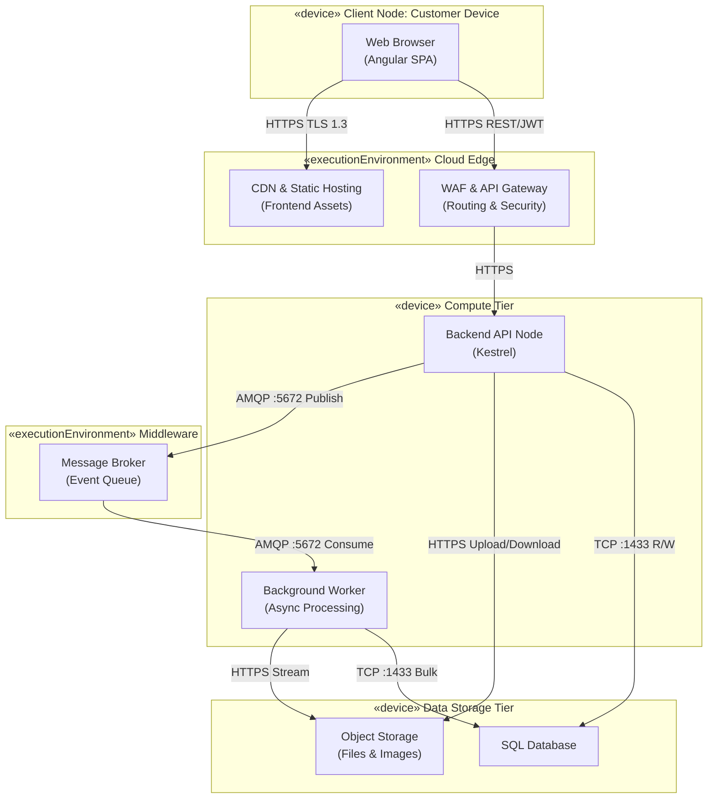
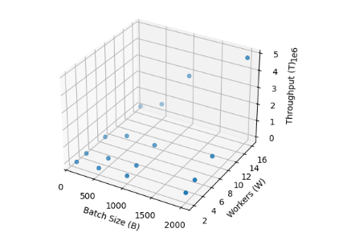

# Test Plan

## Table of Contents
1. [General Planning](#general-planning)  
2. [Feature development](#feature-development)
   1. [Overview of the Feature](#overview-of-the-feature)
   2. [Feature Objectives](#feature-objectives)
   3. [Functional Description](#functional-description)
   4. [Feature Workflow](#feature-workflow)
   5. [Validation and Business Rules](#validation-and-business-rules)
3. [Testing Tools and Technologies](#testing-tools-and-technologies)  
4. [Functional Test Planning](#functional-test-planning)  
   1. [Overview](#functional-tests-overview)  
   2. [Functional Test Cases](#functional-test-cases)  
   3. [Functional Test Coverage](#functional-test-coverage)  
5. [Non-Functional Test Planning (NFRs)](#non-functional-test-planning-nfrs)  
   1. [Overview](#non-functional-tests-overview)  
   2. [NFR Test Cases](#nfr-test-cases)  
   3. [NFR Test Coverage](#nfr-test-coverage)    

# General Planning

The tests described in this document aim to ensure the **quality, reliability, performance, and usability** of the Equiem system. The planning includes positive and negative scenarios, evaluating both functional behavior and non-functional attributes, as well as the real experience of end users.

The tests were defined considering the business requirements, the constraints of the academic project, and the feasibility of execution in a controlled environment.

# FEATURE DEVELOPMENT  
File Upload Feature — Frontend Implementation

---

# Overview of the Feature

The File Upload feature allows users to submit structured project files through the platform’s web interface. These files typically contain information related to buildings, floors, amenities, or other entities managed by the system.

The upload interface is implemented in the **presentation layer (frontend)** of the application and provides a user-friendly mechanism for selecting and submitting files. Once a file is uploaded, it is transmitted to the backend API, where it is stored and prepared for further processing.

This feature supports the system’s onboarding workflow by enabling clients to provide large datasets in bulk instead of manually configuring each entity within the platform.

---

# Feature Objectives

The main objectives of this feature are:

- Allow users to upload project files directly through the web interface.
- Provide an intuitive and accessible file submission interface.
- Validate file format and size before transmission.
- Ensure secure and reliable communication with the backend API.
- Support the platform’s data onboarding process through file-based submissions.

---

# Functional Description

The File Upload feature enables users to select a file from their local device and submit it to the system using a dedicated upload interface.

From the user's perspective, the process consists of selecting a valid file, confirming the upload action, and receiving feedback indicating whether the upload was successful.

On the technical side, the frontend captures the selected file through a file input component and sends it to the backend API using an HTTP request. The backend then handles storage and further processing of the file.

The frontend is responsible for managing the interaction with the user, validating the file before upload, and communicating with the backend API to initiate the submission process.

---

# Feature Workflow

The feature operates through the following interaction flow:

1. The user accesses the file upload interface in the web application.
2. The user selects a file from their local device.
3. The frontend validates the selected file based on predefined rules.
4. If validation succeeds, the frontend sends the file to the backend API using a POST request.
5. The backend receives the file and stores it in the system storage layer.
6. The system registers the submission and prepares the file for further processing.
7. The frontend receives a response from the API and informs the user about the upload result.

---

# Validation and Business Rules

The following validation rules apply to file uploads:

- Only authenticated users are allowed to upload files.
- Supported file formats include `.csv` and `.xlsx`.
- The maximum allowed file size is **100 MB**.
- The file must follow the expected data structure required by the system.
- The backend performs final validation to ensure data integrity and security.

These rules ensure that only valid and properly structured files are submitted to the system for processing.

# Testing Tools and Technologies

The following tools were selected to support the testing process:

- **Postman**: manual and automated testing of REST APIs  
- **Jest**: automated testing of business logic  
- **Google Chrome**: manual functional tests and usability testing  
- **k6 / Apache JMeter**: load and concurrency simulation  
- **Google Sheets**: recording results and feedback from usability tests  
- **Markdown (.md)**: versioned and structured documentation of the test plan  

These tools were chosen due to their wide adoption in the industry, ease of use, and suitability for the academic context of the project.

# Functional Test Planning

## Functional Tests Overview

Functional tests aim to validate whether all functionalities of the Equiem system correctly meet the defined **Functional Requirements (FRs)**. The focus is on the complete onboarding workflow, from the initial upload to the final consolidation and external integration.

The planning includes both main flows and exception scenarios, ensuring that the system responds correctly to invalid inputs, operational errors, and unexpected interruptions.

## Functional Test Cases

### FR01 – Structured Onboarding Data Upload

**Objective:** Validate that authenticated users can upload CSV/XLSX files.

**Precondition:** User is authenticated in the system.

**Procedure**

1. Access the system with valid credentials  
2. Navigate to the onboarding screen  
3. Select the upload option  
4. Upload a CSV or XLSX file  
5. Confirm submission and wait for the system response  

**Positive Scenario**

- Upload of a valid file  

**Negative Scenario**

- Upload attempt without authentication or with an invalid format  

**Expected Result**

- Upload accepted or error handled correctly  

**Post-condition**

- File stored in the staging layer  

### FR02 – Data Standardization

**Objective:** Ensure that uploaded data is converted to the internal standardized model.

**Precondition:** File successfully uploaded.

**Procedure**

1. Trigger the standardization process  
2. Monitor logs and interface feedback  

**Positive Scenario**

- Data compatible with the schema  

**Negative Scenario**

- Missing or incompatible fields  

**Expected Result**

- Data standardized or error reported  

**Post-condition**

- Data ready for validation  

### FR03 – Intermediate Data Persistence

**Objective:** Verify the secure persistence of standardized data.

**Procedure**

- Save data in the intermediate storage layer  

**Expected Result**

- Data persisted without overwriting previous versions  

### FR04 – Data Validation and Conflict Detection

**Objective:** Identify errors, duplicates, and conflicts in the data.

**Procedure**

1. Execute the validation routine  
2. Analyze the generated report  

**Positive Scenario**

- Valid data approved  

**Negative Scenario**

- Invalid data generates alerts  

**Expected Result**

- Detailed error report generated  

### FR05 – Safe Data Correction via Re-Submission

**Objective:** Validate safe replacement of corrected data.

**Procedure**

1. Fix errors in the original file  
2. Resubmit a new version  
3. Confirm safe replacement  

**Expected Result**

- Previous data replaced correctly  

### FR06 – Change Comparison Visualization

**Objective:** Verify comparison between submitted versions.

**Expected Result**

- Differences highlighted correctly  

### FR07 – Automatic Progress Persistence

**Objective:** Ensure automatic progress saving.

**Procedure**

1. Close the system  
2. Reopen it later  

**Expected Result**

- Progress restored  

### FR08 – Dynamic Onboarding Interface

**Objective:** Validate dynamic display of sections according to active modules.

**Expected Result**

- Only relevant sections displayed  

### FR09 – Section Dependency Enforcement

**Objective:** Ensure dependent sections are properly blocked.

**Expected Result**

- Access blocked when prerequisites are not completed  

### FR10 – Collaborative Section Assignment

**Objective:** Validate assignment of sections to multiple collaborators.

**Expected Result**

- Parallel work enabled  

### FR11 – Onboarding Status and Feedback

**Objective:** Verify onboarding status tracking.

**Expected Result**

- Status correctly updated  

### FR12 – Data Consolidation and Secure Integration

**Objective:** Validate final data consolidation and external system integration.

**Procedure**

1. Complete all mandatory sections  
2. Generate consolidated data package  
3. Send it to the external system  
4. Confirm successful integration  

# Functional Test Coverage

The following analysis demonstrates **how the planned functional tests cover the system requirements**:

| FR | Coverage | How Coverage Ensures Requirement is Met |
|----|----------|----------------------------------------|
| FR01 | ✅ Full | Tests both positive (valid upload) and negative (invalid file or no authentication), ensuring only authorized users can upload files. |
| FR02 | ✅ Full | Validates standardization process, handling compatible and incompatible data to maintain schema integrity. |
| FR03 | ✅ Full | Confirms persistence layer saves standardized data securely without overwriting existing records. |
| FR04 | ✅ Full | Verifies detection of errors, duplicates, and conflicts; ensures only valid data progresses. |
| FR05 | ✅ Full | Tests safe replacement of corrected data, preventing loss of previous versions. |
| FR06 | ✅ Full | Validates visual comparison, highlighting differences to support user review. |
| FR07 | ✅ Full | Ensures automatic progress saving works, maintaining session continuity. |
| FR08 | ✅ Full | Checks dynamic interface adapts to active modules, preventing irrelevant section display. |
| FR09 | ✅ Full | Confirms section dependencies are enforced, guaranteeing process correctness. |
| FR10 | ✅ Full | Validates multi-user collaboration on sections, supporting parallel work. |
| FR11 | ✅ Full | Ensures onboarding status is updated correctly, providing accurate feedback to users. |
| FR12 | ✅ Full | Confirms final data consolidation and integration with external systems succeed, guaranteeing end-to-end process reliability. |

> **Discussion:** All FRs are covered with clear positive and negative scenarios. The coverage ensures that every critical system function is tested, confirming both correctness and robustness. Each test scenario directly maps to its corresponding FR and reflects real-world usage, providing confidence that the system meets business and project requirements.

# Non-Functional Test Planning

## Non-Functional Tests Overview

Non-functional requirement (NFR) tests evaluate essential quality attributes for the success of the **Equiem** system, ensuring that the onboarding process operates with robustness, stability, adequate performance, and architectural evolution capability.

Unlike functional tests, NFR tests validate **how the system behaves** under conditions such as high load, failures, and future scalability scenarios.

The objective of these tests is to ensure that the system maintains **data integrity, performance, reliability, and extensibility**, even in adverse or high-demand situations.

The tests defined below ensure compliance with **NFR01 to NFR05**.

## NFR Test Cases

### CT-NF01 – Data Integrity and Compliance

**Non-Functional Requirement:** NFR01 – Data Integrity Compliance  

#### Objective

Ensure that only data fully compliant with the internal schema can be validated, consolidated, and exported by the system.

#### Test Scenarios

**Positive Scenario**
- Upload a dataset that fully follows the required schema and contains valid values.

**Negative Scenario**
- Upload a dataset containing missing mandatory fields, invalid data types, or inconsistent values.

#### Execution Steps

1. Access the onboarding interface.
2. Upload a dataset that follows the correct schema.
3. Run the validation process.
4. Verify that the system accepts the dataset and allows export.

Negative test:

5. Upload a dataset with missing or incorrect fields.
6. Run the validation process.
7. Verify that the system blocks the export and reports validation errors.

#### Expected Result

- Valid datasets are accepted and exported successfully.
- Invalid records are blocked.
- Export is prevented when inconsistencies exist.
- A detailed error report is generated for incorrect records.

### CT-NF02 – Large File Handling and Responsiveness

**Non-Functional Requirement:** NFR02 – Large File Handling and Responsiveness  

#### Objective

Validate that the system supports uploads of files up to **100MB** while maintaining interface responsiveness and system stability.

#### Test Scenarios

**Positive Scenario**

- Upload a file close to the maximum allowed size (e.g., 95–100MB).

**Negative Scenario**

- Attempt to upload a file larger than the maximum limit.

#### Execution Steps

1. Prepare a test dataset with approximately 100MB.
2. Upload the dataset using the onboarding interface.
3. Monitor system responsiveness during upload and processing.
4. Verify that processing completes successfully.

Negative test:

5. Attempt to upload a dataset larger than the allowed limit.
6. Verify that the system rejects the file and displays an appropriate message.

#### Expected Result

- Files within the allowed limit are processed successfully.
- The interface remains responsive during upload and processing.
- The application does not crash or freeze.
- Files exceeding the limit are rejected with a clear error message.

### CT-NF03 – Processing Reliability

**Non-Functional Requirement:** NFR03 – Processing Reliability  

#### Objective

Ensure that failures during data processing do not cause data corruption or partial persistence.

#### Test Scenarios

**Positive Scenario**

- Execute the normal validation and processing flow without interruptions.

**Negative Scenario**

- Simulate an interruption during processing (e.g., network failure or server restart).

#### Execution Steps

1. Upload a valid dataset.
2. Start the processing pipeline.
3. Confirm that the data is processed successfully.

Negative test:

4. Start processing a dataset.
5. Simulate a system interruption (e.g., stop the service or disconnect the network).
6. Restart the system.
7. Verify that no partial or corrupted data was stored.

#### Expected Result

- Successful processing results in consistent stored data.
- Interrupted processes do not corrupt stored data.
- The system maintains data consistency after recovery.

### CT-NF04 – File Format Extensibility

**Non-Functional Requirement:** NFR04 – Extensible File Format Support  

#### Objective

Validate that new file formats can be added without requiring changes to the core system logic.

#### Test Scenarios

**Positive Scenario**

- Add support for a new format using the system's extensible structure.

**Negative Scenario**

- Attempt to process an unsupported format.

#### Execution Steps

1. Implement support for an additional test format (e.g., JSON or XML).
2. Upload a file using the new format.
3. Execute the validation process.

Negative test:

4. Upload a file with an unsupported format.
5. Attempt to process it.

#### Expected Result

- Newly supported formats are processed successfully without modifying the core logic.
- Unsupported formats are rejected with an informative error message.

### CT-NF05 – Concurrent Submission Support

**Non-Functional Requirement:** NFR05 – Concurrent Submission Handling  

#### Objective

Ensure the system safely handles multiple simultaneous data submissions.

#### Test Scenarios

**Positive Scenario**

- Multiple users upload datasets simultaneously.

**Negative Scenario**

- Simultaneous submissions under high load conditions.

#### Execution Steps

1. Simulate multiple users (e.g., 5–10) uploading datasets at the same time.
2. Monitor system behavior during concurrent processing.
3. Verify that each dataset is processed independently.

Negative test:

4. Increase the number of concurrent submissions to stress the system.
5. Observe potential failures or delays.

#### Expected Result

- The system processes submissions without data conflicts.
- Each upload is handled independently.
- No data loss or corruption occurs under concurrent load.

## NFR Test Coverage

The defined tests ensure coverage of the most critical non-functional aspects of the system:

**Data Integrity**

CT-NF01 guarantees that only valid and consistent data can be processed and exported.

**Performance and Responsiveness**

CT-NF02 verifies that the system maintains stability and responsiveness even when handling large files.

**Reliability**

CT-NF03 ensures that the system maintains data consistency even in the presence of failures or interruptions.

**Extensibility**

CT-NF04 validates that the system architecture supports future file formats without requiring structural modifications.

**Scalability and Concurrency**

CT-NF05 ensures that the system can support multiple users and concurrent submissions safely.

> **Discussion:** All NFRs cover critical non-functional aspects, ensuring that the system is robust, stable, extensible, and reliable in real-world onboarding scenarios.
---

# Unit tests

This document presents the strategy, execution, and results of the unit tests conducted in the project according to the Sprint 3 requirements. The focus of this stage was to ensure the integrity of backend functionalities (Node.js + TypeScript) and preparation for the frontend (Angular + TypeScript), aligning the tests with the defined Functional Requirements (FR) and Non-Functional Requirements (NFR).

## 1. Unit Testing Strategy
The adopted unit testing strategy aims to ensure the reliability, correctness, and maintainability of the code by validating the behavior of each component in isolation.

### Guiding Principles
- Total Isolation: Extensive use of mocks for all external dependencies such as databases, APIs, and third-party services (Auth0).
- Critical Path Coverage: Initial focus on the business rules related to file upload and processing.
- Determinism: Ensuring that tests produce the same results in any development environment.
- Automation: Full integration with the development cycle using Jest.

## 2. Test Scope
Tests were implemented covering the main layers of the system architecture.

### Backend (Node.js + TypeScript)
- Services (UploadService): Validation of business rules, file size limits, and allowed extensions.
- Controllers (UploadController): Handling HTTP requests and response codes (200, 400, 500).
- Middleware (UploadMiddleware): Spreadsheet processing logic (ExcelJS) and validation of required fields.
- Models (UploadModel): Data persistence integrity and database queries (mocked).

### Frontend (Angular + TypeScript)
- Services and Components: Base test structure prepared using Jasmine and Karma, focusing on dependency injection and component creation.

## 3. Tools and Technologies
| Layer | Tool | Description |
|---|---|---|
| Backend | Jest | Main framework for tests and assertions |
| Backend | ts-jest | Allows tests to run directly in TypeScript |
| Backend | ExcelJS Mocks | Simulation of Excel file processing |
| Frontend | Jasmine | Behavior-driven framework for Angular tests |
| Frontend | Karma | Test runner for browsers |

## 4. Test Directory Structure
The organization follows a modular pattern to facilitate test script location and maintenance.

```text
tests/
├── backend/
│   ├── UploadController.test.ts
│   ├── UploadMiddleware.test.ts
│   ├── UploadModel.test.ts
│   └── UploadService.test.ts
└── frontend/
  └── app.component.spec.ts
``` 

## 5. Implemented Test Cases and Results

The table below details the validated scenarios, relating **Test Case IDs (CT)** with their respective **Functional Requirements (FR)** and **Non-Functional Requirements (NFR)**.

| ID    | Module           | Tested Scenario                                   | Related Requirement        | Result |
|------|------------------|---------------------------------------------------|----------------------------|--------|
| CT-01 | UploadService     | Accept valid CSV file                             | FR01 (Data Upload)         | PASS   |
| CT-02 | UploadService     | Accept valid XLSX file                            | FR01 (Data Upload)         | PASS   |
| CT-03 | UploadService     | Reject invalid format (.pdf)                      | NFR04 (Extensible Formats) | PASS   |
| CT-04 | UploadService     | Reject zero-size file                             | NFR03 (Reliability)        | PASS   |
| CT-05 | UploadService     | Reject when no file is sent                       | FR04 (Data Validation)     | PASS   |
| CT-16 | UploadController  | Return data in getAll method                      | FR11 (Status and Feedback) | PASS   |
| CT-17 | UploadController  | Create upload through controller                  | FR01 (Data Upload)         | PASS   |
| CT-20 | UploadController  | Handle database error                             | NFR03 (Reliability)        | PASS   |
| CT-21 | UploadModel       | Data persistence in database query                | FR03 (Data Persistence)    | PASS   |
| CT-22 | UploadModel       | Retrieve list of uploads                          | FR11 (Status and Feedback) | PASS   |
| CT-23 | UploadMiddleware  | Error when file is missing                        | FR04 (Data Validation)     | PASS   |
| CT-24 | UploadMiddleware  | Error in required fields (customer_id)            | FR04 (Data Validation)     | PASS   |
| CT-25 | UploadMiddleware  | Failure during Excel spreadsheet parsing          | NFR03 (Reliability)        | PASS   |
| CT-26 | UploadMiddleware  | Processing and next() call                        | FR02 (Standardization)     | PASS   |


## 6. Test Coverage (Code Coverage)

Below are the consolidated code coverage results obtained using `jest --coverage`.

### Backend Summary

| Metric     | Percentage |
|------------|-----------|
| Statements | 86.66%    |
| Branches   | 81.25%    |
| Functions  | 72.72%    |
| Lines      | 86.66%    |


### File-Level Coverage Details

| File                   | Lines Coverage | Uncovered Lines        |
|------------------------|---------------|------------------------|
| UploadController.ts     | 91.66%        | 19                     |
| UploadMiddleware.ts     | 75.67%        | 13-18, 29-37, 47      |
| UploadModel.ts          | 100%          | -                      |
| UploadService.ts        | 100%          | -                      |
| db.ts                   | 100%          | -                      |

## 7. Execution Evidence
The tests were successfully executed in the terminal. Below is the summary of the latest execution.

Command: npm run test:coverage

Test Suites: 4 passed, 4 total

Tests: 14 passed, 14 total

Snapshots: 0 total

Time: 5.631 s

Note: The execution was validated in the local environments of all group members, ensuring

development environment parity and compliance with NFR02 (Responsiveness).

## 8. CI/CD Integration
Tests can be automatically executed in CI pipelines using the command:
npm run test:coverage
This ensures that new code changes do not break existing functionalities.

## 9. Conclusion
The Sprint 3 unit tests cover the critical functionalities of file upload and data persistence, ensuring compliance with the requirements of Data Integrity (NFR01) and Standardization (FR02). The backend coverage of 86.66% of lines ensures that the core business logic is protected against regressions, facilitating future expansion to support additional file formats (NFR04).


-----


# Functional Requirements Implementation Analysis

This section presents an analysis of the current implementation status of the twelve Functional Requirements of the system, considering exclusively the elements that exist in the source code repository. For each functional requirement, the document indicates whether the implementation can be considered validated based on repository evidence, how it is currently implemented, and which components still need to be developed to fully satisfy the specification.

## Summary of Functional Requirements Status

| FR | Title | Validated | Evidence in the Repository |
|----|-------|-----------|----------------------------|
| FR01 | Structured Onboarding Data Upload | Yes | Backend supports CSV and XLSX upload through POST `/upload` route with persistence. Frontend provides upload interface with file selection, progress indicator, and 100 MB limit. |
| FR02 | Data Standardization | Yes, partial implementation | File `UploadMiddleware.ts` contains the `parseSpreadsheet()` function that converts CSV or XLSX files into a row based data structure. |
| FR03 | Intermediate Data Persistence | Yes | Table `SUBMISSION` and method `UploadModel.create()` insert new records without overwriting previous submissions. |
| FR04 | Data Validation and Conflict Detection | Yes, partial implementation | Validation of file format, presence of file, mandatory fields `customer_id` and `status`, and empty file verification. |
| FR05 | Safe Data Correction via Re Submission | Yes, partial implementation | A new submission creates a new record in the database while preserving previous versions. |
| FR06 | Change Comparison Visualization | No | No API or interface for comparing submission versions exists in the repository. |
| FR07 | Automatic Progress Persistence | No | No mechanism exists to persist onboarding progress or session state. |
| FR08 | Dynamic Onboarding Interface | No | Field `modules_enabled` exists in the CUSTOMER table but is not used in the application logic. |
| FR09 | Section Dependency Enforcement | No | No model of sections or dependency rules exists in the repository. |
| FR10 | Collaborative Section Assignment | No | No mechanism exists for assigning sections to collaborators. |
| FR11 | Onboarding Status and Feedback | Yes | Field `status` stored in the SUBMISSION table is accepted in requests and returned by the API. |
| FR12 | Data Consolidation and Secure Integration | No | No routines for data consolidation or external system integration exist in the repository. |

Based on the evidence available in the source code, six functional requirements have some level of implementation: FR01, FR02, FR03, FR04, FR05, and FR11.


# Existing Implementations in the Repository

## FR01 Structured Onboarding Data Upload

The repository contains a basic implementation of the onboarding file upload mechanism.

In the backend located in `src/backend`, the middleware `UploadMiddleware.ts` configures Multer to handle file uploads. This middleware accepts CSV and Excel files through a MIME type filter. Uploaded files are stored in the `uploads` directory with a unique name generated from a timestamp and a random value.

The same file contains the function `parseSpreadsheet(filePath)`, which uses the ExcelJS library to read CSV or XLSX files. The method iterates through rows of the first worksheet and transforms the content into a structured array representing rows and columns. The result is attached to the request object as `parsedData`.

The service `UploadService.ts` validates the existence of the file, verifies the allowed MIME type, and prevents processing of empty files. The service then calls `UploadModel.create` to register the submission in the database.

The controller `UploadController.ts` exposes the endpoint responsible for handling file uploads. The POST `/upload` route is defined in `routes/index.ts` and applies the upload and processing middleware before executing the `create` method.

In the frontend located in `src/frontend/src/app/upload`, a component provides the file upload interface. The component allows users to select a file, simulates a progress indicator, and displays a success message when the process finishes. The interface also indicates a maximum file size of one hundred megabytes.

Despite these features, the frontend still does not send the file to the backend through real HTTP requests.

Remaining elements to be implemented include mandatory authentication for upload routes, actual file submission from the frontend, and support for multiple files with real progress tracking.


## FR02 Data Standardization

Initial data standardization occurs within the middleware `UploadMiddleware.ts`.

The function `parseSpreadsheet` converts the submitted file content into a uniform row and column data structure. The function uses a Workbook object from the ExcelJS library, reads the first worksheet, and iterates through each row using the `eachRow` method. The content of each row is stored in an array representing column values.

This approach ensures that data originating from CSV or XLSX files is converted into a common internal structure before any subsequent processing stage.

However, the system still lacks mapping from this structure into internal domain models. A canonical schema defining field names, types, and normalization rules has not yet been implemented. The file `ExtractionService.ts` exists in the repository but currently has no implementation.


## FR03 Intermediate Data Persistence

The system implements an intermediate persistence layer through the `SUBMISSION` table defined in the script `01_create_database.sql`.

This table contains the fields `id`, `customer_id`, `status`, `file_path`, and `upload_date`. The `id` field is auto incremental and the `upload_date` automatically records the submission timestamp.

The model `UploadModel.ts` implements the `create` method responsible for inserting new records into the table using an SQL insert statement. Since no update mechanism exists that replaces previous records, each submission generates an independent new record.

This approach ensures that previous versions of submitted data remain preserved in the database, representing an intermediate persistence layer prior to any final consolidation process.

Nevertheless, the system still lacks an explicit distinction between staging data and consolidated data. There is also no formal versioning mechanism that groups submissions belonging to the same dataset.


## FR04 Data Validation and Conflict Detection

Some basic validations are executed during the submission process.

The middleware `UploadMiddleware.ts` verifies whether a file is included in the request and checks whether the fields `customer_id` and `status` are present. If any of these values are missing, the request is rejected with an appropriate error code.

The same middleware applies a file filter to ensure that only CSV or Excel files are accepted.

The service `UploadService.ts` performs additional checks. It confirms that the file exists, validates the MIME type against an allowed list, and ensures that the file size is greater than zero.

Although these validations guarantee basic request correctness, the system does not yet implement structural validation of the submitted data. There is no verification of mandatory spreadsheet fields, no validation of data types, and no detection of duplicates or conflicting records.


## FR05 Safe Data Correction via Re Submission

Data correction through file resubmission is implicitly supported by the creation of new records in the submissions table.

Whenever a new upload is performed, the method `UploadModel.create` inserts a new record into the database. Each submission therefore receives a unique identifier.

This strategy preserves all previous versions of submitted data and allows a user to correct information by uploading a new file without overwriting earlier records.

However, the system currently lacks mechanisms that automatically determine which records should be replaced when a correction occurs. It also lacks natural identifiers that would enable selective updates of specific logical datasets.


## FR11 Onboarding Status and Feedback

The system already implements a basic mechanism to store and retrieve the status of a submission.

The `SUBMISSION` table includes a `status` column with a default value of `pending`. This column allows the system to record the current state of each submission.

The interface `IUpload`, defined in `global.interfaces.ts`, includes the `status` property to ensure the attribute exists within the backend data structure.

The controller `UploadController.ts` receives the `status` value from the request body and forwards it to the service responsible for processing the submission. The model `UploadModel.ts` persists this value in the database during record insertion.

In addition, the endpoint that retrieves all submissions returns the `status` field as part of the API response, enabling clients to check the current state of each upload.

However, a formal set of processing states and transitions between them has not yet been defined. The system also lacks a detailed progress tracking interface and user notifications once processing is completed.


# Functionalities Not Yet Implemented

Functional requirements FR06, FR07, FR08, FR09, FR10, and FR12 do not currently have implementations in the repository.

These functionalities include mechanisms for comparing different versions of submitted data, automatic persistence of onboarding progress, dynamic interfaces based on active modules, dependency control between onboarding sections, collaborative assignment of tasks among contributors, and secure consolidation of data for integration with external systems.

The absence of these components indicates that the system is still in an early implementation phase, focusing primarily on the basic infrastructure for uploading and storing onboarding submissions.

--- 

# Coding Architecture

## Architecture Model

The system follows a **Layered Architecture based on the MVC pattern (Model–View–Controller)**, separating responsibilities between data handling, business logic, and user interface.

The backend is implemented using **Node.js with TypeScript**, while the frontend is built using **Angular**.

This architecture improves **maintainability, scalability, and separation of concerns**, allowing each layer of the system to evolve independently.


## Backend Architecture

The backend is organized into multiple layers, each with a specific responsibility.

### Controllers
Controllers are responsible for **handling HTTP requests and responses**.

They:
- Receive requests from the client
- Validate and extract request data
- Call the appropriate service
- Return the response to the client

Controllers do **not contain business logic**, keeping them lightweight.


### Services
Services implement the **core business logic of the application**.

They:
- Process application rules
- Coordinate data operations
- Interact with models and repositories

This layer ensures that business logic is **centralized and reusable**.


### Models
Models represent the **data structures of the system**.

They define:
- The structure of entities
- Data attributes
- Database interaction logic

Models are used by services to **read and write data**.


### Routes
Routes define the **API endpoints exposed by the backend**.

They:
- Map HTTP methods (GET, POST, PUT, DELETE)
- Connect endpoints to controllers
- Organize the API structure


### Middleware
Middleware functions run **before the request reaches the controller**.

They are used for:
- Authentication
- Request validation
- Logging
- Error handling


### Interfaces
Interfaces define **TypeScript contracts and types** used across the system.

They help enforce:
- Type safety
- Consistency between layers
- Better code maintainability


## Frontend Architecture (Angular)

The frontend follows the **Angular modular architecture**, which organizes the application into reusable and maintainable units.

### Components
Components are responsible for the **user interface and interaction logic**.

Each component:
- Displays UI elements
- Handles user events
- Communicates with services


### Services
Angular services handle **communication with the backend API and shared logic**.

They:
- Perform HTTP requests
- Process API responses
- Share data between components


### Modules
Modules organize the application into **logical functional blocks**, improving scalability and maintainability.

They help structure:
- Components
- Services
- Routing


## Architecture Diagram

            +----------------------+
            |      Frontend        |
            |       (Angular)      |
            |                      |
            |   Components        |
            |   Services          |
            |   Modules           |
            +----------+-----------+
                       |
                       | HTTP Requests
                       v
            +----------------------+
            |       Backend        |
            |   (Node.js + TS)     |
            |                      |
            |      Routes          |
            |        |             |
            |     Controllers      |
            |        |             |
            |      Services        |
            |        |             |
            |       Models         |
            |                      |
            |     Middleware       |
            +----------------------+
                       |
                       v
                +-------------+
                |  Database   |
                +-------------+

---

# Directory Structure

The project is organized into **backend and frontend layers**, each containing its own internal structure.

```
project-root
│
├── assets
│
├── docs
│
├── src
│ │
│ ├── backend
│ │ ├── controllers
│ │ ├── interfaces
│ │ ├── middleware
│ │ ├── models
│ │ ├── routes
│ │ └── services
│ │
│ ├── database
│ │
│ ├── frontend
│ │ ├── public
│ │ └── src
│ │ └── app
│ │
│ └── tests
│
├── package.json
├── tsconfig.json
├── README.md
└── .gitignore
```


## Backend Folders

| Folder | Description |
|------|------|
| controllers | Handles HTTP requests and responses |
| services | Contains business logic |
| models | Defines system data structures |
| routes | Defines API endpoints |
| middleware | Handles authentication, validation, and request processing |
| interfaces | TypeScript interfaces and type definitions |


## Frontend Folders

| Folder | Description |
|------|------|
| public | Static frontend resources |
| src/app | Angular application source code |

---
# Technical Infrastructure and Deploy Mapping

### UML Deployment Diagram

**Purpose (per [Visual Paradigm](https://www.visual-paradigm.com/guide/uml-unified-modeling-language/what-is-deployment-diagram/) and [Creately](https://creately.com/guides/deployment-diagram-examples/)).** A deployment diagram shows the *runtime* topology: which hardware or execution environments host which software, and how they communicate. It bridges design and implementation and supports planning for scalability, reliability, and security. Use it to answer: what systems will this integrate with? Who connects and how? What middleware and protocols are used? How will the system be monitored?

The following diagram illustrates the physical and logical distribution of the system across cloud infrastructure, using a decoupled, highly available architecture for asynchronous file processing and data integrity. Nodes are grouped by tier; stereotypes `«device»` and `«executionEnvironment»` distinguish node types; connections show communication paths with protocol and port.



*Diagram 1 — Deployment diagram showing the distribution of the infrastructure: the client accesses the edge layer (CDN/WAF), which routes requests to the API. Asynchronous processing is handled by workers through a message broker, with persistence in a relational database and object storage.*

---
## Infrastructure Elements and Component Specification

The architecture follows a layered view aligned with DDD: deployment distributes these layers across specialised cloud *nodes* (client/edge, compute, *middleware*, storage) to guarantee operational scalability. The tables below detail each element in *Diagram 1*.

### Client and Edge Infrastructure

| Component | Type | Responsibility | Protocol / Port |
|-----------|------|----------------|-----------------|
| Web Browser | Client Device | Executes the React-based Single Page Application (SPA). | — |
| CDN & Static Hosting | Network Device | Hosts frontend static assets (`/public`, compiled JS/CSS); low-latency delivery. | HTTPS (TLS 1.3), TCP 443 |
| API Gateway & WAF | Execution Environment | Single entry point for backend; SSL termination, rate limiting, OWASP protection. | HTTPS (TLS 1.3), TCP 443 |

### Compute Infrastructure

| Component | Type | Responsibility | Protocol / Port |
|-----------|------|----------------|-----------------|
| Backend API Node | Server | HTTP REST API (TypeScript/Kestrel). Synchronous requests, JWT auth, upload orchestration. | HTTPS (to WAF, Blob), AMQP (to Queue), TDS (to DB); 443, 5672, 1433 |
| Background Worker Node | Server | Async parsing, validation, and standardization of CSV/XLSX. Decoupled from API to keep UI responsive. | AMQP (Queue), HTTPS (Blob), TDS (DB); 5672, 443, 1433 |

### Middleware Infrastructure

| Component | Type | Responsibility | Protocol / Port |
|-----------|------|----------------|-----------------|
| Message Broker | Execution Environment | HA queue (e.g. RabbitMQ). Receives submission events from API; delivers to Worker. | AMQP, TCP 5672 |

### Data Storage Infrastructure

| Component | Type | Responsibility | Protocol / Port |
|-----------|------|----------------|-----------------|
| Relational Database Server | Database | SQL schema (migrations). Domain: Buildings, Floors, Amenities, Submissions. | TDS, TCP 1433 |
| Object Storage Node | Storage | Blob storage for raw `.csv`/`.xlsx` and building/amenity images. | HTTPS, TCP 443 |

---

## 20.3. Justification for Deployment Choices

The decision to adopt a distributed, queue-based architecture directly addresses the core business bottleneck: the inability to concurrently process large volumes of data without manual intervention.

**Decoupling Compute from Processing.** By separating the `Backend API Node` from the `Background Worker Node`, the system ensures that long-running tasks — such as standardizing a 100 MB spreadsheet — do not consume API threads. This prevents timeout errors and guarantees that the client interface remains fast and responsive.

**Stateless API Design.** The application servers are designed to be stateless, storing sessions via JWT and persisting files directly to Object Storage. This allows the infrastructure to scale horizontally by adding more servers seamlessly during peak onboarding periods.

**Dedicated Object Storage.** Storing physical files in a Blob Storage node rather than in the relational database prevents database bloat, reduces backup costs, and allows async workers to stream file data directly into memory for processing.

---

## 20.4. Considerations Regarding Performance and Security

### Performance

**Load Leveling.** The Message Broker acts as a shock absorber. If 50 clients submit large onboarding files simultaneously, the API accepts the files instantly, offloads them to Object Storage, and queues the processing events. The workers consume these events at a controlled rate, preventing CPU or memory exhaustion.

**Latency Mitigation.** Serving the React frontend via a CDN ensures that static assets are cached geographically close to the users (office managers globally), reducing initial load times.

### Security

**Data Protection in Transit and at Rest.** All external communication is forced over HTTPS (TLS 1.3). Sensitive data stored in the Relational Database and Object Storage is encrypted at rest using AES-256.

**Access Control.** The API Gateway intercepts requests to validate JSON Web Tokens (JWT) before traffic reaches the internal subnets. The database and storage nodes are placed in private subnets, completely isolated from the public internet, accessible only by the Backend and Worker nodes.

### Monitoring

Per deployment diagram best practice ([Visual Paradigm](https://www.visual-paradigm.com/guide/uml-unified-modeling-language/what-is-deployment-diagram/): *“How will you monitor the system once deployed?”* The WAF is configured with CloudWatch metrics (`visibility_config` in Terraform). The pipeline and compute nodes (ECS) integrate with monitoring for service health, API latency, queue depth, and DB/storage usage, so the runtime topology in *Diagram 1* can be observed and alerted on.

---

## 20.5. Deployment Planning Checklist

Based on the [Deployment Planning Checklist](https://www.visual-paradigm.com/guide/uml-unified-modeling-language/what-is-deployment-diagram/) (Visual Paradigm), the project addresses:

| Area | Addressed by |
|------|----------------|
| **Installation** | Terraform provisions all nodes in *Diagram 1*; CI/CD deploys artifacts. Installer is automation; success is validated by tests and health checks. |
| **Rollback** | Version-controlled infrastructure and code; rollback via pipeline revert or Terraform state. |
| **Different versions in production** | GitFlow and environments (Dev, Staging, Prod); parity via same Terraform and container images. |
| **Physical sites / order of deploy** | Single region in the example (e.g. `us-east-1`); multi-site would extend Terraform modules. |
| **Training and documentation** | Docs in `/docs`; deployment and topology described in this document and *Diagram 1*. |

---

## Integration with Non-Functional Requirements (NFRs)

Infrastructure choices are driven by the project's non-functional requirements, as defined in **Project-step1.md** (section 17. Non-Functional Requirements). The table below maps each NFR to the architectural decision and to the *nodes* in *Diagram 1*.

| NFR | Description | Architectural impact (*Diagram 1*) |
|-----|-------------|-------------------------------------|
| **NFR01** | Data Integrity Compliance | **Data Storage (DB):** cascading rules and referential integrity. **Compute (API):** DDD validations before persisting. |
| **NFR02** | Large File Handling and Responsiveness | **Data Storage (Object Storage):** direct upload. **Middleware + Compute (Broker → Worker):** async processing; UI remains responsive up to ~100 MB. |
| **NFR03** | Processing Reliability | **Middleware (Message Broker):** guaranteed delivery; message re-queued or sent to DLQ on Worker failure; zero data loss. |
| **NFR04** | Extensible File Format Support | **Compute (Worker Node):** independent service; adding a new parser (e.g. PDF) only requires updating the Worker, without affecting the API. |
| **NFR05** | Concurrent Submission Handling | **Compute (API + Worker):** stateless + queue; elastic horizontal scaling; orchestrator can add Workers to drain the queue during spikes. |

---

## 20.6. Infrastructure Provisioning and DevOps Lifecycle

To guarantee reproducibility, scalability, and security across all environments (Development, Staging, and Production), the deployment strategy incorporates modern DevOps practices, moving away from manual cloud console configurations. This automation directly satisfies **NFR03 (Processing Reliability)** and **NFR05 (Concurrent Submission Handling)**. The provisioned resources implement the topology in *Diagram 1* (Edge, Compute, Middleware, Data Storage) and address the *installation* and *reproducibility* aspects of the [Deployment Planning Checklist](https://www.visual-paradigm.com/guide/uml-unified-modeling-language/what-is-deployment-diagram/) (Visual Paradigm): who installs, how long it takes, and how to avoid configuration drift.

### 20.6.1. Infrastructure as Code (Terraform)

All cloud resources represented in the deployment diagram (*Diagram 1*) are provisioned declaratively using **Terraform (HCL)**. This eliminates configuration drift and ensures strict environment parity. The HCL blocks below map to the diagram’s tiers: Edge & Frontend (CDN, WAF), Compute (ECS API and Worker), Middleware (Message Broker), and Storage (RDS, S3).

```hcl
# infra/main.tf
provider "aws" { region = "us-east-1" }

# Edge & Frontend (CDN & S3)
resource "aws_s3_bucket" "frontend_app" {
  bucket = "equiem-onboarding-frontend-prod"
}

resource "aws_cloudfront_distribution" "frontend_cdn" {
  origin {
    domain_name = aws_s3_bucket.frontend_app.bucket_regional_domain_name
    origin_id   = "S3-EquiemFrontend"
  }
  enabled    = true
  web_acl_id = aws_wafv2_web_acl.api_gateway_waf.arn
  viewer_certificate { cloudfront_default_certificate = true }
}

# Edge Security (WAF)
resource "aws_wafv2_web_acl" "api_gateway_waf" {
  name  = "equiem-waf-prod"
  scope = "CLOUDFRONT"
  default_action { allow {} }
  visibility_config {
    cloudwatch_metrics_enabled = true
    metric_name                = "EquiemWaf"
    sampled_requests_enabled   = true
  }
}

# Compute Tier (ECS Cluster for API and Worker)
resource "aws_ecs_cluster" "app_cluster" {
  name = "equiem-compute-cluster"
}

resource "aws_ecs_service" "backend_api" {
  name          = "equiem-api-node"
  cluster       = aws_ecs_cluster.app_cluster.id
  desired_count = 2
}

resource "aws_ecs_service" "background_worker" {
  name          = "equiem-worker-node"
  cluster       = aws_ecs_cluster.app_cluster.id
  desired_count = 2
}

# Middleware Tier (Message Broker)
resource "aws_mq_broker" "event_queue" {
  broker_name        = "equiem-message-broker"
  engine_type        = "RabbitMQ"
  engine_version     = "3.11.20"
  host_instance_type = "mq.m5.large"
  user {
    username = "admin"
    password = "SecurePassword123!"
  }
}

# Storage Tier (Database & Blob)
resource "aws_db_instance" "sql_database" {
  allocated_storage   = 100
  engine              = "sqlserver-ex"
  instance_class      = "db.t3.large"
  publicly_accessible = false
}

resource "aws_s3_bucket" "object_storage" {
  bucket = "equiem-onboarding-files-storage"
}
```

---

### CI/CD Pipeline (GitHub Actions)

The deployment lifecycle is automated through a Continuous Integration and Continuous Deployment (CI/CD) pipeline defined in **YAML**. This pipeline guarantees that no code reaches production without passing automated testing and infrastructure validation.

```yaml
# .github/workflows/deploy.yml
name: CI/CD Pipeline - Equiem Onboarding

on:
  push:
    branches: [ main ]

jobs:
  infrastructure_provisioning:
    name: Provision Infrastructure (Terraform)
    runs-on: ubuntu-latest
    steps:
      - uses: actions/checkout@v3
      - uses: hashicorp/setup-terraform@v2
      - name: Terraform Init
        run: terraform init
        working-directory: ./infra
      - name: Terraform Apply
        run: terraform apply -auto-approve
        working-directory: ./infra
        env:
          AWS_ACCESS_KEY_ID: ${{ secrets.AWS_ACCESS_KEY_ID }}
          AWS_SECRET_ACCESS_KEY: ${{ secrets.AWS_SECRET_ACCESS_KEY }}

  build_and_deploy_backend:
    name: Build and Deploy .NET Backend
    needs: infrastructure_provisioning
    runs-on: ubuntu-latest
    steps:
      - uses: actions/checkout@v3
      - uses: actions/setup-dotnet@v3
        with:
          dotnet-version: '8.0.x'
      - name: Run Tests
        run: dotnet test ./src/backend/tests/
      - name: Publish
        run: dotnet publish ./src/backend/ -c Release -o ./publish
      - name: Deploy to ECS
        run: echo "Deploying artifacts to ECS Cluster..."

  build_and_deploy_frontend:
    name: Build and Deploy React SPA
    needs: infrastructure_provisioning
    runs-on: ubuntu-latest
    steps:
      - uses: actions/checkout@v3
      - uses: actions/setup-node@v3
        with:
          node-version: '20'
      - name: Install and Build
        run: npm install && npm run build
        working-directory: ./src/frontend
      - name: Sync to S3
        run: echo "aws s3 sync ./src/frontend/build s3://equiem-onboarding-frontend-prod"
```

# Video Evidence 

[](https://youtu.be/2lrxsI1QkUs)

[Watch the video](https://youtu.be/2lrxsI1QkUs)

## Authentication (Planned Integration with Auth0)

Although authentication has not yet been implemented in the current version of the system, the project architecture already considers the integration of an external authentication service using **Auth0**.

Auth0 will be responsible for providing secure identity management and access control for the application, ensuring that only authenticated users can access protected onboarding functionalities.

### Planned Authentication Flow

The authentication process will follow a **token-based architecture using JSON Web Tokens (JWT)**. The expected flow is described below:

1. A user accesses the frontend application developed in **Angular**.
2. When authentication is required, the user will be redirected to the **Auth0 login interface**.
3. After successful authentication, Auth0 will generate a **JWT access token**.
4. The frontend will store this token securely and include it in the **Authorization header** of API requests.
5. The backend API developed in **Node.js + TypeScript** will validate the token using Auth0's public keys.
6. Only requests containing valid tokens will be allowed to access protected endpoints, such as file upload and onboarding management.

### Backend Protection Strategy

To enforce authentication in the backend, a **middleware layer** will be implemented. This middleware will intercept incoming requests and verify the presence and validity of the JWT token before allowing the request to reach the controller layer.

Protected routes will include:

- File upload endpoints
- Submission management endpoints
- Onboarding data retrieval endpoints

If a request does not contain a valid authentication token, the API will return an **HTTP 401 (Unauthorized)** response.

### Current Status

At the current stage of the project (Sprint 3), the authentication mechanism has **not yet been implemented in the codebase**. However, the architecture and API design already anticipate this integration, ensuring that the authentication layer can be incorporated without requiring significant structural changes to the system.

The implementation of Auth0 authentication is planned for a future sprint as the user access management features are introduced.

# Appendix A: System Configuration and Optimization Report

## 1. Benchmark Data Log

### Overview

During this phase, a benchmark was conducted to evaluate system performance by varying two key parameters: Batch Size (B) and Worker Count (W). A synthetic dataset containing 50,000 records was used to ensure consistency across all tests.

A total of 12 distinct combinations of (B, W) were executed. Each experiment was repeated three times, and the average execution time and throughput (measured in records per second) were calculated to reduce variability and improve result reliability.

The processing workflow was structured into batches and executed concurrently using multiple workers. Additionally, a simulated computational load was introduced to better approximate real-world conditions involving I/O and CPU usage.

The results indicate that increasing both Batch Size and Worker Count leads to significant improvements in throughput. However, this improvement is not linear, suggesting the presence of system constraints such as resource contention, overhead, and diminishing returns from parallelism.

This observed non-linearity justifies the use of a quadratic regression model.


### Benchmark Results

| Batch Size (B) | Worker Count (W) | Throughput (records/sec) |
|----------------|------------------|---------------------------|
| 100            | 2                | 12807.93                  |
| 100            | 8                | 51131.77                  |
| 100            | 16               | 330330.56                 |
| 500            | 2                | 65185.27                  |
| 500            | 8                | 302685.99                 |
| 500            | 16               | 475384.11                 |
| 1000           | 2                | 140209.64                 |
| 1000           | 8                | 483373.35                 |
| 1000           | 16               | 847608.34                 |
| 2000           | 2                | 510109.59                 |
| 2000           | 8                | 934358.53                 |
| 2000           | 16               | 2007323.83                |


## 2. The Performance Model

### Model Definition

A quadratic regression model was applied to represent system throughput as a function of Batch Size (B) and Worker Count (W):

T(B, W) = -0.11766B² + 9770.24W² + 179.19BW - 258.32B - 197428.77W + 571856.77


### Model Accuracy

- R² (coefficient of determination): 0.9443

This value indicates a high level of accuracy, meaning the model provides a strong fit to the observed data and reliably captures the system’s performance behavior.


### Model Interpretation

From the regression coefficients, the following insights can be derived:

- Worker Count (W) has a significant impact on throughput, indicating that parallel processing is a key performance driver.
- The interaction term (BW) is positive, suggesting that Batch Size and Worker Count reinforce each other when increased together.
- The negative quadratic coefficient for Batch Size (B²) indicates diminishing returns for very large batch sizes.


### Visualization

The 3D surface plot illustrates the relationship between Batch Size (B), Worker Count (W), and system throughput.

The visualization shows that increasing the number of workers leads to substantial throughput gains, particularly when combined with larger batch sizes. This behavior highlights the strong influence of parallelism on system performance while also revealing non-linear scaling effects.

<div align="center">
  <br>
  <sub>Figure A.1 – 3D surface representing system throughput as a function of Batch Size (B) and Worker Count (W). Source: Authors, 2026.</sub>
</div>
<br>

```
import matplotlib.pyplot as plt
from mpl_toolkits.mplot3d import Axes3D

# Dados
B = [100, 100, 100,
     500, 500, 500,
     1000, 1000, 1000,
     2000, 2000, 2000]

W = [2, 8, 16,
     2, 8, 16,
     2, 8, 16,
     2, 8, 16]

T = [12807.93, 51131.77, 330330.56,
     65185.27, 302685.99, 475384.11,
     140209.64, 483373.35, 847608.34,
     510109.59, 934358.53, 2007323.83]

# Criar figura
fig = plt.figure()
ax = fig.add_subplot(111, projection='3d')

# Scatter plot
ax.scatter(B, W, T)

# Labels
ax.set_xlabel('Batch Size (B)')
ax.set_ylabel('Workers (W)')
ax.set_zlabel('Throughput (T)')

# Mostrar gráfico
plt.show()
```

## 3. Optimization Derivation

### 3.1 Partial Derivatives

∂T/∂B = -0.23532B + 179.19W - 258.32  

∂T/∂W = 19540.48W + 179.19B - 197428.77  


### 3.2 Gradient Vector

∇T(B,W) = (
  -0.23532B + 179.19W - 258.32,
  19540.48W + 179.19B - 197428.77
)


### 3.3 Critical Point

Setting both partial derivatives equal to zero:

-0.23532B + 179.19W - 258.32 = 0  
179.19B + 19540.48W - 197428.77 = 0  

Solving the system:

B = (179.19W - 258.32) / 0.23532  

B ≈ 761.51W - 1097.77  

Substituting:

W ≈ 8.52  

B ≈ 5373.6  

**Critical Point:**

(B, W) ≈ (5373.6, 8.52)


### 3.4 Hessian Matrix

| -0.23532 | 179.19  |
|----------|---------|
| 179.19   | 19540.48 |


### 3.5 Hessian Determinant

D = (-0.23532 × 19540.48) - (179.19²)  

D ≈ -36703.6  


### 3.6 Classification

Since D < 0, the critical point is classified as a **saddle point**.


### 3.7 Interpretation

The model does not present a local maximum at the stationary point.

This occurs because:
- The function is concave downward with respect to B  
- The function is concave upward with respect to W  

Therefore, the optimal configuration is not located at the stationary point, but rather along the boundaries of the feasible experimental region, where system constraints and scaling effects dominate.


## 4. Strategic Recommendation

### Recommended Configuration

Based on empirical results:

- Batch Size (B): 2000 (or higher, depending on memory constraints)  
- Worker Count (W): 16 (maximum tested)  

This configuration maximizes parallel processing and overall throughput.


### Sensitivity Analysis

The variable with the greatest impact on throughput is:

-> Worker Count (W)

Reasons:
- Large coefficient associated with W²  
- Strong nonlinear growth with increased parallelism  

Batch Size (B):
- Moderate impact  
- Subject to diminishing returns  


### Usage Scenarios

**High-Performance Scenario**
- B: High  
- W: High  
→ Maximizes throughput  

**Memory-Constrained Environment**
- B: Moderate  
- W: High  
→ Balances memory and performance  

**Latency-Sensitive System**
- B: Low  
- W: Moderate  
→ Reduces response time per batch  


## Conclusion

- The mathematical model demonstrated strong accuracy (R² ≈ 0.94)  
- The analytical critical point corresponds to a saddle point, not a maximum  
- Optimal performance occurs at the boundary of the tested region  
- Worker Count is the primary driver of scalability  

This highlights an important limitation of purely analytical optimization in real-world systems, where empirical validation remains essential.