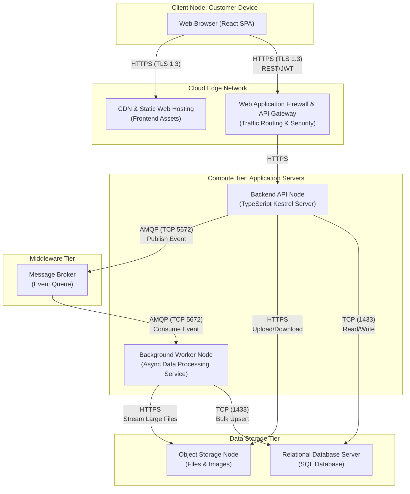

## Technical Infrastructure and Deploy Mapping

## UML Deployment Diagram

The following UML Deployment Diagram illustrates the physical and logical distribution of the system across cloud infrastructure, utilizing a decoupled, highly available architecture to handle asynchronous file processing and data integrity.

---
## Infrastructure Elements and Component Specification

The architecture adopts a 3-layer approach aligned with Domain-Driven Design (DDD) principles. The deployment distributes these layers across specialized cloud infrastructure nodes to guarantee operational scalability.

### Client and Edge Infrastructure

| Component | Type | Responsibility | Protocol |
|---|---|---|---|
| Web Browser | Client Device | Executes the React-based Single Page Application (SPA) | — |
| CDN & Static Hosting | Network Device | Hosts frontend static assets (`/public`, compiled JS/CSS) ensuring low-latency delivery | HTTPS (TLS 1.3) — TCP 443 |
| API Gateway & WAF | Middleware / Network | Single entry point for backend communication; provides SSL termination, rate limiting, and OWASP top 10 protection | HTTPS (TLS 1.3) — TCP 443 |

### Compute Infrastructure

| Component | Type | Responsibility | Protocol |
|---|---|---|---|
| Backend API Node | Server | Hosts the HTTP REST API built on TypeScript. Handles synchronous requests, JWT authentication, and upload controller orchestration | HTTP / HTTPS |
| Background Worker Node | Server | Dedicated compute instance for asynchronously parsing, validating, and standardizing large CSV/XLSX files. Decoupled from the API node to keep the UI responsive during heavy processing loads | AMQP (TCP 5672) |

### Middleware and Storage Infrastructure

| Component | Type | Responsibility | Protocol |
|---|---|---|---|
| Message Broker | Middleware | Highly available queue (e.g., RabbitMQ or cloud-native service) that receives submission events from the API and reliably delivers them to the Worker Node | AMQP — TCP 5672 |
| Relational Database Server | Database | Hosts the SQL schema generated by backend migrations, maintaining the primary structural domain (Buildings, Floors, Amenities, Submissions) | TDS / TCP 1433 |
| Object Storage Node | Storage | Scalable blob storage for persisting raw `.csv` and `.xlsx` files, as well as building and amenity images | HTTPS |

---
