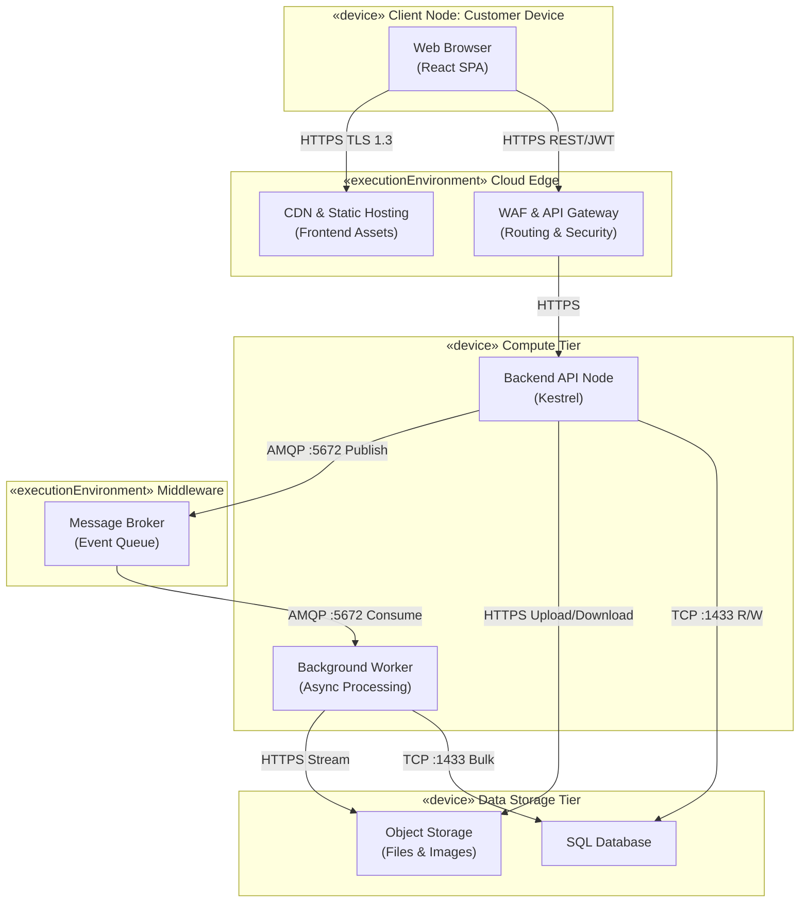

## Technical Infrastructure and Deploy Mapping

### UML Deployment Diagram

**Purpose (per [Visual Paradigm](https://www.visual-paradigm.com/guide/uml-unified-modeling-language/what-is-deployment-diagram/) and [Creately](https://creately.com/guides/deployment-diagram-examples/)).** A deployment diagram shows the *runtime* topology: which hardware or execution environments host which software, and how they communicate. It bridges design and implementation and supports planning for scalability, reliability, and security. Use it to answer: what systems will this integrate with? Who connects and how? What middleware and protocols are used? How will the system be monitored?

The following diagram illustrates the physical and logical distribution of the system across cloud infrastructure, using a decoupled, highly available architecture for asynchronous file processing and data integrity. Nodes are grouped by tier; stereotypes `«device»` and `«executionEnvironment»` distinguish node types; connections show communication paths with protocol and port.



*Diagram 1 — Deployment diagram showing the distribution of the infrastructure: the client accesses the edge layer (CDN/WAF), which routes requests to the API. Asynchronous processing is handled by workers through a message broker, with persistence in a relational database and object storage.*

---
## Infrastructure Elements and Component Specification

The architecture follows a layered view aligned with DDD: deployment distributes these layers across specialised cloud *nodes* (client/edge, compute, *middleware*, storage) to guarantee operational scalability. The tables below detail each element in *Diagram 1*.

### Client and Edge Infrastructure

| Component | Type | Responsibility | Protocol / Port |
|-----------|------|----------------|-----------------|
| Web Browser | Client Device | Executes the React-based Single Page Application (SPA). | — |
| CDN & Static Hosting | Network Device | Hosts frontend static assets (`/public`, compiled JS/CSS); low-latency delivery. | HTTPS (TLS 1.3), TCP 443 |
| API Gateway & WAF | Execution Environment | Single entry point for backend; SSL termination, rate limiting, OWASP protection. | HTTPS (TLS 1.3), TCP 443 |

### Compute Infrastructure

| Component | Type | Responsibility | Protocol / Port |
|-----------|------|----------------|-----------------|
| Backend API Node | Server | HTTP REST API (TypeScript/Kestrel). Synchronous requests, JWT auth, upload orchestration. | HTTPS (to WAF, Blob), AMQP (to Queue), TDS (to DB); 443, 5672, 1433 |
| Background Worker Node | Server | Async parsing, validation, and standardization of CSV/XLSX. Decoupled from API to keep UI responsive. | AMQP (Queue), HTTPS (Blob), TDS (DB); 5672, 443, 1433 |

### Middleware Infrastructure

| Component | Type | Responsibility | Protocol / Port |
|-----------|------|----------------|-----------------|
| Message Broker | Execution Environment | HA queue (e.g. RabbitMQ). Receives submission events from API; delivers to Worker. | AMQP, TCP 5672 |

### Data Storage Infrastructure

| Component | Type | Responsibility | Protocol / Port |
|-----------|------|----------------|-----------------|
| Relational Database Server | Database | SQL schema (migrations). Domain: Buildings, Floors, Amenities, Submissions. | TDS, TCP 1433 |
| Object Storage Node | Storage | Blob storage for raw `.csv`/`.xlsx` and building/amenity images. | HTTPS, TCP 443 |

---

## 20.3. Justification for Deployment Choices

The decision to adopt a distributed, queue-based architecture directly addresses the core business bottleneck: the inability to concurrently process large volumes of data without manual intervention.

**Decoupling Compute from Processing.** By separating the `Backend API Node` from the `Background Worker Node`, the system ensures that long-running tasks — such as standardizing a 100 MB spreadsheet — do not consume API threads. This prevents timeout errors and guarantees that the client interface remains fast and responsive.

**Stateless API Design.** The application servers are designed to be stateless, storing sessions via JWT and persisting files directly to Object Storage. This allows the infrastructure to scale horizontally by adding more servers seamlessly during peak onboarding periods.

**Dedicated Object Storage.** Storing physical files in a Blob Storage node rather than in the relational database prevents database bloat, reduces backup costs, and allows async workers to stream file data directly into memory for processing.

---

## 20.4. Considerations Regarding Performance and Security

### Performance

**Load Leveling.** The Message Broker acts as a shock absorber. If 50 clients submit large onboarding files simultaneously, the API accepts the files instantly, offloads them to Object Storage, and queues the processing events. The workers consume these events at a controlled rate, preventing CPU or memory exhaustion.

**Latency Mitigation.** Serving the React frontend via a CDN ensures that static assets are cached geographically close to the users (office managers globally), reducing initial load times.

### Security

**Data Protection in Transit and at Rest.** All external communication is forced over HTTPS (TLS 1.3). Sensitive data stored in the Relational Database and Object Storage is encrypted at rest using AES-256.

**Access Control.** The API Gateway intercepts requests to validate JSON Web Tokens (JWT) before traffic reaches the internal subnets. The database and storage nodes are placed in private subnets, completely isolated from the public internet, accessible only by the Backend and Worker nodes.

### Monitoring

Per deployment diagram best practice ([Visual Paradigm](https://www.visual-paradigm.com/guide/uml-unified-modeling-language/what-is-deployment-diagram/): *“How will you monitor the system once deployed?”* The WAF is configured with CloudWatch metrics (`visibility_config` in Terraform). The pipeline and compute nodes (ECS) integrate with monitoring for service health, API latency, queue depth, and DB/storage usage, so the runtime topology in *Diagram 1* can be observed and alerted on.

---

## 20.5. Deployment Planning Checklist

Based on the [Deployment Planning Checklist](https://www.visual-paradigm.com/guide/uml-unified-modeling-language/what-is-deployment-diagram/) (Visual Paradigm), the project addresses:

| Area | Addressed by |
|------|----------------|
| **Installation** | Terraform provisions all nodes in *Diagram 1*; CI/CD deploys artifacts. Installer is automation; success is validated by tests and health checks. |
| **Rollback** | Version-controlled infrastructure and code; rollback via pipeline revert or Terraform state. |
| **Different versions in production** | GitFlow and environments (Dev, Staging, Prod); parity via same Terraform and container images. |
| **Physical sites / order of deploy** | Single region in the example (e.g. `us-east-1`); multi-site would extend Terraform modules. |
| **Training and documentation** | Docs in `/docs`; deployment and topology described in this document and *Diagram 1*. |

---

## Integration with Non-Functional Requirements (NFRs)

Infrastructure choices are driven by the project's non-functional requirements, as defined in **Project-step1.md** (section 17. Non-Functional Requirements). The table below maps each NFR to the architectural decision and to the *nodes* in *Diagram 1*.

| NFR | Description | Architectural impact (*Diagram 1*) |
|-----|-------------|-------------------------------------|
| **NFR01** | Data Integrity Compliance | **Data Storage (DB):** cascading rules and referential integrity. **Compute (API):** DDD validations before persisting. |
| **NFR02** | Large File Handling and Responsiveness | **Data Storage (Object Storage):** direct upload. **Middleware + Compute (Broker → Worker):** async processing; UI remains responsive up to ~100 MB. |
| **NFR03** | Processing Reliability | **Middleware (Message Broker):** guaranteed delivery; message re-queued or sent to DLQ on Worker failure; zero data loss. |
| **NFR04** | Extensible File Format Support | **Compute (Worker Node):** independent service; adding a new parser (e.g. PDF) only requires updating the Worker, without affecting the API. |
| **NFR05** | Concurrent Submission Handling | **Compute (API + Worker):** stateless + queue; elastic horizontal scaling; orchestrator can add Workers to drain the queue during spikes. |

---

## 20.6. Infrastructure Provisioning and DevOps Lifecycle

To guarantee reproducibility, scalability, and security across all environments (Development, Staging, and Production), the deployment strategy incorporates modern DevOps practices, moving away from manual cloud console configurations. This automation directly satisfies **NFR03 (Processing Reliability)** and **NFR05 (Concurrent Submission Handling)**. The provisioned resources implement the topology in *Diagram 1* (Edge, Compute, Middleware, Data Storage) and address the *installation* and *reproducibility* aspects of the [Deployment Planning Checklist](https://www.visual-paradigm.com/guide/uml-unified-modeling-language/what-is-deployment-diagram/) (Visual Paradigm): who installs, how long it takes, and how to avoid configuration drift.

### 20.6.1. Infrastructure as Code (Terraform)

All cloud resources represented in the deployment diagram (*Diagram 1*) are provisioned declaratively using **Terraform (HCL)**. This eliminates configuration drift and ensures strict environment parity. The HCL blocks below map to the diagram’s tiers: Edge & Frontend (CDN, WAF), Compute (ECS API and Worker), Middleware (Message Broker), and Storage (RDS, S3).

```hcl
# infra/main.tf
provider "aws" { region = "us-east-1" }

# Edge & Frontend (CDN & S3)
resource "aws_s3_bucket" "frontend_app" {
  bucket = "equiem-onboarding-frontend-prod"
}

resource "aws_cloudfront_distribution" "frontend_cdn" {
  origin {
    domain_name = aws_s3_bucket.frontend_app.bucket_regional_domain_name
    origin_id   = "S3-EquiemFrontend"
  }
  enabled    = true
  web_acl_id = aws_wafv2_web_acl.api_gateway_waf.arn
  viewer_certificate { cloudfront_default_certificate = true }
}

# Edge Security (WAF)
resource "aws_wafv2_web_acl" "api_gateway_waf" {
  name  = "equiem-waf-prod"
  scope = "CLOUDFRONT"
  default_action { allow {} }
  visibility_config {
    cloudwatch_metrics_enabled = true
    metric_name                = "EquiemWaf"
    sampled_requests_enabled   = true
  }
}

# Compute Tier (ECS Cluster for API and Worker)
resource "aws_ecs_cluster" "app_cluster" {
  name = "equiem-compute-cluster"
}

resource "aws_ecs_service" "backend_api" {
  name          = "equiem-api-node"
  cluster       = aws_ecs_cluster.app_cluster.id
  desired_count = 2
}

resource "aws_ecs_service" "background_worker" {
  name          = "equiem-worker-node"
  cluster       = aws_ecs_cluster.app_cluster.id
  desired_count = 2
}

# Middleware Tier (Message Broker)
resource "aws_mq_broker" "event_queue" {
  broker_name        = "equiem-message-broker"
  engine_type        = "RabbitMQ"
  engine_version     = "3.11.20"
  host_instance_type = "mq.m5.large"
  user {
    username = "admin"
    password = "SecurePassword123!"
  }
}

# Storage Tier (Database & Blob)
resource "aws_db_instance" "sql_database" {
  allocated_storage   = 100
  engine              = "sqlserver-ex"
  instance_class      = "db.t3.large"
  publicly_accessible = false
}

resource "aws_s3_bucket" "object_storage" {
  bucket = "equiem-onboarding-files-storage"
}
```

---

### CI/CD Pipeline (GitHub Actions)

The deployment lifecycle is automated through a Continuous Integration and Continuous Deployment (CI/CD) pipeline defined in **YAML**. This pipeline guarantees that no code reaches production without passing automated testing and infrastructure validation.

```yaml
# .github/workflows/deploy.yml
name: CI/CD Pipeline - Equiem Onboarding

on:
  push:
    branches: [ main ]

jobs:
  infrastructure_provisioning:
    name: Provision Infrastructure (Terraform)
    runs-on: ubuntu-latest
    steps:
      - uses: actions/checkout@v3
      - uses: hashicorp/setup-terraform@v2
      - name: Terraform Init
        run: terraform init
        working-directory: ./infra
      - name: Terraform Apply
        run: terraform apply -auto-approve
        working-directory: ./infra
        env:
          AWS_ACCESS_KEY_ID: ${{ secrets.AWS_ACCESS_KEY_ID }}
          AWS_SECRET_ACCESS_KEY: ${{ secrets.AWS_SECRET_ACCESS_KEY }}

  build_and_deploy_backend:
    name: Build and Deploy .NET Backend
    needs: infrastructure_provisioning
    runs-on: ubuntu-latest
    steps:
      - uses: actions/checkout@v3
      - uses: actions/setup-dotnet@v3
        with:
          dotnet-version: '8.0.x'
      - name: Run Tests
        run: dotnet test ./src/backend/tests/
      - name: Publish
        run: dotnet publish ./src/backend/ -c Release -o ./publish
      - name: Deploy to ECS
        run: echo "Deploying artifacts to ECS Cluster..."

  build_and_deploy_frontend:
    name: Build and Deploy React SPA
    needs: infrastructure_provisioning
    runs-on: ubuntu-latest
    steps:
      - uses: actions/checkout@v3
      - uses: actions/setup-node@v3
        with:
          node-version: '20'
      - name: Install and Build
        run: npm install && npm run build
        working-directory: ./src/frontend
      - name: Sync to S3
        run: echo "aws s3 sync ./src/frontend/build s3://equiem-onboarding-frontend-prod"
```


