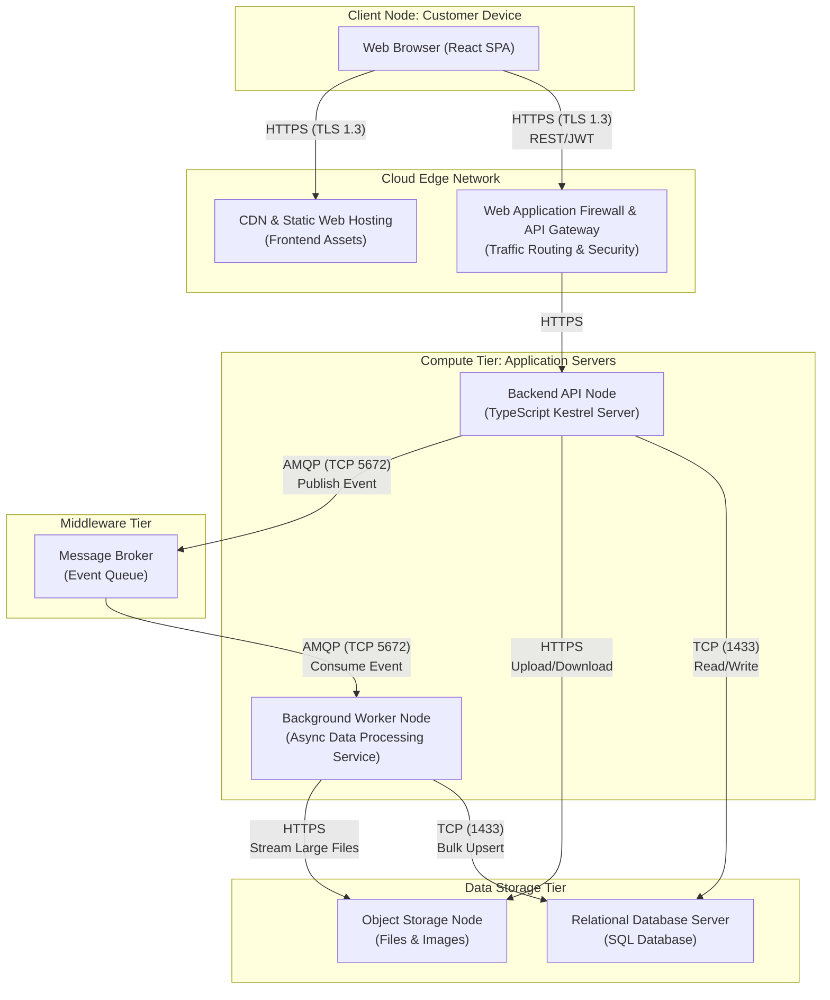

## Technical Infrastructure and Deploy Mapping

## UML Deployment Diagram

The following UML Deployment Diagram illustrates the physical and logical distribution of the system across cloud infrastructure, utilizing a decoupled, highly available architecture to handle asynchronous file processing and data integrity.

---
## Infrastructure Elements and Component Specification

The architecture adopts a 3-layer approach aligned with Domain-Driven Design (DDD) principles. The deployment distributes these layers across specialized cloud infrastructure nodes to guarantee operational scalability.

### Client and Edge Infrastructure

| Component | Type | Responsibility | Protocol |
|---|---|---|---|
| Web Browser | Client Device | Executes the React-based Single Page Application (SPA) | — |
| CDN & Static Hosting | Network Device | Hosts frontend static assets (`/public`, compiled JS/CSS) ensuring low-latency delivery | HTTPS (TLS 1.3) — TCP 443 |
| API Gateway & WAF | Middleware / Network | Single entry point for backend communication; provides SSL termination, rate limiting, and OWASP top 10 protection | HTTPS (TLS 1.3) — TCP 443 |

### Compute Infrastructure

| Component | Type | Responsibility | Protocol |
|---|---|---|---|
| Backend API Node | Server | Hosts the HTTP REST API built on TypeScript. Handles synchronous requests, JWT authentication, and upload controller orchestration | HTTP / HTTPS |
| Background Worker Node | Server | Dedicated compute instance for asynchronously parsing, validating, and standardizing large CSV/XLSX files. Decoupled from the API node to keep the UI responsive during heavy processing loads | AMQP (TCP 5672) |

### Middleware and Storage Infrastructure

| Component | Type | Responsibility | Protocol |
|---|---|---|---|
| Message Broker | Middleware | Highly available queue (e.g., RabbitMQ or cloud-native service) that receives submission events from the API and reliably delivers them to the Worker Node | AMQP — TCP 5672 |
| Relational Database Server | Database | Hosts the SQL schema generated by backend migrations, maintaining the primary structural domain (Buildings, Floors, Amenities, Submissions) | TDS / TCP 1433 |
| Object Storage Node | Storage | Scalable blob storage for persisting raw `.csv` and `.xlsx` files, as well as building and amenity images | HTTPS |

---

## 20.3. Justification for Deployment Choices

The decision to adopt a distributed, queue-based architecture directly addresses the core business bottleneck: the inability to concurrently process large volumes of data without manual intervention.

**Decoupling Compute from Processing.** By separating the `Backend API Node` from the `Background Worker Node`, the system ensures that long-running tasks — such as standardizing a 100 MB spreadsheet — do not consume API threads. This prevents timeout errors and guarantees that the client interface remains fast and responsive.

**Stateless API Design.** The application servers are designed to be stateless, storing sessions via JWT and persisting files directly to Object Storage. This allows the infrastructure to scale horizontally by adding more servers seamlessly during peak onboarding periods.

**Dedicated Object Storage.** Storing physical files in a Blob Storage node rather than in the relational database prevents database bloat, reduces backup costs, and allows async workers to stream file data directly into memory for processing.

---

## 20.4. Considerations Regarding Performance and Security

### Performance

**Load Leveling.** The Message Broker acts as a shock absorber. If 50 clients submit large onboarding files simultaneously, the API accepts the files instantly, offloads them to Object Storage, and queues the processing events. The workers consume these events at a controlled rate, preventing CPU or memory exhaustion.

**Latency Mitigation.** Serving the React frontend via a CDN ensures that static assets are cached geographically close to the users (office managers globally), reducing initial load times.

### Security

**Data Protection in Transit and at Rest.** All external communication is forced over HTTPS (TLS 1.3). Sensitive data stored in the Relational Database and Object Storage is encrypted at rest using AES-256.

**Access Control.** The API Gateway intercepts requests to validate JSON Web Tokens (JWT) before traffic reaches the internal subnets. The database and storage nodes are placed in private subnets, completely isolated from the public internet, accessible only by the Backend and Worker nodes.

---

## 20.5. Integration with Non-Functional Requirements (NFRs)

The infrastructure choices are strictly dictated by the project's Non-Functional Requirements. The table below maps each NFR to its corresponding architectural decision.

| NFR | Description | Architectural Impact |
|---|---|---|
| **NFR01** | Data Integrity Compliance | Relational Database configured with cascading rules and referential integrity constraints. The Backend API enforces DDD constraints before data reaches the persistence layer. |
| **NFR02** | Large File Handling and Responsiveness | File uploads are mapped directly to the Object Storage Node; the Message Broker triggers the async Worker Node for background processing, preventing UI freezes for files up to 100 MB. |
| **NFR03** | Processing Reliability | The Message Broker guarantees delivery. If a Worker Node crashes mid-processing, the message is returned to the queue or sent to a Dead Letter Queue (DLQ) for retry, ensuring zero data loss. |
| **NFR04** | Extensible File Format Support | The Worker Node is deployed as an independent service. Adding a new file parser (e.g., PDF data extraction) only requires updating the worker environment, without risking the stability of the core API. |
| **NFR05** | Concurrent Submission Handling | The stateless API and queue-based architecture allow elastic horizontal scaling. Cloud orchestrators can automatically spin up additional Worker Nodes to drain the queue faster during submission spikes. |

---
