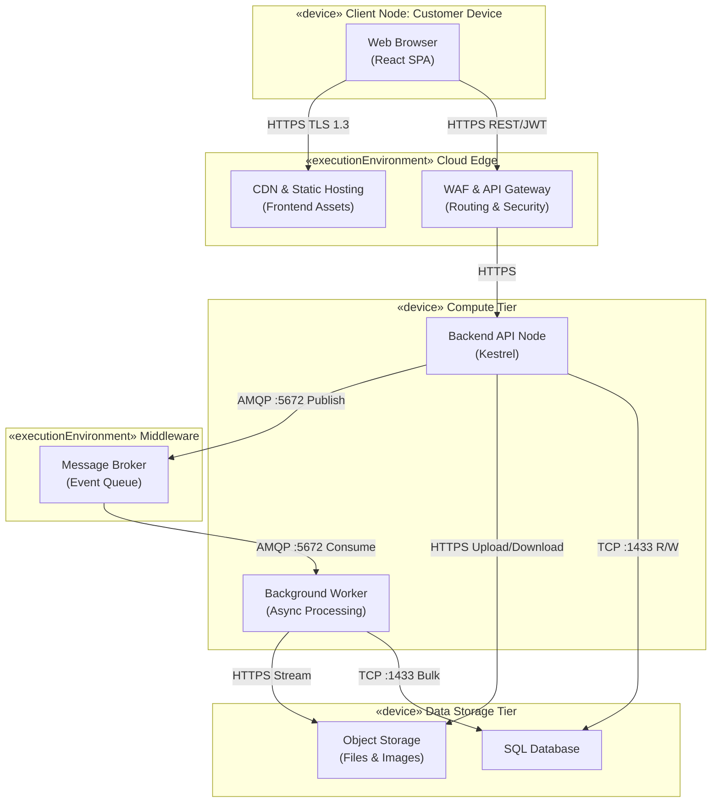

## Technical Infrastructure and Deploy Mapping

### UML Deployment Diagram

The following UML Deployment Diagram illustrates the physical and logical distribution of the system across cloud infrastructure, utilizing a decoupled, highly available architecture to handle asynchronous file processing and data integrity.



*Diagram 1 — Deployment diagram showing the distribution of the infrastructure: the client accesses the edge layer (CDN/WAF), which routes requests to the API. Asynchronous processing is handled by workers through a message broker, with persistence in a relational database and object storage.*

---
## Infrastructure Elements and Component Specification

The architecture follows a layered view aligned with DDD: deployment distributes these layers across specialised cloud *nodes* (client/edge, compute, *middleware*, storage) to guarantee operational scalability. The tables below detail each element in *Diagram 1*.

### Client and Edge Infrastructure

| Component | Type | Responsibility | Protocol / Port |
|-----------|------|----------------|-----------------|
| Web Browser | Client Device | Executes the React-based Single Page Application (SPA). | — |
| CDN & Static Hosting | Network Device | Hosts frontend static assets (`/public`, compiled JS/CSS); low-latency delivery. | HTTPS (TLS 1.3), TCP 443 |
| API Gateway & WAF | Execution Environment | Single entry point for backend; SSL termination, rate limiting, OWASP protection. | HTTPS (TLS 1.3), TCP 443 |

### Compute Infrastructure

| Component | Type | Responsibility | Protocol / Port |
|-----------|------|----------------|-----------------|
| Backend API Node | Server | HTTP REST API (TypeScript/Kestrel). Synchronous requests, JWT auth, upload orchestration. | HTTPS (to WAF, Blob), AMQP (to Queue), TDS (to DB); 443, 5672, 1433 |
| Background Worker Node | Server | Async parsing, validation, and standardization of CSV/XLSX. Decoupled from API to keep UI responsive. | AMQP (Queue), HTTPS (Blob), TDS (DB); 5672, 443, 1433 |

### Middleware Infrastructure

| Component | Type | Responsibility | Protocol / Port |
|-----------|------|----------------|-----------------|
| Message Broker | Execution Environment | HA queue (e.g. RabbitMQ). Receives submission events from API; delivers to Worker. | AMQP, TCP 5672 |

### Data Storage Infrastructure

| Component | Type | Responsibility | Protocol / Port |
|-----------|------|----------------|-----------------|
| Relational Database Server | Database | SQL schema (migrations). Domain: Buildings, Floors, Amenities, Submissions. | TDS, TCP 1433 |
| Object Storage Node | Storage | Blob storage for raw `.csv`/`.xlsx` and building/amenity images. | HTTPS, TCP 443 |

---

## Justification for Deployment Choices

The decision to adopt a distributed, queue-based architecture (*Diagram 1*) addresses the core business bottleneck: processing large volumes of data concurrently without manual intervention.

| Tier (*Diagram 1*) | Decision | Justification |
|-------------------|----------|---------------|
| **Compute** | Backend API Node and Background Worker Node separated | Long-running tasks (e.g. normalising a 100 MB spreadsheet) do not consume API threads; avoids timeouts and keeps the UI responsive. |
| **Compute** | API and Worker stateless; session via JWT; files written directly to Object Storage | Horizontal scalability: add more Compute nodes during onboarding peaks. |
| **Data Storage** | Files in Object Storage Node, not in the Relational Database | Avoids DB bloat, reduces backup cost; Worker can stream files into memory. |
| **Middleware** | Message Broker between API and Worker | Decoupling and guaranteed delivery; API publishes events, Worker consumes at a controlled rate. |
| **Client / Edge** | CDN for frontend; WAF as single entry point | Low-latency static assets; security and rate limiting in one place. |

---

## Considerations Regarding Performance and Security

The options below refer to the *nodes* and connections in *Diagram 1* (Client/Edge, Compute, Middleware, Data Storage).

### Performance

| Aspect | Where (*Diagram 1*) | Measure |
|--------|---------------------|--------|
| **Load leveling** | Middleware (Message Broker) + Compute (API, Worker) | The Broker absorbs spikes: many clients submitting files at once; the API accepts, writes to Object Storage and publishes events; Workers consume at a controlled rate, avoiding CPU/memory exhaustion. |
| **Latency** | Client/Edge (CDN) | React frontend served via CDN; assets cached close to users; lower initial load time. |

### Security

| Aspect | Where (*Diagram 1*) | Measure |
|--------|---------------------|--------|
| **Data in transit and at rest** | All external links; Data Storage (DB, Object Storage) | External traffic forced over HTTPS (TLS 1.3). Sensitive data in DB and Blob encrypted at rest (AES-256). |
| **Access control** | Edge (WAF/API Gateway); Data Storage | WAF validates JWT before traffic reaches internal subnets. DB and Object Storage in private subnets; only Compute nodes (API, Worker) have access. |

---

## Integration with Non-Functional Requirements (NFRs)

Infrastructure choices are driven by the project's non-functional requirements, as defined in **Project-step1.md** (section 17. Non-Functional Requirements). The table below maps each NFR to the architectural decision and to the *nodes* in *Diagram 1*.

| NFR | Description | Architectural impact (*Diagram 1*) |
|-----|-------------|-------------------------------------|
| **NFR01** | Data Integrity Compliance | **Data Storage (DB):** cascading rules and referential integrity. **Compute (API):** DDD validations before persisting. |
| **NFR02** | Large File Handling and Responsiveness | **Data Storage (Object Storage):** direct upload. **Middleware + Compute (Broker → Worker):** async processing; UI remains responsive up to ~100 MB. |
| **NFR03** | Processing Reliability | **Middleware (Message Broker):** guaranteed delivery; message re-queued or sent to DLQ on Worker failure; zero data loss. |
| **NFR04** | Extensible File Format Support | **Compute (Worker Node):** independent service; adding a new parser (e.g. PDF) only requires updating the Worker, without affecting the API. |
| **NFR05** | Concurrent Submission Handling | **Compute (API + Worker):** stateless + queue; elastic horizontal scaling; orchestrator can add Workers to drain the queue during spikes. |

---

## Infrastructure Provisioning and DevOps Lifecycle

To guarantee reproducibility, scalability and security across all environments (Development, Staging, Production), the deployment strategy uses DevOps practices and avoids manual cloud configuration. This automation supports **NFR03 (Processing Reliability)** and **NFR05 (Concurrent Submission Handling)**. The resources correspond to the tiers in *Diagram 1*: Edge, Compute, Middleware, Data Storage.

### Infrastructure as Code (Terraform)

All cloud resources represented in *Diagram 1* are provisioned declaratively with **Terraform (HCL)**. This reduces configuration drift and keeps environment parity.

```hcl
# infra/main.tf
provider "aws" { region = "us-east-1" }

# Edge & Frontend (CDN & S3)
resource "aws_s3_bucket" "frontend_app" {
  bucket = "equiem-onboarding-frontend-prod"
}

resource "aws_cloudfront_distribution" "frontend_cdn" {
  origin {
    domain_name = aws_s3_bucket.frontend_app.bucket_regional_domain_name
    origin_id   = "S3-EquiemFrontend"
  }
  enabled    = true
  web_acl_id = aws_wafv2_web_acl.api_gateway_waf.arn
  viewer_certificate { cloudfront_default_certificate = true }
}

# Edge Security (WAF)
resource "aws_wafv2_web_acl" "api_gateway_waf" {
  name  = "equiem-waf-prod"
  scope = "CLOUDFRONT"
  default_action { allow {} }
  visibility_config {
    cloudwatch_metrics_enabled = true
    metric_name                = "EquiemWaf"
    sampled_requests_enabled   = true
  }
}

# Compute Tier (ECS Cluster for API and Worker)
resource "aws_ecs_cluster" "app_cluster" {
  name = "equiem-compute-cluster"
}

resource "aws_ecs_service" "backend_api" {
  name          = "equiem-api-node"
  cluster       = aws_ecs_cluster.app_cluster.id
  desired_count = 2
}

resource "aws_ecs_service" "background_worker" {
  name          = "equiem-worker-node"
  cluster       = aws_ecs_cluster.app_cluster.id
  desired_count = 2
}

# Middleware Tier (Message Broker)
resource "aws_mq_broker" "event_queue" {
  broker_name        = "equiem-message-broker"
  engine_type        = "RabbitMQ"
  engine_version     = "3.11.20"
  host_instance_type = "mq.m5.large"
  user {
    username = "admin"
    password = "SecurePassword123!"
  }
}

# Storage Tier (Database & Blob)
resource "aws_db_instance" "sql_database" {
  allocated_storage   = 100
  engine              = "sqlserver-ex"
  instance_class      = "db.t3.large"
  publicly_accessible = false
}

resource "aws_s3_bucket" "object_storage" {
  bucket = "equiem-onboarding-files-storage"
}
```

---

### CI/CD Pipeline (GitHub Actions)

The deployment lifecycle is automated through a Continuous Integration and Continuous Deployment (CI/CD) pipeline defined in **YAML**. This pipeline guarantees that no code reaches production without passing automated testing and infrastructure validation.

```yaml
# .github/workflows/deploy.yml
name: CI/CD Pipeline - Equiem Onboarding

on:
  push:
    branches: [ main ]

jobs:
  infrastructure_provisioning:
    name: Provision Infrastructure (Terraform)
    runs-on: ubuntu-latest
    steps:
      - uses: actions/checkout@v3
      - uses: hashicorp/setup-terraform@v2
      - name: Terraform Init
        run: terraform init
        working-directory: ./infra
      - name: Terraform Apply
        run: terraform apply -auto-approve
        working-directory: ./infra
        env:
          AWS_ACCESS_KEY_ID: ${{ secrets.AWS_ACCESS_KEY_ID }}
          AWS_SECRET_ACCESS_KEY: ${{ secrets.AWS_SECRET_ACCESS_KEY }}

  build_and_deploy_backend:
    name: Build and Deploy .NET Backend
    needs: infrastructure_provisioning
    runs-on: ubuntu-latest
    steps:
      - uses: actions/checkout@v3
      - uses: actions/setup-dotnet@v3
        with:
          dotnet-version: '8.0.x'
      - name: Run Tests
        run: dotnet test ./src/backend/tests/
      - name: Publish
        run: dotnet publish ./src/backend/ -c Release -o ./publish
      - name: Deploy to ECS
        run: echo "Deploying artifacts to ECS Cluster..."

  build_and_deploy_frontend:
    name: Build and Deploy React SPA
    needs: infrastructure_provisioning
    runs-on: ubuntu-latest
    steps:
      - uses: actions/checkout@v3
      - uses: actions/setup-node@v3
        with:
          node-version: '20'
      - name: Install and Build
        run: npm install && npm run build
        working-directory: ./src/frontend
      - name: Sync to S3
        run: echo "aws s3 sync ./src/frontend/build s3://equiem-onboarding-frontend-prod"
```


