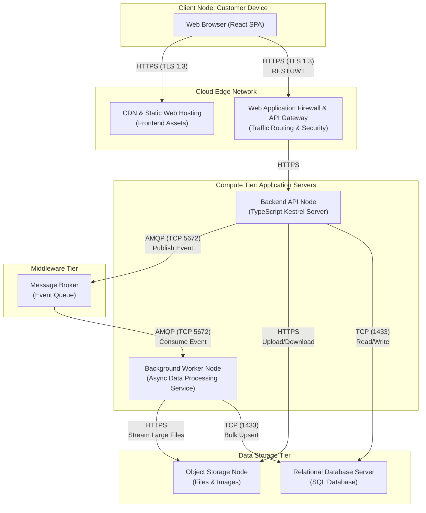

## Technical Infrastructure and Deploy Mapping

## UML Deployment Diagram

The following UML Deployment Diagram illustrates the physical and logical distribution of the system across cloud infrastructure, utilizing a decoupled, highly available architecture to handle asynchronous file processing and data integrity.

---
