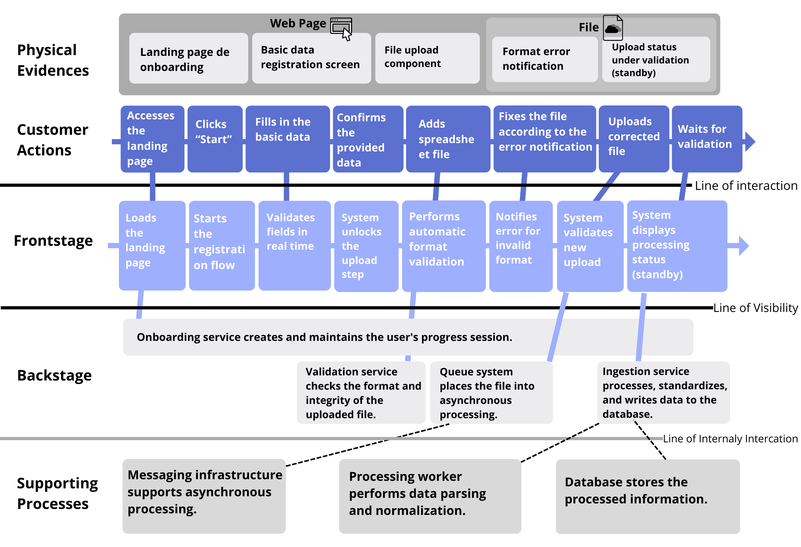

# Service Blueprint

## Sumário

- [1. BLUEPRINT](#1-blueprint)
- [2. Swim Lanes](#2-swim-lanes)
  - [2.1Physical Evidences](#21-physical-evidences)
  - [2.2 Customer Actions](#22-customer-actions)
  - [2.3 Frontstage](#23-frontstage)
  - [2.4 Backstage](#24-backstage)
  - [2.5 Supporting Processes](#25-supporting-processes)
- [3. Mapeamento das Linhas do Blueprint](#3-mapeamento-das-linhas-do-blueprint)
- [4. Etapas do Processo](#4-etapas-do-processo)
  - [4.1 Acesso e Cadastro](#41-acesso-e-cadastro)
  - [4.2 Upload do Arquivo](#42-upload-do-arquivo)
  - [4.3 Tratamento de Erro e Reenvio](#43-tratamento-de-erro-e-reenvio)
  - [4.4 Processamento](#44-processamento)
- [5. Melhorias Técnicas](#5-melhorias-técnicas)
  - [5.1 Duração Estimada](#51-duração-estimada)
  - [5.2 Gargalos (Fail Points)](#52-gargalos-fail-points)

## 1. BLUEPRINT

Figure 1 - Blueprint 
   
  Source: Material produced by the authors, 2026.

## 2. Swim Lanes

### 2.1 Physical Evidences

- Landing page de onboarding
- Tela de cadastro de dados básicos
- Componente de upload de arquivo
- Notificação de erro de formato
- Status de upload em validação (standby)

### 2.2 Customer Actions

- Acessa a landing page
- Clica em "Start"
- Preenche os dados básicos
- Confirma os dados informados
- Adiciona arquivo da planilha
- Corrige o arquivo e confirma a notificação de erro
- Envia o arquivo corrigido
- Aguarda a validação

### 2.3 Frontstage

- Carrega a landing page
- Inicia o fluxo de cadastro
- Valida os campos em tempo real
- Sistema libera a etapa de upload
- Realiza validação automática de formato
- Notifica erro por formato inválido
- Sistema valida novo upload
- Status de processamento (standby)

### 2.4 Backstage

- Serviço de onboarding cria e mantém a sessão de progresso do usuário.
- Serviço de validação verifica formato e integridade do arquivo enviado.
- Sistema de filas coloca o arquivo em processamento.
- Serviço de ingestão processa, padroniza e grava os dados no banco.

### 2.5 Supporting Processes

- Infraestrutura de mensageria suporta o processamento assíncrono.
- Worker de processamento executa parsing e normalização dos dados.
- Banco de dados armazena as informações processadas.

## 3. Mapeamento das Linhas do Blueprint

### 3.1 Linha de Interação

Separa as ações do cliente das atividades executadas pelo sistema visível (Frontstage).  
Representa todos os pontos de contato diretos entre o usuário e a interface.

- Physical Evidences
- Customer Actions
- Frontstage

### 3.2 Linha de Visibilidade

Separa o que é visível ao usuário do que acontece internamente no sistema.  
Tudo abaixo dessa linha não é percebido diretamente pelo cliente.

- Frontstage
- Backstage

### 3.3 Linha de Interação Interna

Separa os processos internos principais dos processos de suporte.  
Representa as integrações e dependências técnicas que sustentam o funcionamento do serviço.

- Backstage
- Supporting Processes

## 4. Etapas do Processo

### 4.1 Acesso e Cadastro

Cliente acessa a landing page e inicia o processo de cadastro.

Physical Evidence:
- Landing page de onboarding
- Tela de cadastro de dados básicos

Customer Actions:
- Acessa a landing page
- Clica em "Start"
- Preenche os dados básicos
- Confirma os dados informados

Frontstage:
- Carrega a landing page (5 segundos)
- Inicia o fluxo de cadastro (2 a 3 segundos)
- Valida os campos em tempo real (até 500 ms)

Backstage:
- Serviço de onboarding cria e mantém a sessão de progresso do usuário.

Supporting Processes:
- Infraestrutura de autenticação e sessão

### 4.2 Upload do Arquivo

Cliente realiza o envio da planilha para validação.

Physical Evidence:
- Componente de upload de arquivo

Customer Actions:
- Adiciona arquivo da planilha
- Envia o arquivo

Frontstage:
- Sistema libera a etapa de upload (1 segundo)
- Realiza validação automática de formato (1 segundo)

Backstage:
- Serviço de validação verifica formato e integridade do arquivo enviado.

### 4.3 Tratamento de Erro e Reenvio

Caso o arquivo esteja em formato incorreto, o sistema notifica o cliente.

Physical Evidence:
- Notificação de erro de formato

Customer Actions:
- Corrige o arquivo
- Confirma a notificação de erro
- Envia o arquivo corrigido

Frontstage:
- Notifica erro por formato inválido (1 segundo)
- Sistema valida novo upload (5 segundos)

Backstage:
- Serviço de validação executa nova verificação.

### 4.4 Processamento

Arquivo validado segue para processamento interno.

Physical Evidence:
- Status de upload em validação (standby)

Customer Actions:
- Aguarda a validação

Frontstage:
- Status de processamento (standby) (1 segundo)

Backstage:
- Sistema de filas coloca o arquivo em processamento.
- Serviço de ingestão processa, padroniza e grava os dados no banco.

Supporting Processes:
- Infraestrutura de mensageria suporta o processamento assíncrono.
- Worker de processamento executa parsing e normalização dos dados.
- Banco de dados armazena as informações processadas.

## 5. Technical Improvements  

### 5.1 Estimated Duration

The “Estimated Duration” labels were not incorporated into the Service Blueprint due to the impossibility of accurately mapping this concept within the proposed structure. However, the following explanatory text provides a more detailed clarification of this issue.

Defining the “Estimated Duration” for background processes is essential to ensure a positive user experience. It is important to measure the maximum expected time for these processes to be completed. However, this duration may vary depending on the technology used, the available infrastructure, the volume of processed data, and other technical factors that directly impact performance.

More than the absolute execution time, what truly influences user perception is whether feedback is provided during processing. In many cases, users do not abandon a request because it takes a few extra seconds, but because they receive no indication that the system is functioning properly.

For example, imagine a user accesses the application, completes all steps in the flow, and finally submits a `.csv` file containing the necessary information for an onboarding process. If, after submission, there is no visual feedback indicating that the file is being processed, a situation of uncertainty is created.

In this scenario, the following perceptions may arise:

- A feeling that the system has frozen;
- A seemingly stalled screen, with no indication of progress;
- Possible abandonment of the process by the user;
- Multiple attempts to resubmit the same file, generating duplicate requests.

This phenomenon is known as a temporal expectation breakdown. Users hold an implicit expectation regarding how long a given action should take. When the system fails to communicate its processing state, this expectation is disrupted, undermining trust, usability, and even the operational efficiency of the application.

Therefore, in addition to estimating and optimizing technical execution time, it is essential to implement mitigation strategies, such as loading indicators, progress bars, status messages (“Processing file…”, “Validation in progress…”), or even remaining time estimates. These measures do not necessarily reduce the actual processing time, but they significantly reduce the negative perception associated with waiting.

### 5.2 Bottlenecks (Fail Points)

| Bottleneck (Critical Point) | What happens in the Frontstage if it fails or becomes overloaded? |
|-----------------------------|-------------------------------------------------------------------|
| File Validation Service | When handling large files or heavy processing loads, validation time can increase significantly. If the service fails or takes longer than expected, the user may only see a “processing” status indefinitely or receive a generic error message. This creates a perception of system freezing, uncertainty about whether the file was successfully submitted, and the possibility of duplicate re-uploads. Without proper handling, the experience is perceived as unstable and unreliable. |
| Asynchronous Processing Queue | Since multiple users submit files that enter the same validation queue, if the system does not process them concurrently or scale properly, a backlog can form. In the Frontstage, this appears as excessive delay after file submission. The user may believe the system did not respond, leading to frustration, abandonment of the process, or repeated submission attempts. Without transparency regarding queue position or estimated processing time, a temporal expectation breakdown occurs. |

