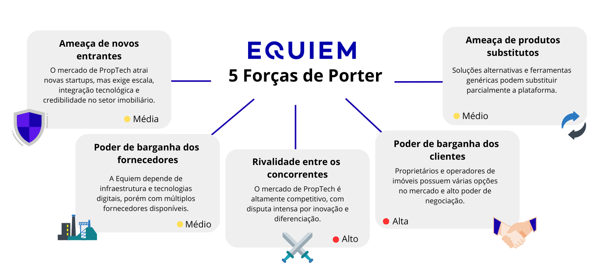

# Project and Business Understanding

## Table of Contents
- [Problem](#problem)
- [Partner Industry Context](#partner-industry-context)
- [Product Vision](#product-vision)
- [Product Scope (Does / Does Not Do)](#product-scope-does--does-not-do)
- [Product Goal](#product-goal)
- [Personas](#personas)
- [User Journey](#user-journey)
- [Business Flow](#business-flow)
- [Feature Brainstorming](#feature-brainstorming)
- [Delivery Sequencing and Prioritization](#delivery-sequencing-and-prioritization)
- [MVP Canvas](#mvp-canvas)
- [Project Risk Matrix](#project-risk-matrix)


## Problem

``` 
Complete here
```

## 2. Partner Industry Context: PropTech

Equiem operates within the **Property Technology (PropTech)** sector, which focuses on leveraging technology to optimize the way buildings are bought, sold, managed, and used. This industry is a high-growth segment within the broader real estate market.

### 2.1 Market Dynamics & Strategic Imperatives

| Market Dynamic | Description & Implication for Equiem |
| :--- | :--- |
| **Exponential Growth** | The PropTech market is projected to grow from **$44.6B in 2026 to $104.6B by 2034 (11.2% CAGR)**, more than double the growth rate of the general real estate market. This signals a massive market opportunity but also attracts intense competition. |
| **Key Drivers** | Growth is fueled by demands for **operational efficiency, sustainability (ESG), and enhanced tenant experiences**. Equiem's platform directly addresses these drivers, but the market expects seamless, modern digital interactions from its vendors. |
| **Dominant Trends** | **AI-driven automation, data analytics, and integrated platforms** are no longer novelties but standard expectations. A manual, disjointed onboarding process is a significant competitive disadvantage and clashes with the industry's core value proposition of technological sophistication. |
| **The Onboarding Imperative** | In a competitive SaaS market, **rapid and frictionless customer onboarding is a strategic weapon**. It directly accelerates revenue recognition (TTV) and is the first, most critical touchpoint for establishing long-term customer satisfaction and retention. A flawed onboarding process signals operational immaturity and undermines the brand's promise of efficiency. |

In summary, the PropTech industry context makes solving the onboarding problem an **urgent strategic necessity**. Failure to do so puts Equiem at a competitive disadvantage, limits its ability to scale, and contradicts the very essence of its brand as a technology leader.

### 2.2 Porter's 5 Forces

<div align="center">
<sub>Figure 1 - Porter's 5 Forces</sub>
<br>

<br>
<sup>Source: Material produced by the authors, 2026.</sup>
</div>

#### 2.2.1 Threat of New Entrants

The threat of new entrants in the Property Technology market is considered moderate, as it is an attractive sector due to its rapid growth and the opportunities generated by the digital transformation of the real estate market. Nevertheless, competitive entry at scale requires significant investments in technology, cloud infrastructure, integration with complex real estate systems, and the building of credibility with large property owners and operators. These factors act as barriers to entry and make it difficult for new competitors to consolidate quickly.

#### 2.2.2 Bargaining Power of Customers

The bargaining power of customers in the market in which Equiem operates is high, since its main clients are property owners, real estate funds, and operators of large portfolios—organizations with strong decision-making power and access to multiple competing solutions. The wide availability of PropTech platforms allows for greater comparison among providers, enabling tougher negotiations on pricing, features, and service levels, while also pressuring companies in the sector to continuously innovate and improve the user experience.

#### 2.2.3 Bargaining Power of Suppliers

The bargaining power of suppliers in the PropTech market is classified as moderate, as companies such as Equiem rely primarily on technology providers, including cloud computing services, data platforms, and software tools. Although many of these suppliers are large global players, the standardization of SaaS technologies and the existence of multiple alternatives in the market reduce dependence on a single supplier, providing greater strategic flexibility for companies in the sector.

#### 2.2.4 Threat of Substitute Products

The threat of substitute products in the Property Technology market is considered moderate, as there are alternative solutions capable of partially meeting the same needs, such as traditional property management software, generic CRMs, and tools specialized in specific modules. However, these alternatives generally offer lower levels of integration, scalability, and user experience focus, which limits their ability to fully replace more comprehensive and integrated platforms such as those offered by Equiem.

#### 2.2.5 Rivalry Among Existing Competitors

Rivalry among existing competitors in the Property Technology market is high, characterizing a highly competitive and fragmented environment, with global, regional, and startup companies competing for market share through technological innovation, feature differentiation, and the quality of the experience delivered. Rapid technological evolution and the high volume of investments in the sector intensify competition, requiring companies like Equiem to continuously invest in development, strategic positioning, and customer retention to maintain their competitive advantage.

## Product Vision

```
Complete here
```

## 4. What the Product Does / Does Not Do: Scope Definition

Clarity of scope is critical for the MVP. The boundaries are defined to ensure focus on solving the most acute pain points first.

| The Product **DOES** | The Product **DOES NOT** (Out of Scope for MVP) |
| :--- | :--- |
| **Provide a single, web-based portal** for clients to submit all required onboarding data. | **Integrate directly with client-side systems** (e.g., their internal databases or property management software). |
| **Validate data formats in real-time** at the point of entry (e.g., correct date format, valid email structure). | **Perform complex business logic validation** (e.g., cross-referencing tenant data with lease agreements). |
| **Provide a dashboard for both the client and Equiem** to track the completion status of required data sections. | **Automate the final provisioning of the client's environment** in Equiem's production system. The output is a clean, validated dataset. |
| **Enable clients to upload data via CSV templates** for bulk information. | **Support custom data schemas or fields** per client. The data schema is standardized for the MVP. |
| **Generate a clean, validated, and complete dataset** as its final output for the Equiem internal team. | **Manage post-onboarding configuration changes**. The scope is limited to the initial data intake. |

---

## 5. Product Goal: Specific Objective (Done)

The primary goal of the Equiem Onboarding Intake MVP is to **reduce the difficulty to scale onboarding users while reducing time complexity from employees that manually fill  of  client onboarding cycle time by 50% within the first six months of launch.**

This single, measurable objective directly addresses the core problem of inefficiency and delayed revenue. It serves as the North Star for all development and design decisions.

### Supporting Metrics (Key Performance Indicators):

Achieving the primary goal will be validated by tracking these supporting metrics:

- **Time-to-Value (TTV):** Measured from contract sign-off to project go-live. Target: **Reduce from an average of 10 days to 1 days.**
- **Data Error Rate:** Percentage of data fields requiring manual correction after initial submission. Target: **Reduce from ~30% to below 5%.**
- **Onboarding Specialist Time per Project:** Hours spent by Equiem staff on data collection and validation tasks. Target: **Reduce by 100%.**
- **Client Satisfaction (CSAT) for Onboarding:** Measured via a post-onboarding survey. Target: **Increase from 6/10 to 9/10.**

---

## Personas

```
Complete here:
- Name
- Role
- Goals
- Pain Points
- Context of use
```

## User Journey

```
Complete here:
Describe the steps users go through when interacting with the product.
Highlight needs, expectations, and pain points at each stage.
```

## Business Flow
#### Business Context
The business flow represents the onboarding and data ingestion process of new buildings into Equiem’s platform, focusing on how building data is collected, validated, standardized, and made available to internal systems.

#### Identified Business Processes
The main business processes involved in the project are:
- Building onboarding request
- Data submission by the client
- Data ingestion and validation
- Data standardization
- Data availability for internal systems

#### Business Flow Modeling (BPMN-Oriented Description)
This business flow is modeled using BPMN (Business Process Model and Notation), a standardized notation used to visually represent business processes, enabling clear communication between technical and non-technical stakeholders.

**Actors (Pools / Lanes):**
In BPMN, Pools represent different participants involved in the process, while Lanes subdivide a Pool to clarify responsibilities within the same participant.

- Client (Building Manager)
- Equiem Platform
- Data Processing Middleware

#### Process Flow
**Start Event**
The client initiates the onboarding of a new building.

**User Task – Submit Building Data**
The client uploads CSV and PDF files containing building information or fills out the form provided directly on the platform.

**System Task – Validate Files**
The platform validates file format, size, and basic data integrity.
- Exclusive Gateway – Files Valid?
**No:** The system notifies the client and requests corrections.
**Yes:** The process continues.

**Service Task – Ingest Data**
The middleware ingests the submitted data.

**Service Task – Standardize Data**
The middleware transforms the ingested data into a unified internal format.

**Exclusive Gateway – Standardization Successful?**
**No:** The error is logged and the user is notified.
**Yes:** The process continues.

**System Task – Store Standardized Data**
The standardized data is stored and made available to internal systems.

**End Event**
- The onboarding process is completed.

#### Notation and Modeling Approach.
The business flow is modeled following BPMN concepts, using:
- Start and End Events
- User Tasks
- System and Service Tasks
- Exclusive Gateways
- Swimlanes to separate responsibilities

This modeling approach ensures clear visibility of responsibilities, decision points, and system interactions throughout the entire onboarding process.


## Feature Brainstorming

```
Complete here
```

## Delivery Sequencing and Prioritization

```
Complete here
Describe the criteria used (e.g., value, risk, effort, dependencies).
```

## MVP Canvas

```
Complete here:
- Value Proposition
- Customer Segments
- Key Features
- Objectives
- Success Metrics
- Risks
```

## Project Risk Matrix

```
Complete here
For each risk, include:
- Risk Description
- Probability (Low / Medium / High)
- Impact (Low / Medium / High)
- Prevention Actions
- Contingency Actions
```
