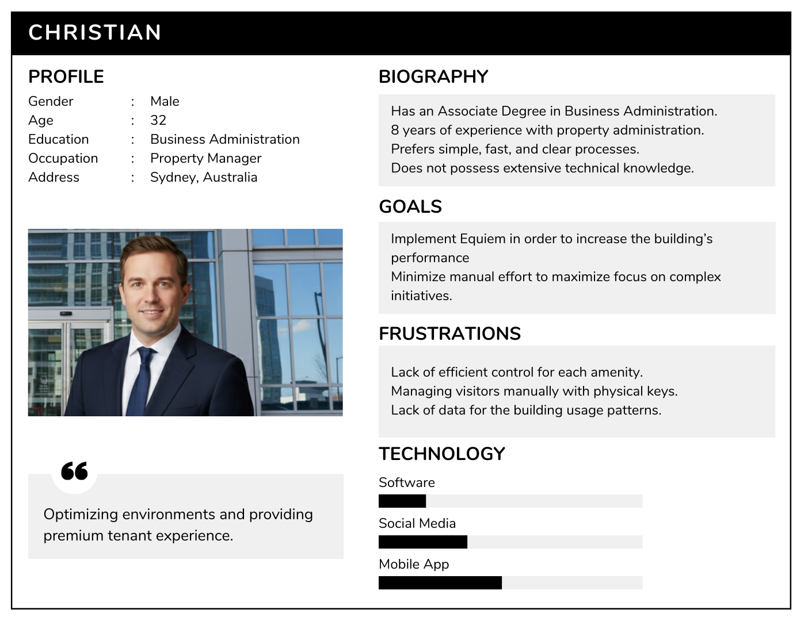
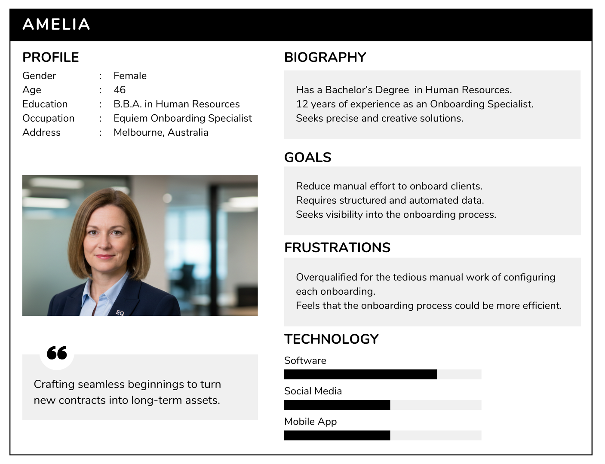

# Project and Business Understanding

## Table of Contents
- [Problem](#problem)
- [Partner Industry Context](#partner-industry-context)
- [Product Vision](#product-vision)
- [Product Scope (Does / Does Not Do)](#product-scope-does--does-not-do)
- [Product Goal](#product-goal)
- [Personas](#personas)
- [User Journey](#user-journey)
- [Business Flow](#business-flow)
- [Feature Brainstorming](#feature-brainstorming)
- [Delivery Sequencing and Prioritization](#delivery-sequencing-and-prioritization)
- [MVP Canvas](#mvp-canvas)
- [Project Risk Matrix](#project-risk-matrix)


## Problem

``` 
Complete here
```

## 2. Partner Industry Context: PropTech

Equiem operates within the **Property Technology (PropTech)** sector, which focuses on leveraging technology to optimize the way buildings are bought, sold, managed, and used. This industry is a high-growth segment within the broader real estate market.

### Market Dynamics & Strategic Imperatives

| Market Dynamic | Description & Implication for Equiem |
| :--- | :--- |
| **Exponential Growth** | The PropTech market is projected to grow from **$44.6B in 2026 to $104.6B by 2034 (11.2% CAGR)**, more than double the growth rate of the general real estate market. This signals a massive market opportunity but also attracts intense competition. |
| **Key Drivers** | Growth is fueled by demands for **operational efficiency, sustainability (ESG), and enhanced tenant experiences**. Equiem's platform directly addresses these drivers, but the market expects seamless, modern digital interactions from its vendors. |
| **Dominant Trends** | **AI-driven automation, data analytics, and integrated platforms** are no longer novelties but standard expectations. A manual, disjointed onboarding process is a significant competitive disadvantage and clashes with the industry's core value proposition of technological sophistication. |
| **The Onboarding Imperative** | In a competitive SaaS market, **rapid and frictionless customer onboarding is a strategic weapon**. It directly accelerates revenue recognition (TTV) and is the first, most critical touchpoint for establishing long-term customer satisfaction and retention. A flawed onboarding process signals operational immaturity and undermines the brand's promise of efficiency. |

In summary, the PropTech industry context makes solving the onboarding problem an **urgent strategic necessity**. Failure to do so puts Equiem at a competitive disadvantage, limits its ability to scale, and contradicts the very essence of its brand as a technology leader.

---

## Product Vision

```
Complete here
```

## 4. What the Product Does / Does Not Do: Scope Definition

Clarity of scope is critical for the MVP. The boundaries are defined to ensure focus on solving the most acute pain points first.

| The Product **DOES** | The Product **DOES NOT** (Out of Scope for MVP) |
| :--- | :--- |
| **Provide a single, web-based portal** for clients to submit all required onboarding data. | **Integrate directly with client-side systems** (e.g., their internal databases or property management software). |
| **Validate data formats in real-time** at the point of entry (e.g., correct date format, valid email structure). | **Perform complex business logic validation** (e.g., cross-referencing tenant data with lease agreements). |
| **Provide a dashboard for both the client and Equiem** to track the completion status of required data sections. | **Automate the final provisioning of the client's environment** in Equiem's production system. The output is a clean, validated dataset. |
| **Enable clients to upload data via CSV templates** for bulk information. | **Support custom data schemas or fields** per client. The data schema is standardized for the MVP. |
| **Generate a clean, validated, and complete dataset** as its final output for the Equiem internal team. | **Manage post-onboarding configuration changes**. The scope is limited to the initial data intake. |

---

## 5. Product Goal: Specific Objective (Done)

The primary goal of the Equiem Onboarding Intake MVP is to **reduce the difficulty to scale onboarding users while reducing time complexity from employees that manually fill  of  client onboarding cycle time by 50% within the first six months of launch.**

This single, measurable objective directly addresses the core problem of inefficiency and delayed revenue. It serves as the North Star for all development and design decisions.

### Supporting Metrics (Key Performance Indicators):

Achieving the primary goal will be validated by tracking these supporting metrics:

- **Time-to-Value (TTV):** Measured from contract sign-off to project go-live. Target: **Reduce from an average of 10 days to 1 days.**
- **Data Error Rate:** Percentage of data fields requiring manual correction after initial submission. Target: **Reduce from ~30% to below 5%.**
- **Onboarding Specialist Time per Project:** Hours spent by Equiem staff on data collection and validation tasks. Target: **Reduce by 100%.**
- **Client Satisfaction (CSAT) for Onboarding:** Measured via a post-onboarding survey. Target: **Increase from 6/10 to 9/10.**

---

## Personas





## User Journey

```
Complete here:
Describe the steps users go through when interacting with the product.
Highlight needs, expectations, and pain points at each stage.
```

## Business Flow

```
Complete here
```

## Feature Brainstorming

```
Complete here
```

## Delivery Sequencing and Prioritization

```
Complete here
Describe the criteria used (e.g., value, risk, effort, dependencies).
```

## MVP Canvas

```
Complete here:
- Value Proposition
- Customer Segments
- Key Features
- Objectives
- Success Metrics
- Risks
```

## Project Risk Matrix

```
Complete here
For each risk, include:
- Risk Description
- Probability (Low / Medium / High)
- Impact (Low / Medium / High)
- Prevention Actions
- Contingency Actions
```
